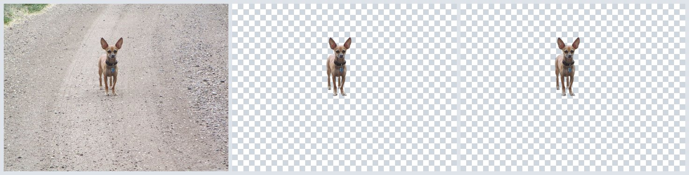
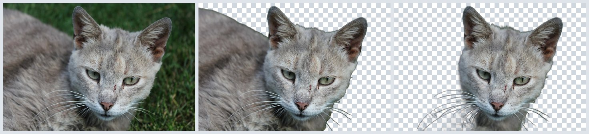
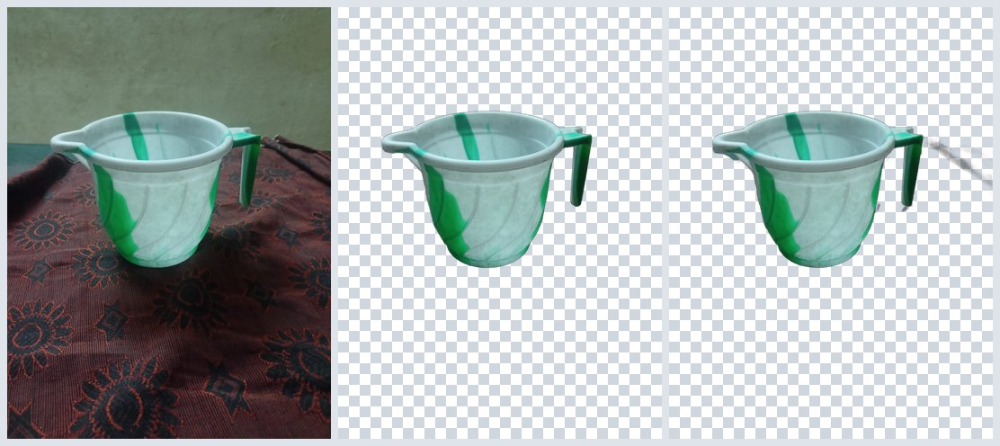
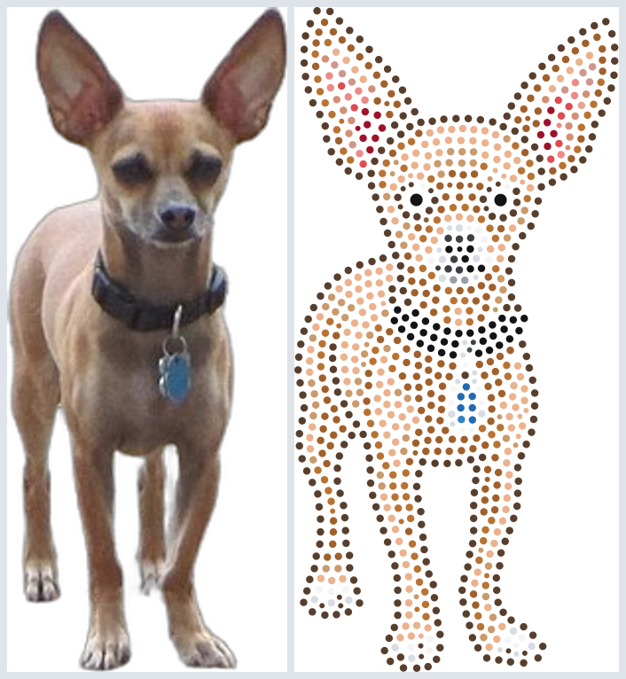
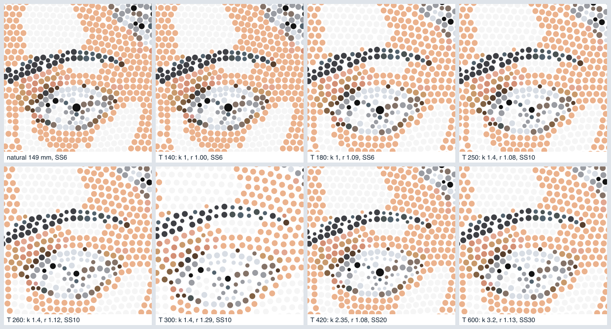
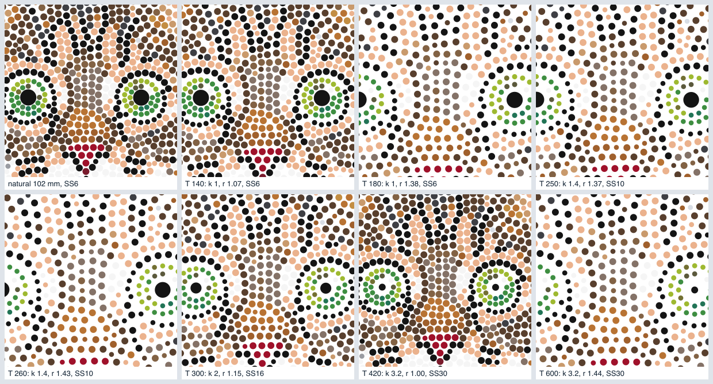
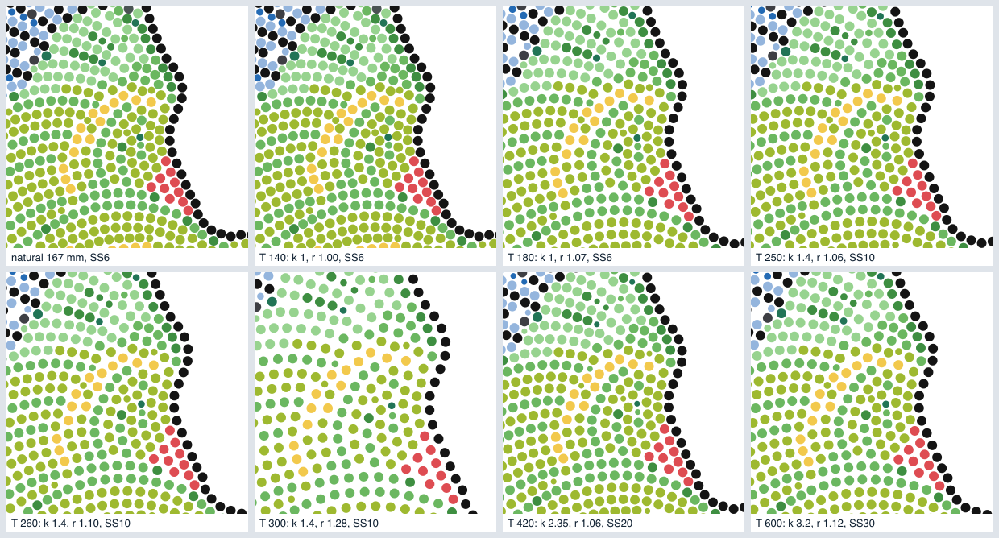
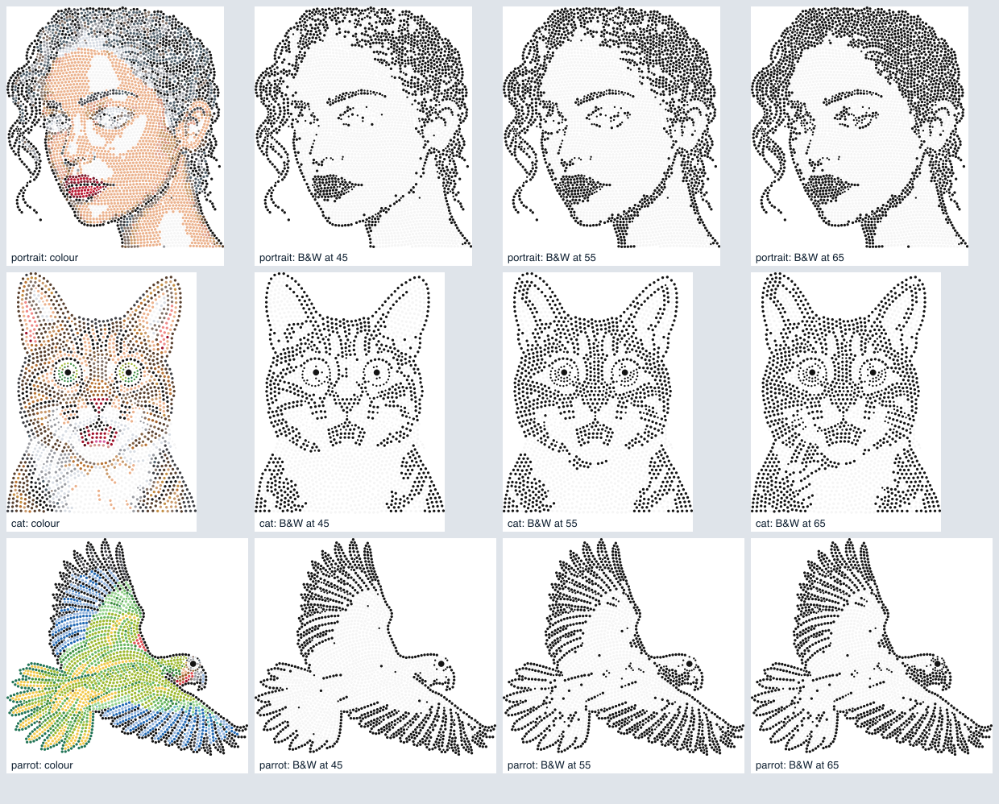
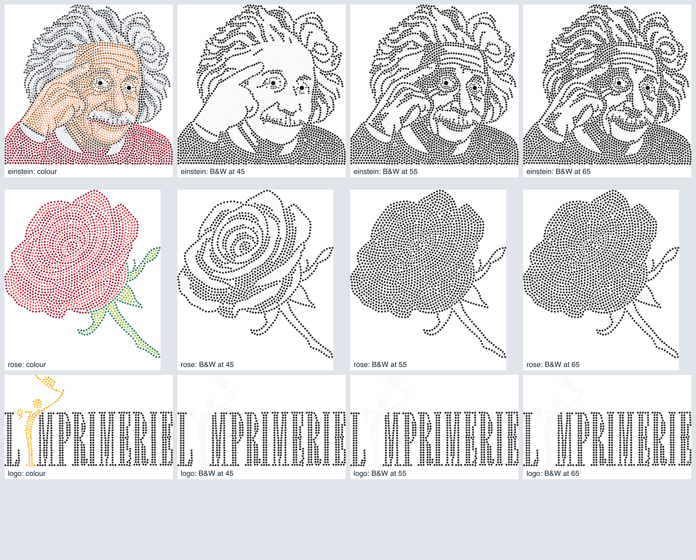

# IS-03 results

Pipeline build IS-03 (spec section 17), 18 Oct 2026, on the production Mac (iMac18,3, Intel Core i5-7600,
16 GB). Measurements are reproducible with the scripts named in each section.

## 1. Flaky test

`npm test` 20 times on a clean checkout of `main`: run 1 failed in
`tools/test-upload.mjs` › "a much larger body is answered long before the client has sent it all" with
`write EPIPE`. In isolation it failed 8 of 40 runs.

Cause: the 413 answer carried `Connection: close`, so Node closed the socket 1-3 ms after writing it
(64 KB-2 MB read instead of `refuse()`'s intended 8 MB / 2 s drain). A client still sending got a reset,
sometimes before it had read the 413. Fix (commit "upload: keep the socket open while draining a refused
upload"): no `Connection: close`; `refuse()` decides when to cut. After the fix: 0 of 40 isolated runs,
20 of 20 full `npm test` runs.

## 2. Background removal model

`scripts/bench_background.py`, one process per model, the three CC0 photos of
`services/strass/tests/fixtures/photos` (1280 px long side). Model files already on disk.

| Model | Load | Dog | Cat | Mug | Peak memory (RSS) |
| --- | --- | --- | --- | --- | --- |
| birefnet-general | 14.4 s | 30.3 s | 39.1 s | 35.1 s | 8.1 GB |
| isnet-general-use | 1.4 s | 2.1 s | 2.0 s | 1.8 s | 2.0 GB |

Original | birefnet-general | isnet-general-use (checkerboard = transparent):

**Choice: `birefnet-general` stays the default** (`REMBG_MODEL`, `.env.example`). isnet is 15-20 times
faster and needs a quarter of the memory, but its cut-outs are clearly worse on 2 of 3 photos: on the cat
it keeps the head and drops the body, with a half-transparent whisker area; on the mug it keeps a stray
streak of the cloth. The dog is a tie. The cost of birefnet: about 35 s per upload (in the background,
while the buyer is on the Prepare screen) and an 8 GB peak on a 16 GB Mac. If memory becomes a problem,
`REMBG_MODEL=isnet-general-use` switches without a code change.

## 3. Real design

One design in real mode through the HTTP routes (upload → background removal → Create design → poll),
the CC0 dog photo, 250 mm, Colour. Accepted on the first run (no automatic re-run).

| Step | Time |
| --- | --- |
| Background removal | 33 s |
| Preparing + provider | 39 s |
| Layout, tiers, files | 57 s |
| Create design → done | 96 s |

Result: 934 stones (SS10 856, SS6 76, SS20 2), tier 1.4, 121.8 x 250 mm, coverage 0.681, 20 colours.
Prepared image | stones (flat circles, not the IS-04 tinted render):

The dog is small in a wide photo and spec 7.1 pads the whole prepared frame to a square, so the subject
gets only part of the image width and the design has fewer stones than a frame-filling subject would.
See "Open" below.

## 4. Stone-size tiers (spec 7.5)

The 12 RS test layouts are the strass `/layout` answers for the RS test images
(`services/strass/scripts/make_test_layouts.py` → `tools/fixtures/layouts/`). Measured by
`node tools/measure-is03.mjs docs/IS-03-results`. `tools/test-tiers.mjs` (part of `npm test`) checks
0 overlaps and every gap ≥ 0.1 mm for all 12 layouts at all 7 sizes: **0 violations**.

The natural size `L0` is 130-168 mm, not 100-135 mm as the spec assumed, so at T = 140 mm ten of the
twelve layouts are already larger than T. Decision (Alex, IS-03): when `L0 > T` the design is not scaled
and is delivered at `L0`; the result shows the real size and keeps `requestedMm` (spec 7.5 updated).

### Natural layouts

| Layout | L0 mm | stones | sizes (natural) | min gap mm (natural) |
| --- | --- | --- | --- | --- |
| cat | 130.8 | 2150 | SS6 1801, SS4 347, SS20 2 | 0.104 |
| dog | 160.6 | 1671 | SS4 141, SS6 1528, SS30 2 | 0.100 |
| einstein | 150.2 | 3591 | SS4 358, SS6 3231, SS20 2 | 0.100 |
| jesus | 163.9 | 3298 | SS4 417, SS6 2880, SS20 1 | 0.100 |
| lake | 154.7 | 4089 | SS6 3927, SS4 162 | 0.100 |
| leopard | 153.7 | 2431 | SS6 2205, SS4 224, SS20 2 | 0.102 |
| logo | 144.9 | 833 | SS6 824, SS4 9 | 0.102 |
| parrot | 168.3 | 2542 | SS4 234, SS6 2307, SS20 1 | 0.101 |
| portrait | 166.0 | 3995 | SS4 421, SS6 3572, SS10 2 | 0.100 |
| rose | 130.5 | 1846 | SS6 1689, SS4 157 | 0.101 |
| tulips | 141.7 | 2673 | SS6 2547, SS4 126 | 0.101 |
| woman | 146.7 | 2612 | SS6 2392, SS4 218, SS30 2 | 0.100 |

### By requested size T (all 12 layouts)

| T mm | tiers k used | main stone | r min-max | median rim gap / main d, min-max | gap growth vs natural, max | min gap mm | violations |
| --- | --- | --- | --- | --- | --- | --- | --- |
| 140 | 1 | SS6 | 1.000-1.074 | 0.059-0.138 | 2.31x | 0.100 | 0 |
| 180 | 1 | SS6 | 1.071-1.385 | 0.135-0.468 | 7.83x | 0.220 | 0 |
| 250 | 1.4 | SS10 | 1.062-1.374 | 0.126-0.456 | 7.63x | 0.324 | 0 |
| 260 | 1.4 | SS10 | 1.105-1.429 | 0.171-0.515 | 8.61x | 0.450 | 0 |
| 300 | 2, 1.4 | SS16, SS10 | 1.022-1.433 | 0.084-0.518 | 8.68x | 0.295 | 0 |
| 420 | 3.2, 2.35 | SS30, SS20 | 1.004-1.265 | 0.064-0.340 | 5.70x | 0.362 | 0 |
| 600 | 3.2 | SS30 | 1.116-1.443 | 0.182-0.529 | 8.86x | 1.035 | 0 |

Natural median gap / d: 0.059-0.071
Largest gap growth: 8.86x on rose at T 600 (k 3.2, r 1.443, gap 3.39 mm on SS30)
Largest r: 1.443 on rose at T 600 (k 3.2)

"r" widens the centre spacing of every stone by up to 44 %, as the spec predicted. The visible effect is
larger: the natural rim gap is only 6-7 % of the stone diameter (about 0.13 mm on SS6), so the same
stretch makes the gap up to 0.53 d (8.9 times its natural share of the diameter) at the top of a band.
Zoomed crops (same part of the design, main stone always 12 px wide):

Assessment: up to r ≈ 1.2 the design still reads as packed. At r ≈ 1.3-1.44 (T just below the next tier:
about 180, 260-300 and 600 mm for the smaller layouts) the gaps are clearly visible and the design looks
airy, though every shape is still legible. Whether that is good enough for sale, or the 45-stones-across
prompt variant is needed for those bands (spec 19), is Alex's call from the images above.

## 5. Black & white threshold (spec 7.6)

Stone colour → Jet when the CIE L* of its catalogue fill is below `BW_THRESHOLD`, otherwise Crystal (the
catalogue colour named Crystal, id `crystal-clear`, #f5f5f5 — the Crystal of Appendix A). Measured on the
same 12 layouts.

### Catalogue colours by L*

| colour | fill | L* | at 55 |
| --- | --- | --- | --- |
| Jet | #141414 | 6.3 | Jet |
| Indian Siam | #610b16 | 19.4 | Jet |
| Hematite | #3e3f44 | 26.7 | Jet |
| Siam | #7a1b2c | 27.0 | Jet |
| Smoked Topaz | #583f2d | 29.0 | Jet |
| Light Siam | #9f112a | 33.9 | Jet |
| Jet Hematite | #4a5353 | 34.5 | Jet |
| Fuchsia | #902b74 | 35.8 | Jet |
| Khaki | #5b593c | 37.3 | Jet |
| Amethyst | #903f8a | 40.1 | Jet |
| Scarlet | #bb1a33 | 40.5 | Jet |
| Graphite | #52626d | 40.6 | Jet |
| Emerald | #217456 | 43.5 | Jet |
| Light Smoked Topaz | #826244 | 44.1 | Jet |
| Capri Blue | #236ab4 | 44.2 | Jet |
| Olivine | #737033 | 46.3 | Jet |
| Black Diamond | #60726d | 46.5 | Jet |
| Colorado Topaz | #a0602c | 47.0 | Jet |
| Greige | #847267 | 49.4 | Jet |
| Erinite | #4d8355 | 50.1 | Jet |
| Fern Green | #3e8e41 | 52.7 | Jet |
| Sapphire | #2f83c3 | 52.7 | Jet |
| Padparadscha | #de4c52 | 53.3 | Jet |
| Topaz | #b6741e | 54.6 | Jet |
| Copper | #b87333 | 54.8 | Jet |
| Hyacinth | #e0581c | 55.0 | Jet |
| Rose | #d65d9b | 56.6 | Crystal |
| Light Colorado Topaz | #c38e43 | 62.8 | Crystal |
| Grey | #9a9ca2 | 64.4 | Crystal |
| Rose Gold | #d38f75 | 65.6 | Crystal |
| Golden Shadow | #c99a6c | 67.0 | Crystal |
| Vintage Rose | #d1958e | 67.3 | Crystal |
| Rose Peach | #ee8987 | 67.9 | Crystal |
| Peridot | #6bb760 | 67.9 | Crystal |
| Light Topaz | #e2a219 | 70.9 | Crystal |
| Citrus Green | #9eb930 | 71.0 | Crystal |
| Aquamarine | #65bcc2 | 71.3 | Crystal |
| Light Sapphire | #94b5dd | 72.6 | Crystal |
| Light Peach | #e2a791 | 73.4 | Crystal |
| Metallic Sunshine | #dfb758 | 76.2 | Crystal |
| Silk | #ebb28d | 76.9 | Crystal |
| Chrysolite | #97d38f | 79.1 | Crystal |
| Gold | #f3bd32 | 79.4 | Crystal |
| Citrine | #f2c94c | 82.5 | Crystal |
| Silver | #d8dde4 | 87.9 | Crystal |
| Crystal AB | #e9f7ff | 96.4 | Crystal |
| Crystal | #f5f5f5 | 96.5 | Crystal |

### Jet share per threshold

| Layout | Jet % at 45 | Jet % at 50 | Jet % at 55 | Jet % at 60 | Jet % at 65 | pupils Jet at 55 | catch-lights Crystal at 55 |
| --- | --- | --- | --- | --- | --- | --- | --- |
| cat | 41.3 | 48.3 | 53.3 | 53.4 | 59.8 | 2/2 (jet) | 2/2 |
| dog | 29.3 | 31.0 | 35.0 | 35.0 | 41.2 | 2/2 (jet) | 3/3 |
| einstein | 47.8 | 59.8 | 63.1 | 63.1 | 70.1 | 2/2 (jet) | 4/4 |
| jesus | 67.3 | 69.5 | 74.2 | 74.2 | 78.0 | 1/1 (jet) | 1/1 |
| lake | 48.4 | 50.5 | 61.4 | 61.4 | 62.0 | 0/0 (-) | 0/0 |
| leopard | 47.6 | 53.2 | 53.4 | 53.4 | 53.6 | 2/2 (jet) | 2/2 |
| logo | 85.1 | 85.1 | 85.1 | 85.1 | 85.1 | 0/0 (-) | 0/0 |
| parrot | 38.2 | 38.7 | 45.6 | 45.6 | 46.3 | 1/1 (jet) | 4/4 |
| portrait | 36.6 | 42.9 | 42.9 | 42.9 | 49.0 | 0/0 (-) | 0/0 |
| rose | 57.9 | 57.9 | 94.5 | 94.5 | 94.5 | 0/0 (-) | 0/0 |
| tulips | 31.9 | 31.9 | 54.4 | 57.4 | 57.5 | 0/0 (-) | 0/0 |
| woman | 49.8 | 76.6 | 79.9 | 79.9 | 80.1 | 2/2 (jet) | 4/4 |

Pupils are the stones larger than SS10; catch-lights are Crystal stones touching a pupil. At 55 every
pupil becomes Jet and every catch-light stays Crystal on all 12 layouts.

**55 is kept.** Between 45 and 65 the outlines, pupils and lips stay Jet everywhere; what moves is the
mid-tone colours (Copper 54.8, Topaz 54.6, Hyacinth 55.0, Padparadscha 53.3 and Sapphire/Fern Green 52.7
sit just below 55; Rose 56.6 just above). At 45 the portrait's hair thins out and the parrot loses its
face detail; at 65 the cat's fur gets markedly denser. Rose (94.5 % Jet at 55 against 57.9 % at 50) is the most sensitive layout: its
petals are mid-tone reds. In real use the Black & white prompt (Appendix A) asks the provider for Jet and
Crystal only, so the mapping mostly snaps the few stray mid-tones the layout service picks; these
colour-mode layouts are the harder case.

## Open

- Gap bands (section 4): keep plain stretching or add the 45-stone prompt variant.
- 7.1 pads the whole prepared frame; cropping to the cut-out's opaque box first would give small subjects
  in wide photos their full stone count. The spec is silent; not done.
- The Black & white prompt keeps v6's final check sentence ("skin and fur only from their ramps"), which
  has no ramps to refer to in Black & white; the spec replaces section 4 only, so it is unchanged.
