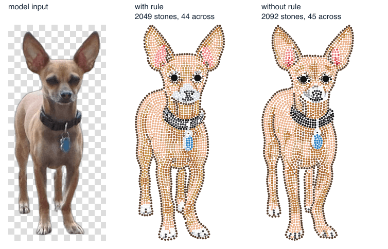
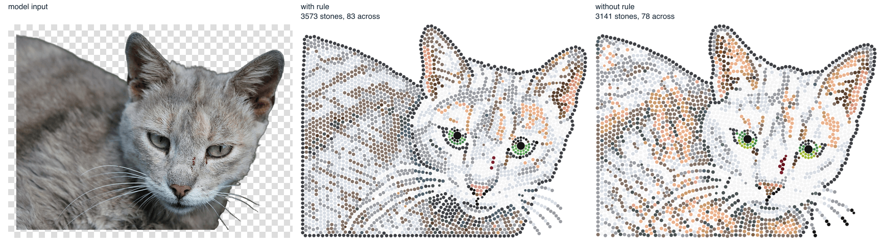
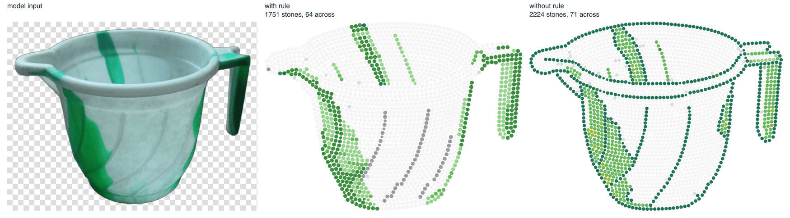
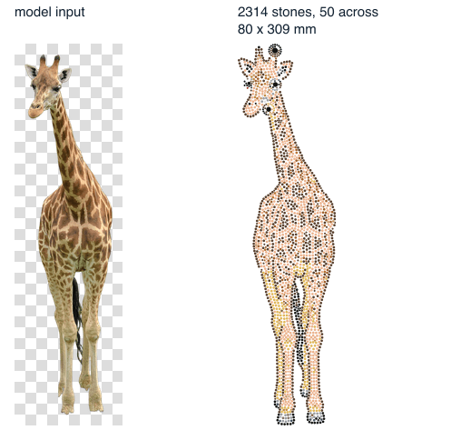
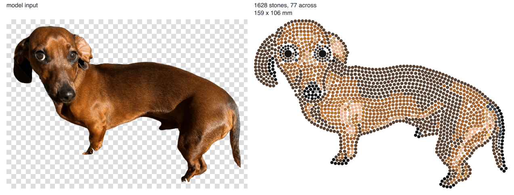
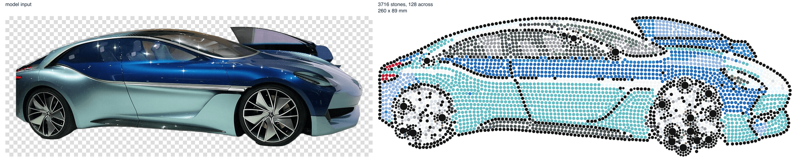

# IS-03b results

Build IS-03b (natural size only), 18 Oct 2026, on the production Mac (iMac18,3, 16 GB). The designs
are reproducible with `node tools/measure-is03b.mjs <work dir>` (real calls, paid) and
`--report` (tables and images below). Every design ran the production steps once: decode,
background removal (birefnet-general), no adjustments, model input cropped to the cut-out plus 3 %
(spec 7.1), provider with `size auto` and the whole-image line (7.2, 7.3), strass `/layout`, natural
size (7.5). No automatic re-run, so 9 provider calls in total.

## 1. Portrait and landscape in the strass service

Two RS test images padded with transparency from 1254 × 1254 to 1254 × 1766 (parrot) and
1766 × 1254 (cat): 2543 and 2152 stones against 2542 and 2150 for the square originals, the same
size in mm (cat 102.9 × 130.6 against 103.0 × 130.8), the same mm per px within 0.2 %, 0 violations.
The 9 real designs below (output aspect 1:2.8 to 2.6:1) were all laid out without an error. The
service has no square assumption; nothing was changed in it.

## 2. The nine designs

"Stones across" is measured, not asked: the median centre distance from each main-size stone to its
nearest main-size neighbour gives the pitch, and the image width (output px × the service's mm per
px) or the design width divided by the pitch gives the stones across the image or the design.

| Design | Model input px | Output px | Stones across image / design | Stones | Natural size | Count per size | Coverage | Min gap mm | Accepted |
| --- | --- | --- | --- | --- | --- | --- | --- | --- | --- |
| dog, rule | 463 × 1024 | 843 × 1864 | 43.7 / 39.5 | 2049 | 83.8 × 200.8 mm (3.30 × 7.91 in) | SS6 1933, SS4 114, SS30 2 | 0.646 | 0.101 | yes |
| dog, no rule | 463 × 1024 | 843 × 1864 | 44.9 / 41.0 | 2092 | 87.0 × 203.1 mm (3.43 × 8.00 in) | SS6 1973, SS4 117, SS30 2 | 0.643 | 0.100 | yes |
| cat, rule | 1024 × 772 | 1444 × 1089 | 83.1 / 79.2 | 3573 | 167.8 × 125.7 mm (6.61 × 4.95 in) | SS6 3269, SS4 302, SS20 2 | 0.670 | 0.101 | yes |
| cat, no rule | 1024 × 772 | 1444 × 1089 | 78.0 / 74.7 | 3141 | 158.4 × 120.8 mm (6.23 × 4.76 in) | SS6 2758, SS4 381, SS20 2 | 0.645 | 0.101 | yes |
| mug, rule | 1024 × 777 | 1440 × 1092 | 64.2 / 61.5 | 1751 | 130.4 × 96.0 mm (5.13 × 3.78 in) | SS6 1681, SS4 70 | 0.700 | 0.103 | yes |
| mug, no rule | 1024 × 777 | 1440 × 1092 | 71.2 / 69.1 | 2224 | 146.5 × 109.6 mm (5.77 × 4.32 in) | SS6 2120, SS4 104 | 0.698 | 0.102 | yes |
| giraffe (portrait), rule | 291 × 1024 | 725 × 2169 | 50.2 / 37.7 | 2314 | 79.8 × 309.4 mm (3.14 × 12.18 in) | SS6 1914, SS4 396, SS16 2, SS10 1, SS20 1 | 0.588 | 0.101 | yes |
| dachshund (landscape), rule | 1024 × 721 | 1494 × 1052 | 77.5 / 75.1 | 1628 | 159.2 × 106.4 mm (6.27 × 4.19 in) | SS6 1452, SS4 174, SS20 2 | 0.678 | 0.102 | yes |
| car (landscape), rule | 1024 × 394 | 2022 × 778 | 128.2 / 122.7 | 3716 | 260.0 × 88.8 mm (10.24 × 3.49 in) | SS6 2920, SS4 777, SS20 15, SS16 3, SS10 1 | 0.633 | −1.494 | **no** (148 violations) |

Times: provider 28–81 s, layout 89–171 s per design.

Model input | stones (flat circles in catalogue colours, not the IS-04 tinted render):

Observations:

- **`size auto` follows the input's shape**, not a fixed set of sizes: every output is about
  1.5–1.6 MP at roughly the input's aspect (the giraffe's 1:3.5 came back as 1:3).
- **The crop works.** The dog of IS-03 (small in a wide photo, padded to a square) gave 934 stones;
  cropped to the cut-out it gives about 2050.
- **The provider draws stones at a nearly fixed pixel pitch** (about 15–22 px) whatever the image
  width, so the stones across follow the output width: 44 on the 843 px dog, 128 on the 2022 px car.
  The natural size follows too: longest side 131 mm (mug) to 309 mm (giraffe), against 130–168 mm for
  the square RS test images.
- **The car was rejected** (it would be re-run automatically in production, 7.4). The service took
  the black wheel-spoke ends for pupils (19 "pupils" reported) and placed 15 SS20 stones there, which
  overlap their neighbours. A subject with many small dark circles is a weak case for the eye
  detection; this is a strass service matter and was not changed.

## 3. SS20 and SS30 stones

Outside D2's SS4 / SS6 / SS10 / SS16, the service places SS20 or SS30 stones where it detects
pupils (SS20 for a pupil of about 4.5–5.9 mm, SS30 from about 6.3 mm). Position in % of the design's
width / height:

| Design | SS20 / SS30 | Where |
| --- | --- | --- |
| dog, rule | SS30 × 2 | pupils (44/25, 70/25) |
| dog, no rule | SS30 × 2 | pupils (46/25, 69/25) |
| cat, rule | SS20 × 2 | pupils (55/52, 77/57) |
| cat, no rule | SS20 × 2 | pupils (54/54, 76/59) |
| giraffe | SS20 × 1 | tip of an ossicone (38/2), detected as a pupil; the real eyes got SS16 |
| dachshund | SS20 × 2 | pupils (13/20, 27/20) |
| car (rejected) | SS20 × 15 | wheel-spoke ends and two body details, detected as pupils |
| mug | none | |

The 12 RS test layouts (`tools/fixtures/layouts`) also have them, all Jet pupils: cat SS20 × 2,
dog SS30 × 2, einstein SS20 × 2, jesus SS20 × 1, leopard SS20 × 2, parrot SS20 × 1, woman SS30 × 2
(13 stones in 7 of 12 layouts; lake, logo, portrait, rose and tulips have none).

So 7 of the 8 accepted real designs carry SS20 or SS30 stones, nearly always 1–2 pupils.

## 4. The "about 60 stones across" rule

Same model input, with and without the rule sentence (dog, cat, mug):

| Photo | Across, rule | Across, no rule | Stones, rule | Stones, no rule |
| --- | --- | --- | --- | --- |
| dog | 43.7 | 44.9 | 2049 | 2092 |
| cat | 83.1 | 78.0 | 3573 | 3141 |
| mug | 64.2 | 71.2 | 1751 | 2224 |

With the rule the counts across were 44, 83 and 64, and 50, 78 and 128 on the other three designs.
None is near 60 except the mug, and the difference with and without the rule goes both ways
(−1, +5, −7). The rule does not set the stone size; the pixel pitch does, as section 2 shows. All
six designs were accepted with similar coverage (0.64–0.70) and the same minimum gap. In the images
the dog and cat pairs look alike. The mug without the rule is better: it outlines the rim, the
handle and the stripes, where the version with the rule lost the rim. That is one sample.

**Recommendation: drop the rule.** With `size auto` the image is no longer square, so "the full
width of the image" means a different stone size for a tall and for a wide subject, which is not what
the rule was tuned for (RS, square 1024 px). The model ignores the rule anyway: it neither holds the
count near 60 nor changes it in a consistent direction. Taking it out costs nothing measurable and
removes an instruction that is wrong for non-square images. Three pairs are a small sample, so a
re-check on a few more designs after the change would be cheap insurance. The rule is unchanged in
the code until Alex decides.

A consequence that does not depend on the rule: with natural size only, the delivered size now
varies with the subject's shape. A tall subject gives a long, narrow design (giraffe 80 × 309 mm)
and a wide one gives a wide design (car 260 × 89 mm).
