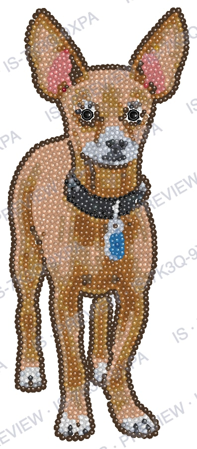
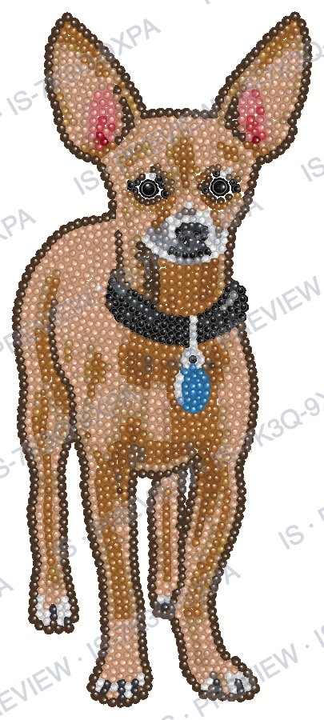
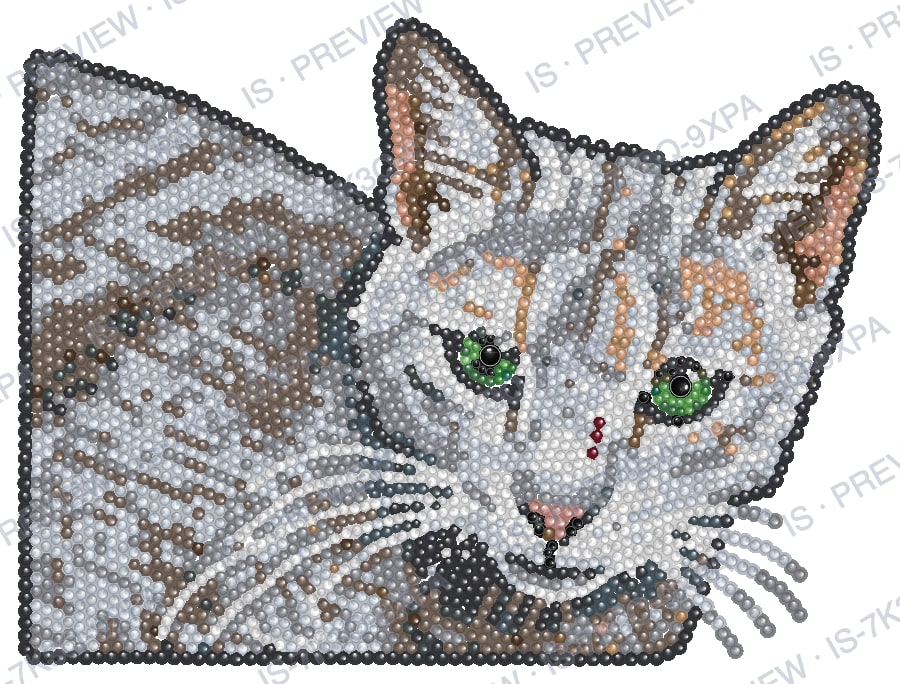
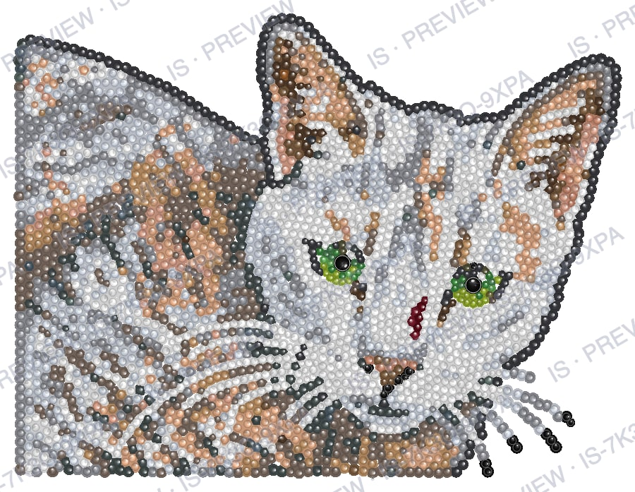
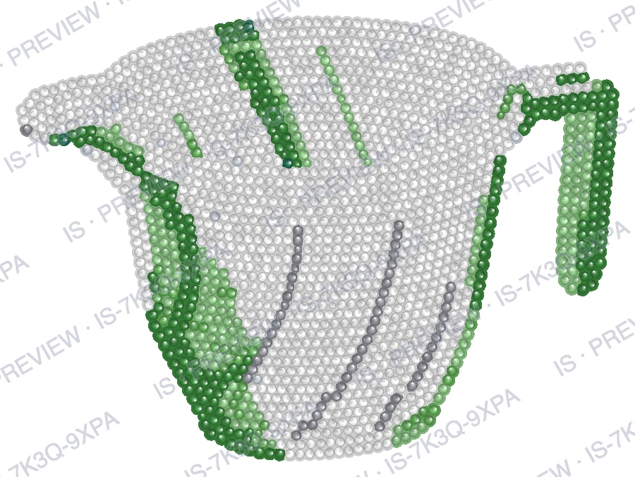
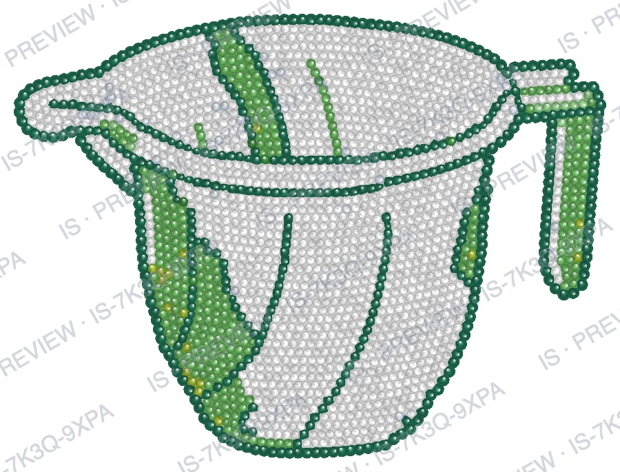
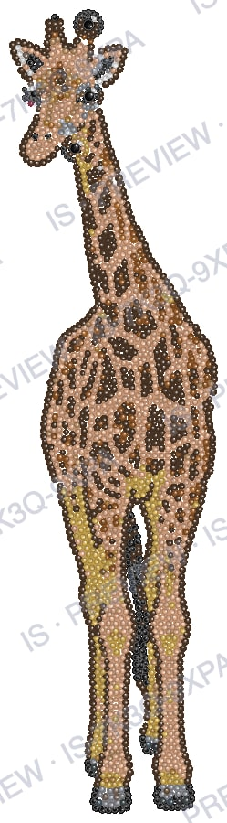
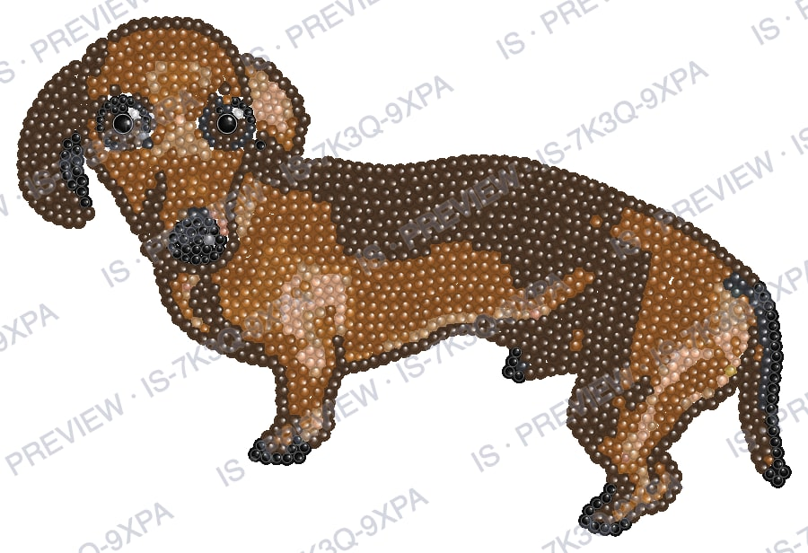

# IS-04 results

Build IS-04 (tinted render and exports), 18 Oct 2026, on the production Mac. No provider calls. The
fixtures are the strass `/layout` answers of the 8 accepted IS-03b designs
(`tools/fixtures/is03b/`), checked by `tools/test-exports.mjs`.

## 1. SS16 size cap (D2, spec 7.5)

After the layout, every stone larger than SS16 becomes SS16 at the same centre, and the gap check
runs again on the capped stones.

| Layouts | Stones capped | Gap check after the cap |
| --- | --- | --- |
| 12 RS test layouts | 13 (cat 2, dog 2, einstein 2, jesus 1, leopard 2, parrot 1, woman 2) | 0 violations on all 12 |
| 8 accepted IS-03b designs | 11 (2 each in dog ×2, cat ×2 and dachshund, 1 in the giraffe, none in the mugs) | 0 violations on all 8 |

The rejected IS-03b car: its saved provider image was laid out again by the strass service (no new
provider call). The service gives the same answer as in IS-03b:

| | Violations (pairs closer than 0.1 mm) | Overlapping pairs | Min gap |
| --- | --- | --- | --- |
| Before the cap (service report) | 148 | 136 | −1.494 mm |
| After the cap (15 SS20 → SS16) | 145 | 130 | −1.378 mm |

Violations remain. 125 of the 145 are SS4–SS4 pairs, 19 SS16–SS4 and 1 SS10–SS4, so the problem is
mostly small stones packed into each other, not the pupil stones. `report.face` for it is
`"animal"`: the field is a string (`"human"` when the face detector found a human face, otherwise
`"animal"`), never `false`. The service reported 19 "pupils" (`pupilsMm`) for it. Acceptance (7.4)
still uses the service's own count, so the car would still be re-run automatically.

## 2. Tinted previews (spec 8)

The preview the browser receives: 900 px on the long side, white background, watermark
`IS · PREVIEW · <code>` (here the example code IS-7K3Q-9XPA). Shown as JPEG to keep the repository
small; the app serves PNG.

| Design | Stones | Natural size | Preview px | Full px | Full render | Preview render |
| --- | --- | --- | --- | --- | --- | --- |
| dog, rule | 2049 | 83.8 × 200.8 mm | 396 × 900 | 1055 × 2400 | 1.8 s | 0.5 s |
| dog, no rule | 2092 | 87.0 × 203.1 mm | 405 × 900 | 1080 × 2400 | 1.5 s | 0.5 s |
| cat, rule | 3573 | 167.8 × 125.7 mm | 900 × 684 | 2400 × 1825 | 3.4 s | 0.9 s |
| cat, no rule | 3141 | 158.4 × 120.8 mm | 900 × 697 | 2400 × 1858 | 3.7 s | 1.1 s |
| mug, rule | 1751 | 130.4 × 96.0 mm | 900 × 676 | 2400 × 1804 | 2.8 s | 0.6 s |
| mug, no rule | 2224 | 146.5 × 109.6 mm | 900 × 685 | 2400 × 1828 | 2.6 s | 0.8 s |
| giraffe | 2314 | 79.8 × 309.4 mm | 249 × 900 | 664 × 2400 | 1.0 s | 0.4 s |
| dachshund | 1628 | 159.2 × 106.4 mm | 900 × 616 | 2400 × 1642 | 2.0 s | 0.5 s |

Sizes are after the SS16 cap (unchanged from IS-03b: no capped pupil lay on the box edge).

## 3. Exports (spec 9)

Every file of section 9, made from the final StoneLayout at the natural size. Sizes in KB.

| Design | A4 sheet pages | Letter sheet pages | PNG px (300 dpi) | SVG | AI | DXF | PNG | Preview PNG |
| --- | --- | --- | --- | --- | --- | --- | --- | --- |
| dog, rule | 2 | 2 | 990 × 2372 | 243 | 510 | 223 | 1269 | 2473 |
| dog, no rule | 2 | 2 | 1028 × 2399 | 246 | 521 | 224 | 1293 | 2487 |
| cat, rule | 2 | 2 | 1982 × 1484 | 415 | 890 | 376 | 2145 | 5179 |
| cat, no rule | 2 | 2 | 1870 × 1427 | 369 | 782 | 335 | 1929 | 4916 |
| mug, rule | 1 | 1 | 1540 × 1134 | 210 | 440 | 185 | 959 | 3271 |
| mug, no rule | 1 | 1 | 1730 × 1295 | 264 | 560 | 232 | 1221 | 3608 |
| giraffe | 3 | 3 | 943 × 3655 | 274 | 580 | 243 | 1390 | 1388 |
| dachshund | 1 | 1 | 1880 × 1257 | 196 | 410 | 181 | 937 | 2620 |

A sheet of 2 or 3 pages is a cover (header and page map) plus true-size tiles (RS-3041). The cat and
dog designs use 23–24 colours and the giraffe 17; their colour breakdown takes so many header lines
that the stones no longer fit on the same page (the dog and giraffe are also too tall). The
dachshund (14 colours) and the mugs (7) fit on one page. The preview PNG (the full 2400 px tinted render, transparent) is
the largest file in the ZIP.

Checked by `tools/test-exports.mjs` on all 8 designs:

| Check | Result |
| --- | --- |
| Tinted render, unit fixture: 1.5 r = 85 % of the nearest stone's fill, 1.7 r = background (transparent in the file, white in the app); nearest measured to the edge | pass |
| SVG: mm size = natural size, one circle per stone, one `<g id>` per colour and size; decodes in headless Chrome at the expected size | pass |
| Production sheets: title, no Object or plate lines, gap 0.1 mm, sizes in mm (A4) / in (Letter), footer `Made with IS · Page i of N` on every page | pass |
| DXF (RS DXF test reader): `$INSUNITS` 4, one circle per stone at (x, H − y, r), one layer per colour, `$LASTSAVEDBY` IS | pass |
| PNG: width and height = mm / 25.4 × 300, 300 dpi, transparent between stones | pass |
| ZIP: entries and order as the table, deflate, contents unchanged | pass |
| No file contains a provider, library or converter name; PNGs carry no text or EXIF chunk | pass (EPS not checked, see below) |
| PDF and AI open in `pdfinfo` (page sizes, Producer / Creator `IS`) | **not run**: poppler is not installed |
| EPS opens in Ghostscript (bounding box, `%%Creator: IS`) and `buildDeliveryZip` end to end | **not run**: Ghostscript is not installed |

`brew install ghostscript poppler` fails on this Mac: macOS 13 gets no bottles, so Homebrew builds
from source, and both formulas stop at the dependency `gobject-introspection` (its pip step crashes
inside Homebrew with `Pathname not allowed in JSON`). Until `gs` and `pdfinfo` exist, those four
tests are skipped with that reason, the EPS export cannot run, and so the ZIP cannot be built.
