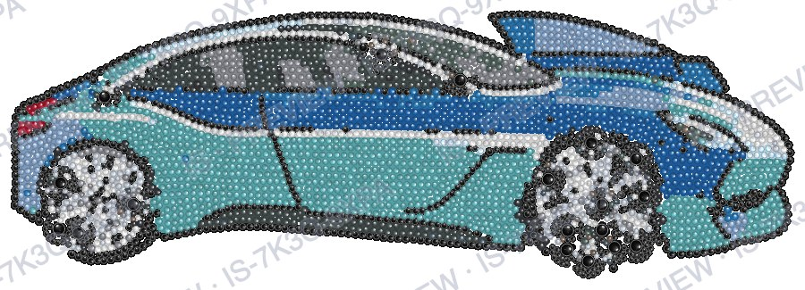

# IS-04 results

Build IS-04 (tinted render and exports), 18 Oct 2026, on the production Mac. No provider calls. The
fixtures are the strass `/layout` answers of the 8 accepted IS-03b designs
(`tools/fixtures/is03b/`), checked by `tools/test-exports.mjs`. Revised 19 Oct 2026: native EPS
writer and pdf.js checks (no Ghostscript or poppler), overlap cleanup (1b), one ZIP end to end (4),
browser test repeated 20 times (5).

## 1. SS16 size cap (D2, spec 7.5)

After the layout, every stone larger than SS16 becomes SS16 at the same centre, and the gap check
runs again on the capped stones.

| Layouts | Stones capped | Gap check after the cap |
| --- | --- | --- |
| 12 RS test layouts | 13 (cat 2, dog 2, einstein 2, jesus 1, leopard 2, parrot 1, woman 2) | 0 violations on all 12 |
| 8 accepted IS-03b designs | 11 (2 each in dog ×2, cat ×2 and dachshund, 1 in the giraffe, none in the mugs) | 0 violations on all 8 |

The rejected IS-03b car: its saved provider image was laid out again by the strass service (no new
provider call). The service gives the same answer as in IS-03b:

| | Violations (pairs closer than 0.1 mm) | Overlapping pairs | Min gap |
| --- | --- | --- | --- |
| Before the cap (service report) | 148 | 136 | −1.494 mm |
| After the cap (15 SS20 → SS16) | 145 | 130 | −1.378 mm |

Violations remain. 125 of the 145 are SS4–SS4 pairs, 19 SS16–SS4 and 1 SS10–SS4, so the problem is
mostly small stones packed into each other, not the pupil stones. `report.face` for it is
`"animal"`: the field is a string (`"human"` when the face detector found a human face, otherwise
`"animal"`), never `false`. The service reported 19 "pupils" (`pupilsMm`) for it. The overlap
cleanup (section 1b) removes the remaining violations.

## 1b. Overlap cleanup (spec 7.4, 7.5)

After the SS16 cap, every pair of stones closer than 0.1 mm loses its smaller stone (on equal size
the one with fewer neighbours, then the later one), worst gap first. The design is accepted when
fewer than 3 % of the stones were removed, the coverage after the cleanup is at least 0.5, the IS
gap check finds 0 violations and at least 300 stones are left. Acceptance uses this IS check, not
the service's violation count.

Coverage after the cleanup is the service's coverage times the area under the delivered stones over
the area under the service's stones (both rasterised at the service's 10 px/mm), so it includes the
cap.

The rejected IS-03b car, from its saved strass `/layout` answer (no provider or layout call;
`tools/fixtures/is03b-rejected/car-rule.json`):

| | Stones | IS violations (gap < 0.1 mm) | Min gap | Coverage | Size |
| --- | --- | --- | --- | --- | --- |
| Service answer | 3716 | 148 (service count) | −1.494 mm | 0.633 | 260.0 × 88.8 mm |
| After the cap (15 SS20 → SS16) | 3716 | 145 | −1.378 mm | | 260.0 × 88.8 mm |
| After the cleanup | 3637 (SS6 2920, SS4 698, SS16 18, SS10 1) | **0** | 0.100 mm | **0.624** | 260.0 × 88.8 mm |

Removed: **79 stones (2.13 %), all SS4.** 145 violating pairs need only 79 removals because many
SS4 stones sat in several pairs at once. Result: **accepted** (2.13 % < 3 %, coverage 0.624 ≥ 0.5,
0 violations, 3637 stones). Instead of a re-run, the car would now be delivered.

Tinted preview of the cleaned car, 900 × 325 px (full render 2400 × 866 px in 1.1 s, preview
0.5 s).

On the other layouts the cleanup removes nothing:

| Layouts | Stones removed | Coverage change (the cap only) | Accepted |
| --- | --- | --- | --- |
| 8 accepted IS-03b designs | 0 on every design | 0 to −0.004 (dog, rule 0.646 → 0.642) | all 8 |
| 12 RS test layouts | 0 on every layout | 0 to −0.005 (dog 0.632 → 0.627) | all 12 |

Checked by `tools/test-cleanup.mjs` (rules on small fixtures, the car, the 8 designs and the 12 RS
layouts) and the acceptance test in `tools/test-pipeline-parts.mjs` (11 or 12 removed of about 400
accepted, 13 rejected; the service's violation count ignored).

## 2. Tinted previews (spec 8)

The preview the browser receives: 900 px on the long side, white background, watermark
`IS · PREVIEW · <code>` (here the example code IS-7K3Q-9XPA). Shown as JPEG to keep the repository
small; the app serves PNG.

| Design | Stones | Natural size | Preview px | Full px | Full render | Preview render |
| --- | --- | --- | --- | --- | --- | --- |
| dog, rule | 2049 | 83.8 × 200.8 mm | 396 × 900 | 1055 × 2400 | 1.8 s | 0.5 s |
| dog, no rule | 2092 | 87.0 × 203.1 mm | 405 × 900 | 1080 × 2400 | 1.5 s | 0.5 s |
| cat, rule | 3573 | 167.8 × 125.7 mm | 900 × 684 | 2400 × 1825 | 3.4 s | 0.9 s |
| cat, no rule | 3141 | 158.4 × 120.8 mm | 900 × 697 | 2400 × 1858 | 3.7 s | 1.1 s |
| mug, rule | 1751 | 130.4 × 96.0 mm | 900 × 676 | 2400 × 1804 | 2.8 s | 0.6 s |
| mug, no rule | 2224 | 146.5 × 109.6 mm | 900 × 685 | 2400 × 1828 | 2.6 s | 0.8 s |
| giraffe | 2314 | 79.8 × 309.4 mm | 249 × 900 | 664 × 2400 | 1.0 s | 0.4 s |
| dachshund | 1628 | 159.2 × 106.4 mm | 900 × 616 | 2400 × 1642 | 2.0 s | 0.5 s |

Sizes are after the SS16 cap (unchanged from IS-03b: no capped pupil lay on the box edge).

## 3. Exports (spec 9)

Every file of section 9, made from the final StoneLayout at the natural size. Sizes in KB.

| Design | A4 sheet pages | Letter sheet pages | PNG px (300 dpi) | SVG | AI | DXF | PNG | Preview PNG |
| --- | --- | --- | --- | --- | --- | --- | --- | --- |
| dog, rule | 2 | 2 | 990 × 2372 | 243 | 510 | 223 | 1269 | 2473 |
| dog, no rule | 2 | 2 | 1028 × 2399 | 246 | 521 | 224 | 1293 | 2487 |
| cat, rule | 2 | 2 | 1982 × 1484 | 415 | 890 | 376 | 2145 | 5179 |
| cat, no rule | 2 | 2 | 1870 × 1427 | 369 | 782 | 335 | 1929 | 4916 |
| mug, rule | 1 | 1 | 1540 × 1134 | 210 | 440 | 185 | 959 | 3271 |
| mug, no rule | 1 | 1 | 1730 × 1295 | 264 | 560 | 232 | 1221 | 3608 |
| giraffe | 3 | 3 | 943 × 3655 | 274 | 580 | 243 | 1390 | 1388 |
| dachshund | 1 | 1 | 1880 × 1257 | 196 | 410 | 181 | 937 | 2620 |

A sheet of 2 or 3 pages is a cover (header and page map) plus true-size tiles (RS-3041). The cat and
dog designs use 23–24 colours and the giraffe 17; their colour breakdown takes so many header lines
that the stones no longer fit on the same page (the dog and giraffe are also too tall). The
dachshund (14 colours) and the mugs (7) fit on one page. The preview PNG (the full 2400 px tinted render, transparent) is
the largest file in the ZIP.

Checked by `tools/test-exports.mjs` on all 8 designs:

| Check | Result |
| --- | --- |
| Tinted render, unit fixture: 1.5 r = 85 % of the nearest stone's fill, 1.7 r = background (transparent in the file, white in the app); nearest measured to the edge | pass |
| SVG: mm size = natural size, one circle per stone, one `<g id>` per colour and size; decodes in headless Chrome at the expected size | pass |
| Production sheets: title, no Object or plate lines, gap 0.1 mm, sizes in mm (A4) / in (Letter), footer `Made with IS · Page i of N` on every page | pass |
| DXF (RS DXF test reader): `$INSUNITS` 4, one circle per stone at (x, H − y, r), one layer per colour, `$LASTSAVEDBY` IS | pass |
| PNG: width and height = mm / 25.4 × 300, 300 dpi, transparent between stones | pass |
| ZIP: entries and order as the table, deflate, contents unchanged | pass |
| No file contains a provider, library or converter name; PNGs carry no text or EXIF chunk | pass (EPS included) |
| PDF and AI open in pdf.js (`pdfjs-dist`): page count (1, 2 or 3 as above; AI 1), page size (A4 595.28 × 841.89 pt, Letter 612 × 792 pt, AI the design plus 10 mm), Producer / Creator / Title `IS` | pass |
| EPS: EPSF-3.0 structure (header to `%%EndComments`, prolog, one page, trailer, `%%EOF`, 7-bit text), the drawing run as PostScript operators with operand counts checked; `%%HiResBoundingBox` = the design size in points, `%%BoundingBox` its rounded-up integers; one circle per stone at (x, H − y, r) in its catalogue fill, one colour group per colour; `%%Creator: IS` | pass |
| `buildDeliveryZip` from an archive to `data/delivery/<code>/<code>.zip`, archive untouched | pass |

No test is skipped any more: `npm test` runs the four tests that needed `gs` or `pdfinfo` (EPS,
production sheets, AI, `buildDeliveryZip`) with pdf.js and the native EPS writer. Ghostscript and
poppler are no longer needed (they did not build on this Mac: macOS 13 gets no Homebrew bottles,
and both stop at `gobject-introspection`).

As one more outside check, macOS's own PostScript interpreter (`/usr/bin/pstopdf`) converted the
mug EPS to a one-page PDF of 370 × 273 pt, the EPS's `%%BoundingBox`. This is not part of the tests
(`pstopdf` is not on every Mac).

## 4. One ZIP end to end

The mug (rule) design run through the real pipeline into a fresh archive: upload over HTTP, Create
design, provider and layout replaced by their saved IS-03b answers (no provider call), SS16 cap,
cleanup, acceptance, `stones.json` and `tinted.png` written, then `buildDeliveryZip` from that
archive (0.5 s). Everything ran under a temporary folder, nothing under `data/`.

Result: 1751 stones (SS6 1681, SS4 70), 7 colours, 130.4 × 96.0 mm (5.13 × 3.78 in), coverage
0.700. ZIP `IS-XXXX-XXXX.zip`, 4 688 769 bytes, `unzip -t` clean:

| Entry | Size (bytes) | Compressed | |
| --- | --- | --- | --- |
| `IS-XXXX-XXXX.svg` | 214 636 | 15 969 | |
| `production-sheet-A4.pdf` | 472 471 | 120 708 | 1 page |
| `production-sheet-Letter.pdf` | 472 320 | 120 695 | 1 page |
| `IS-XXXX-XXXX.ai` | 450 660 | 118 662 | |
| `IS-XXXX-XXXX.eps` | 41 506 | 13 938 | |
| `IS-XXXX-XXXX.dxf` | 189 403 | 22 087 | |
| `IS-XXXX-XXXX.png` | 982 342 | 977 361 | 1540 × 1134 px, 300 dpi |
| `IS-XXXX-XXXX-preview.png` | 3 349 075 | 3 297 487 | 2400 × 1804 px, the archived `tinted.png` |
| `README.txt` | 1 418 | 686 | |
| **9 entries** | **6 173 831** | **4 687 593** | |

(`IS-XXXX-XXXX` stands for the code the run made.) The archive's `attempt-1/` held `original.png`,
`prepared.png`, `settings.json`, `ai.png`, `layout.json`, `stones.json` and `tinted.png`; none of
them was changed by the ZIP build.

## 5. Browser test, 20 runs

`tools/test-adjust-browser.mjs` (adjust.js in Node and in an isolated headless Chrome, same hashes)
run 20 times one after another: **20 of 20 passed**, test time 1.5–14 s. Every run's process,
though, lasted 60 s: the 60 s "browser did not answer" timer of `Promise.race` was never cleared, so
it held the process open after the test had passed. The same pattern was in the SVG browser test in
`tools/test-exports.mjs`. Fixed in both: the timer is cleared when the race ends, and the wait timers
for Chrome's exit are `unref()`'d. `npm test` now takes about 36 s instead of 72 s.

After the fix, 20 more runs: 19 passed in 1–3 s, **1 failed** ("browser did not answer in 60 s":
Chrome never sent its result). A copy of the test that logs each HTTP request and Chrome's stderr
then ran 100 times: 100 passed, all within 5 s (page requested about 1 s after the start, result
posted about 1.2 s). So the failure is rare (1 in 140 runs) and its cause is not known: the one
failing run had no logging, and the logged runs never hung. It is not fixed; if it shows up again,
the request log would tell whether Chrome never loaded the page or loaded it and stalled.
