# IS-05 tinted comparison

Docs only. Made by `node tools/tinted-comparison.mjs <runs dir>` with no provider call. Re-rendered
for IS-05b with the final settings: the tinted renderer of spec section 8 as revised in IS-05b (stones
kept within 2 L* of their catalogue colour, gaps 4 L* darker than the fill, a little more above L* 80), and each design laid out
again by today's strass service from its saved AI image (`services/strass/scripts/is05b_runs.py`,
rules `DEFAULT`: soft outlines off, plausible pupils, the one plausible pair kept of more than two).

Each row shows four images side by side:

1. **Original**: for the IS-03b designs, the buyer photo the design was made from (before background
   removal and the model-input crop, so the framing differs from the design); for the RS test layouts,
   the RS test image (there is no other original: the RS test images are themselves model outputs, so
   columns 1 and 2 are the same image on those rows).
2. **AI image**: the model output the strass service laid out (IS-05b; docs only, the app never
   shows it, spec D4). For the IS-03b designs, the saved provider output of IS-03b.
3. **Plain stones**: the faceted stones (RS `drawCrystalStone`) on white, with no fill between them.
4. **Tinted**: `renderTinted` as in the app's preview, without the watermark.

Plain and tinted use the same canvas (the stones' box plus 2 main-stone diameters) at the same
pixels per mm (640 px on the long side). The original and the AI image are scaled to the same height. Each design
is the delivered one: the strass `/layout` answer after the size cap (a face's two pupils SS20, every other
stone at most SS16) and the overlap cleanup.
Under each row: stone count, stones per size, and the natural size.

## IS-03b (accepted)

### dog-rule

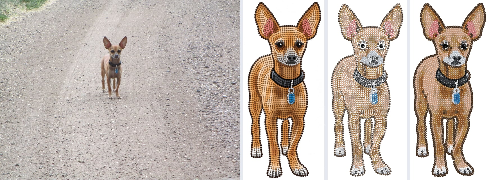

2049 stones (SS6 1933, SS4 114, SS20 2) · 83.8 × 200.8 mm (3.30 × 7.91 in)

### dog-norule

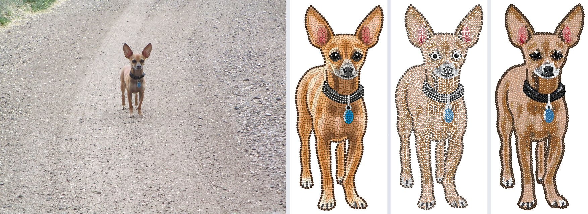

2092 stones (SS6 1973, SS4 117, SS20 2) · 87.0 × 203.1 mm (3.43 × 8.00 in)

### cat-rule

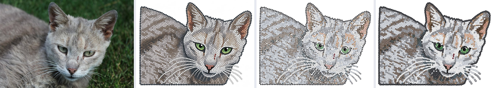

3573 stones (SS6 3269, SS4 302, SS20 2) · 167.8 × 125.7 mm (6.61 × 4.95 in)

### cat-norule

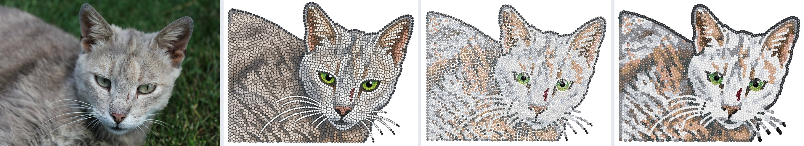

3141 stones (SS6 2758, SS4 381, SS20 2) · 158.4 × 120.8 mm (6.23 × 4.76 in)

### mug-rule

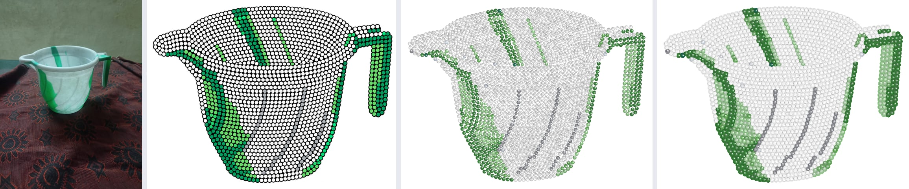

1751 stones (SS6 1681, SS4 70) · 130.4 × 96.0 mm (5.13 × 3.78 in)

### mug-norule

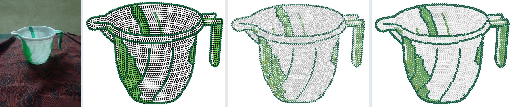

2224 stones (SS6 2120, SS4 104) · 146.5 × 109.6 mm (5.77 × 4.32 in)

### giraffe-rule

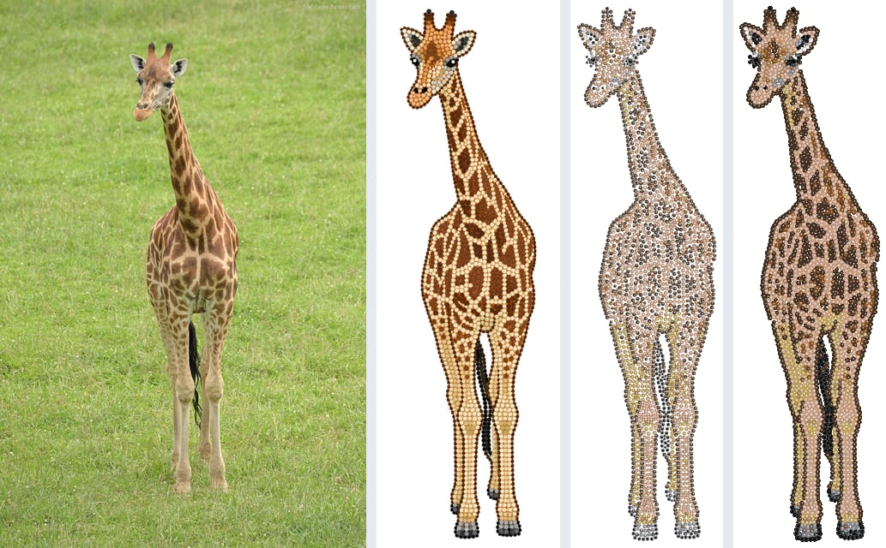

2286 stones (SS6 1945, SS4 339, SS10 2) · 79.8 × 307.5 mm (3.14 × 12.11 in)

### dachshund-rule

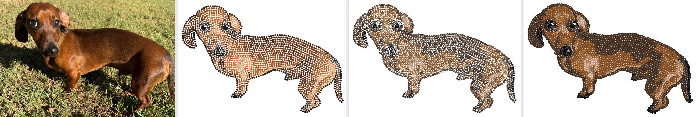

1628 stones (SS6 1452, SS4 174, SS20 2) · 159.2 × 106.4 mm (6.27 × 4.19 in)

## IS-03b car

### car-rule

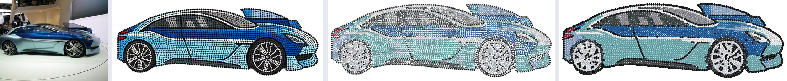

3531 stones (SS6 3276, SS4 255) · 260.0 × 87.4 mm (10.24 × 3.44 in)

## RS test layouts

### rs-cat

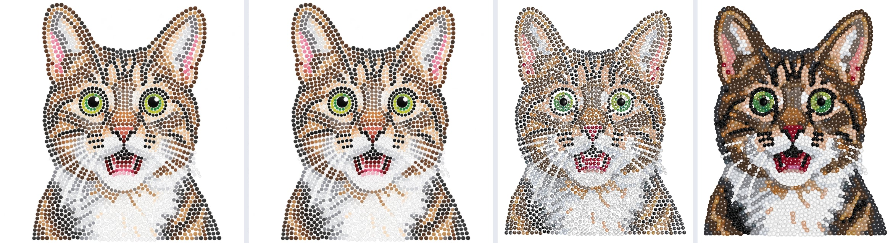

2150 stones (SS6 1801, SS4 347, SS20 2) · 103.0 × 130.8 mm (4.06 × 5.15 in)

### rs-dog

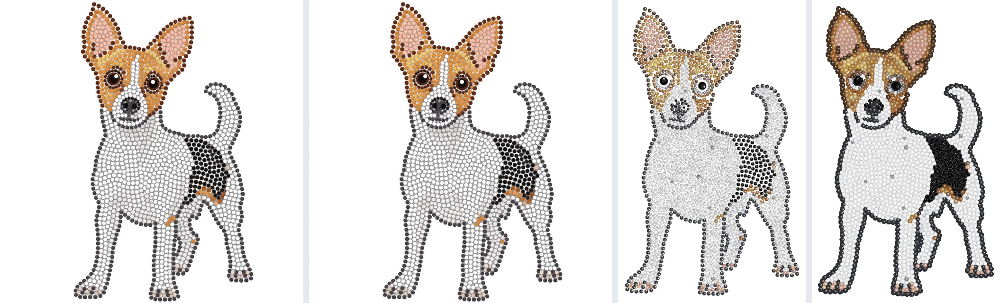

1671 stones (SS6 1528, SS4 141, SS20 2) · 96.6 × 160.6 mm (3.80 × 6.32 in)

### rs-einstein

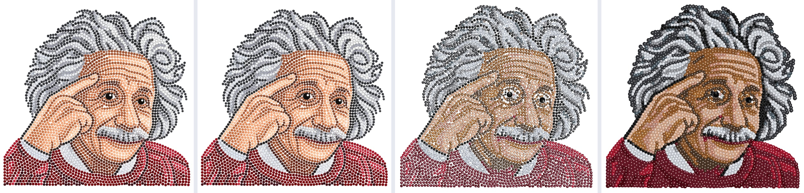

3591 stones (SS6 3231, SS4 358, SS20 2) · 150.2 × 143.2 mm (5.91 × 5.64 in)

### rs-jesus

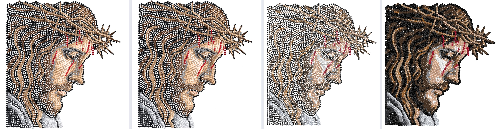

3298 stones (SS6 2880, SS4 417, SS16 1) · 145.8 × 163.9 mm (5.74 × 6.45 in)

### rs-lake

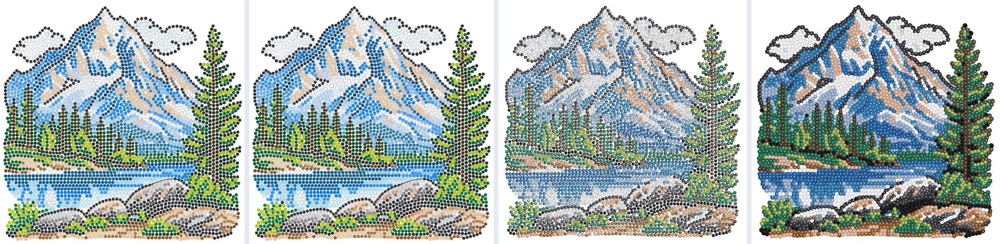

4089 stones (SS6 3927, SS4 162) · 154.7 × 152.1 mm (6.09 × 5.99 in)

### rs-leopard

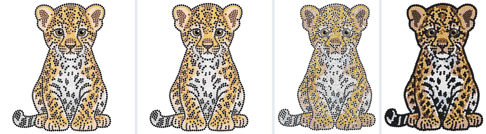

2431 stones (SS6 2205, SS4 224, SS20 2) · 117.2 × 153.7 mm (4.62 × 6.05 in)

### rs-logo

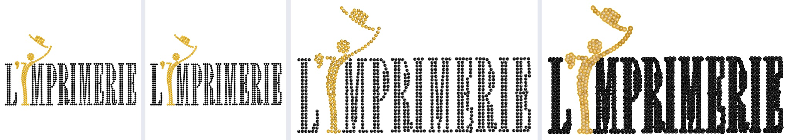

833 stones (SS6 824, SS4 9) · 144.9 × 79.1 mm (5.70 × 3.12 in)

### rs-parrot

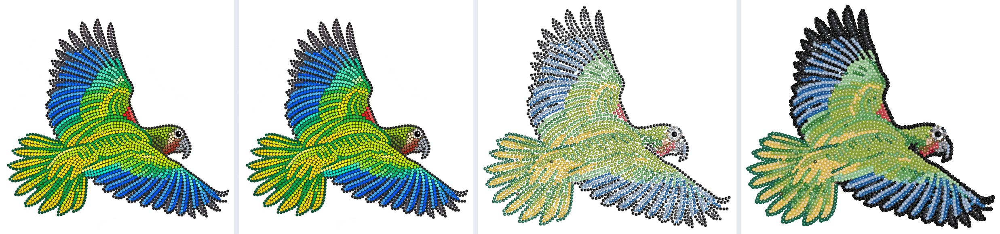

2542 stones (SS6 2307, SS4 234, SS16 1) · 168.3 × 151.6 mm (6.62 × 5.97 in)

### rs-portrait

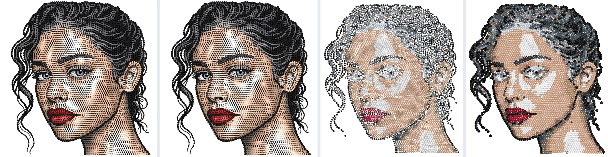

3995 stones (SS6 3572, SS4 421, SS10 2) · 149.5 × 166.0 mm (5.89 × 6.54 in)

### rs-rose

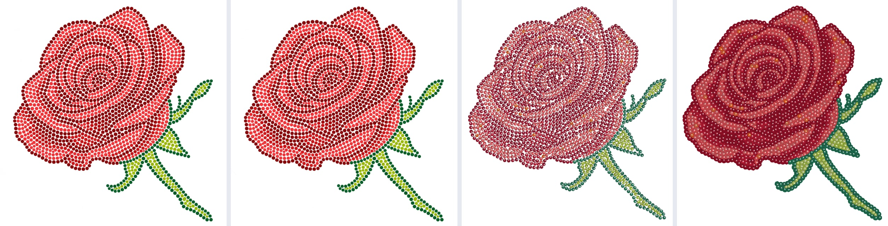

1846 stones (SS6 1689, SS4 157) · 121.0 × 130.5 mm (4.76 × 5.14 in)

### rs-tulips

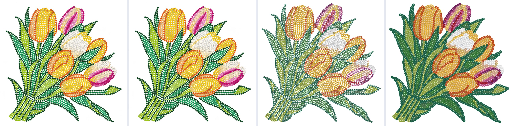

2673 stones (SS6 2547, SS4 126) · 140.3 × 141.7 mm (5.52 × 5.58 in)

### rs-woman

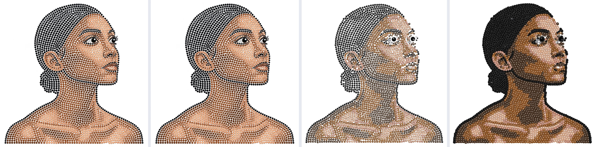

2612 stones (SS6 2392, SS4 218, SS20 2) · 143.9 × 146.7 mm (5.67 × 5.78 in)

## Eye area up close

Plain (left) and tinted (right), 36 px per mm, for 3 designs. Each crop is the box
around the two largest stones (the pupils) plus 7 mm on every side, so the gaps between the stones
can be judged at close range.

### dog-rule

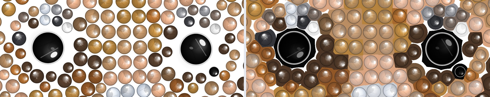

Crop 35.7 × 14.2 mm at x 29.6, y 42.3 mm.

### cat-rule

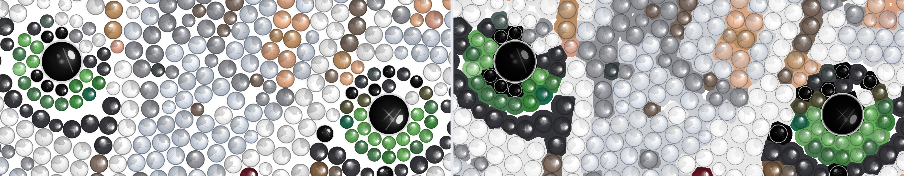

Crop 51.2 × 20.0 mm at x 84.8, y 58.5 mm.

### rs-portrait

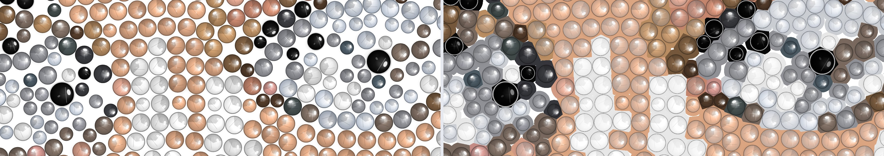

Crop 49.8 × 17.7 mm at x 31.6, y 69.5 mm.

