# IS-05b — colour, eyes and non-face subjects

19 Oct 2026, branch `is-05b-quality`. No provider call: everything below is made from the saved AI
images (the 12 RS test images, which are themselves model outputs, and the IS-03b provider outputs
of 18 Oct) and the strass service run locally.

How to reproduce:

```
# layouts with rule variants, plus each stone's colour after every colour step (services/strass)
.venv/bin/python scripts/is05b_runs.py <runs> <variants> <name>=<AI png> ...
# images and numbers (docs/IS-05b-results/, numbers.json)
node tools/is05b-results.mjs <IS-03b work dir> <runs>
# the comparison document with the AI column
node tools/tinted-comparison.mjs <IS-03b work dir>
```

Re-running the service with the RS 38cd831 rules on a saved AI image reproduces the saved layout
exactly (checked on all 21 designs: 6 below plus 15 in section 4), so the runs below compare like
with like.

## Summary

| Question | Answer |
| --- | --- |
| Where does the colour drift come from? | Two places, about equally. **The tinted renderer** is the biggest single stage on woman, leopard and dog (+4 to +6 ΔE). **The service's first colour pick** (its own sampling and `snap_colours` penalties, not a rule) is the biggest on car and portrait (+2 to +4 ΔE). The tone-separation step adds 0.1–0.4. |
| Which colour rules to keep? | All except `soft_outlines` (recommended set below). No rule is a big lever: switching any one off moves the mean ΔE by at most 0.7. **Defaults not changed.** |
| Eyes: no cap or SS16? | No cap is clearly better (woman, dog). **Implemented:** a face's two pupils may stay SS20. Portrait's pupils are SS10, so its eyes are not a size problem (see 3). |
| Non-face subjects | **Implemented** in the service (`plausible_eyes`). Car: wheels now read as wheels; cleanup removes 0 stones instead of 79; service violations 148 → 0. Unchanged stone for stone: dog, cat, all 12 RS layouts and every other IS-03b design except the giraffe. |

## 1. Comparison with the AI image

[`IS-05-tinted-comparison.md`](IS-05-tinted-comparison.md) now shows four columns per row:
original, AI image, plain stones, tinted. The AI column is docs only (spec D4: the app never shows
it). On the RS rows the original *is* the AI image (the RS test images are model outputs; there is
no other original), so columns 1 and 2 match there.

## 2. Colour diagnosis

### Method

For every delivered stone (after the SS16 cap and the overlap cleanup), the AI image colour under
the stone is the mean CIE Lab of the opaque pixels within 60 % of the stone's radius
(`tools/is05b-measure.mjs`). Its CIE ΔE2000 (kL = kC = kH = 1; checked against skimage to 3·10⁻⁵)
is measured to:

- **(a)** the nearest catalogue colour (plain ΔE2000 over all 47 catalogue fills): the best the
  catalogue allows;
- **(b)** the colour the service assigned (its catalogue fill);
- **(c)** the stone as rendered in the tinted view (mean Lab of the inner 60 % of the rendered
  disc, at 24 px per mm);
- **(t)** for reference, the tint painted around the stone (fill × 0.85, spec 8 step 3).

Designs: RS portrait, woman, leopard; IS-03b car; IS-03b dog and cat (the `-rule` designs of the
IS-05 eye close-ups) as controls.

### Per stage

Mean / 90th percentile ΔE2000:

| Design | Stones | (a) nearest | (b) assigned | (c) rendered | (t) tint | (a) ≠ (b) |
| --- | --- | --- | --- | --- | --- | --- |
| portrait | 3995 | 5.7 / 10.3 | 8.2 / 15.5 | 9.5 / 16.5 | 10.8 / 18.3 | 1033 |
| woman | 2612 | 6.4 / 10.5 | 7.7 / 12.0 | **13.7 / 20.1** | 9.3 / 15.8 | 497 |
| leopard | 2431 | 5.1 / 10.4 | 5.9 / 10.8 | **9.8 / 17.9** | 7.8 / 16.1 | 343 |
| car | 3629 | 6.7 / 12.3 | **11.2 / 17.5** | 13.7 / 22.2 | 12.7 / 20.9 | 959 |
| dog (control) | 2049 | 7.2 / 13.0 | 7.8 / 13.4 | **11.9 / 24.4** | 11.0 / 15.2 | 352 |
| cat (control) | 3573 | 5.6 / 9.6 | 6.4 / 10.5 | 7.4 / 13.9 | 9.4 / 15.0 | 520 |

Drift added by each stage (mean ΔE): service (a → b) / renderer (b → c):

| | portrait | woman | leopard | car | dog | cat |
| --- | --- | --- | --- | --- | --- | --- |
| service | **+2.5** | +1.3 | +0.8 | **+4.5** | +0.6 | +0.8 |
| renderer | +1.3 | **+6.0** | **+3.9** | +2.5 | **+4.1** | +1.0 |

**Which stage causes most of the drift:** the renderer on woman, leopard and dog; the service on
car and portrait. Over the four designs Alex flagged, the two are about equal: service +2.3,
renderer +3.4 on average.

### Inside the service

`scripts/is05b_runs.py` records each stone's colour after every colour step. Mean ΔE from the AI
colour, after each step (the step's number of changed stones in brackets):

| Design | (a) | first pick | darkdots | family fix | distinct tones | skin nearest | soft outlines | calm skin = (b) |
| --- | --- | --- | --- | --- | --- | --- | --- | --- |
| portrait | 5.7 | **7.65** | 7.83 (29) | 7.83 | 8.23 (354) | 8.09 (301) | 8.25 (44) | 8.23 (40) |
| woman | 6.4 | **7.14** | 7.19 (2) | 7.19 | 7.23 (45) | 7.01 (166) | **7.72** (94) | 7.73 (28) |
| leopard | 5.1 | **5.86** | 5.86 | 5.86 | 5.95 (278) | 5.87 (77) | 5.87 | 5.87 (2) |
| car | 6.7 | **10.78** | 10.82 (3) | 10.82 | 11.24 (409) | 11.24 | 11.24 | 11.24 |
| dog | 7.2 | **7.67** | 7.67 | 7.67 | 8.02 (350) | 7.65 (405) | 7.76 (11) | 7.76 (25) |
| cat | 5.6 | **6.22** | 6.23 (2) | 6.23 | 6.37 (167) | 6.35 (76) | 6.35 | 6.35 (1) |

The **first pick** (the colour each stone gets from `stone_colours` + `snap_colours` before any
rule runs) is most of the service's drift on every design: 2.0 of portrait's 2.5 and 4.1 of the
car's 4.5. Its most frequent changes from the nearest colour:

- **car**: crystal → aquamarine 73, jet → hematite 60, light-sapphire → sapphire 57,
  jet → aquamarine 47, light-sapphire → aquamarine 40, hematite → jet 38. The AI's light blue
  becomes aquamarine; `snap_colours` blocks the neutral colours for any sample with chroma ≥ 18
  and penalises catalogue colours less saturated than the sample. That is the car's teal body.
- **portrait**: crystal-clear → silk 160, jet → graphite 78, jet → hematite 48, jet → grey 44.
  The skin highlights and the outlines lose contrast.
- **woman**: silk → rose-gold 182, rose-gold → copper 74, colorado-topaz → smoked-topaz 65. The
  skin is pushed one step darker and redder.

These are not rules in `rules.py`, so switching rules off cannot fix them (next section).

### The 10 most frequent changes from (a) to (b)

- **portrait**: crystal-clear → silk 160, grey → silver 101, jet → graphite 80, jet → smoked-topaz 61, jet → hematite 46, graphite → grey 45, jet → grey 44, silk → light-peach 40, grey → greige 28, silk → golden-shadow 27
- **woman**: silk → rose-gold 144, jet → smoked-topaz 103, colorado-topaz → smoked-topaz 78, rose-gold → copper 63, copper → colorado-topaz 42, hematite → jet 18, rose-gold → colorado-topaz 11, silk → golden-shadow 7, jet → crystal-clear 3, crystal-clear → grey 3
- **leopard**: light-topaz → gold 122, crystal-clear → silver 28, gold → metallic-sunshine 26, colorado-topaz → smoked-topaz 19, crystal-clear → silk 19, jet → smoked-topaz 17, silver → crystal-clear 11, hematite → jet 10, jet → hematite 9, light-topaz → metallic-sunshine 7
- **car**: hematite → jet 98, crystal → aquamarine 73, silver → crystal-clear 67, grey → black-diamond 58, jet → hematite 58, silver → grey 49, jet → aquamarine 47, graphite → jet-hematite 41, light-sapphire → aquamarine 40, jet → silver 34
- **dog**: jet → smoked-topaz 100, golden-shadow → light-colorado 53, light-colorado → copper 27, silk → golden-shadow 21, light-colorado → golden-shadow 11, grey → silver 10, colorado-topaz → smoked-topaz 10, copper → colorado-topaz 9, silver → grey 8, copper → light-colorado 8
- **cat**: crystal-clear → silver 150, silver → grey 34, grey → greige 25, grey → silver 21, silver → crystal-clear 17, grey → graphite 16, crystal-clear → grey 15, light-smoked-topaz → smoked-topaz 15, grey → golden-shadow 14, greige → grey 14

### The renderer

The renderer's own fidelity, measured on a patch of 36 SS6 stones per colour
(`numbers.json` → `renderer`): it **lifts dark stones and darkens light cells**, compressing the
contrast:

| Colour | fill L\* | stone L\* (rendered) | cell L\* (stone + tint) | ΔE fill → stone |
| --- | --- | --- | --- | --- |
| jet | 6 | 18 | 23 | 7.2 |
| indian-siam | 19 | 35 | 23 | 13.0 |
| hematite | 27 | 42 | 30 | 12.8 |
| smoked-topaz | 29 | 43 | 32 | 11.9 |
| graphite | 41 | 52 | 38 | 10.8 |
| copper | 55 | 61 | 48 | 7.7 |
| rose-gold | 66 | 68 | 55 | 5.1 |
| silk | 77 | 77 | 70 | 4.3 |
| silver | 88 | 85 | 77 | 2.0 |
| crystal-clear | 97 | 91 | 78 | 3.5 |

Across all 47 colours, the rendered stone is 10–16 L\* lighter than the fill for every colour
below L\* 45, and the 85 % tint takes 8–19 L\* off every colour above L\* 60. So dark hair and
outlines turn grey-brown, and light skin turns mid-brown. That is the woman's dark look
(`colours-woman.jpg` below). The renderer and the tint are spec section 8 and are unchanged here.
They are a separate lever (tint brightness, or how the faceted renderer shades dark colours),
for Alex to decide.

### Rules switched off one at a time

Each run re-lays out the saved AI image with one colour rule of `strass_layout/rules.py` off (the
RS 38cd831 rules otherwise). Mean ΔE (b) assigned / (c) rendered, with the number of stones whose
colour changed in brackets; "=" means identical to today, stone for stone:

| Rule off | portrait | woman | leopard | car | dog | cat |
| --- | --- | --- | --- | --- | --- | --- |
| *none (today)* | 8.23 / 9.52 | 7.73 / 13.68 | 5.87 / 9.82 | 11.24 / 13.65 | 7.76 / 11.92 | 6.35 / 7.42 |
| extra_colours | = | = | = | = | = | = |
| mean_colour | 8.49 / 9.84 (318) | 7.72 / 13.64 (14) | 5.91 / 9.78 (395) | **10.99** / 13.56 (431) | 7.73 / 11.83 (48) | **6.18** / 7.22 (379) |
| real_colours | = | = | = | = | = | = |
| more_colours | 9.41 / 10.31 (1863) | 8.20 / 13.94 (262) | 6.37 / 10.17 (314) | 12.47 / 14.49 (466) | 8.71 / 12.52 (495) | 7.30 / 7.95 (720) |
| skin_no_wine | 8.23 / 9.52 (2) | 7.73 / 13.68 (1) | = | = | = | = |
| soft_outlines | **8.06** / 9.28 (44) | **7.02** / 12.91 (94) | = | = | **7.66** / 11.81 (11) | = |
| calm_skin | 8.25 / 9.54 (40) | 7.72 / 13.67 (28) | 5.87 / 9.83 (2) | = | 7.76 / 11.91 (25) | 6.35 / 7.42 (1) |
| skin_nearest | 8.40 / 9.74 (277) | 7.95 / 13.81 (163) | 5.95 / 9.93 (75) | = | 8.13 / 12.18 (410) | 6.37 / 7.45 (76) |
| *all eight* | 10.58 / 11.08 (2632) | 8.60 / 13.45 (953) | 9.22 / 11.63 (986) | 13.08 / 15.16 (1866) | 11.76 / 11.91 (1704) | 7.67 / 8.14 (1182) |

Notes:

- `extra_colours` and `real_colours` have no effect while `more_colours` is on (`palette()` then
  ignores them). They are dead flags in the shipped rules.
- `mean_colour` also changes the geometry slightly (woman +1 stone, portrait +1), because the
  ordered layout uses the colour.
- (c) is measured on each run's own render, so it also moves with (b).

A/B images: the AI image (cropped to the stones), today's tinted view, then the tinted view with
each rule off. Rules that change nothing are left out.

#### portrait

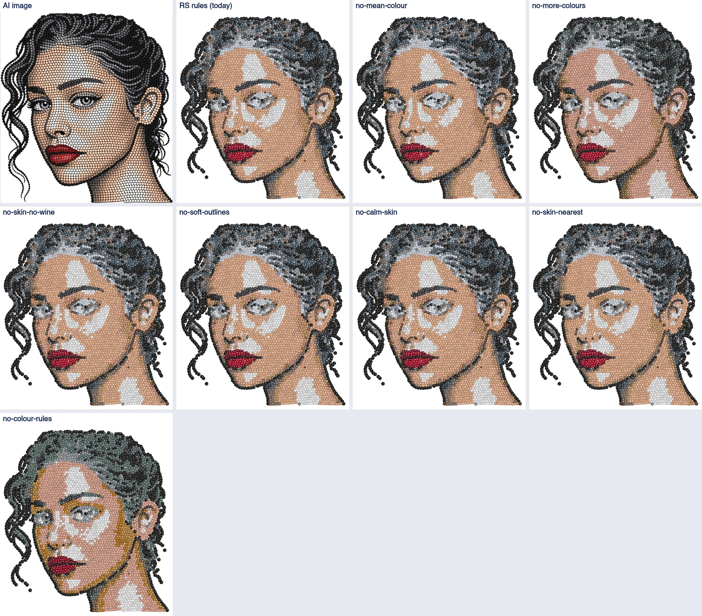

#### woman

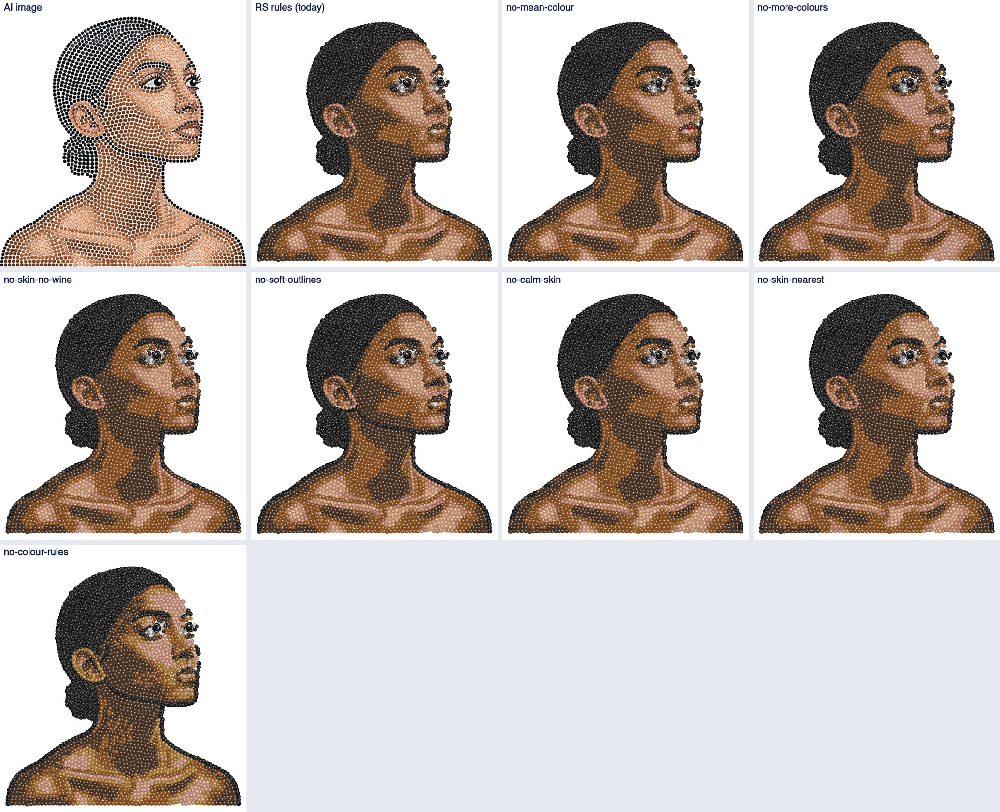

#### leopard

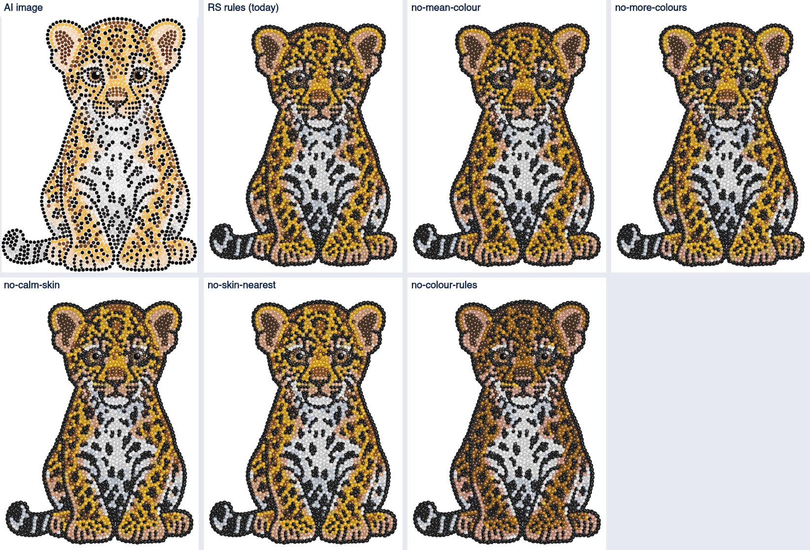

#### car

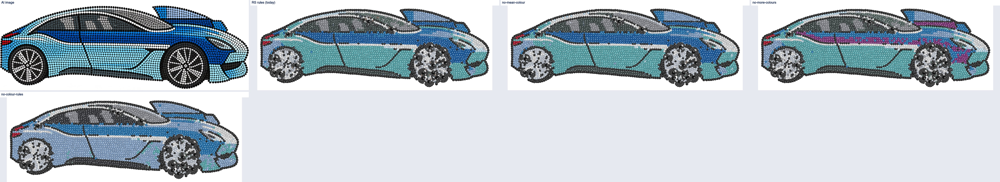

#### dog

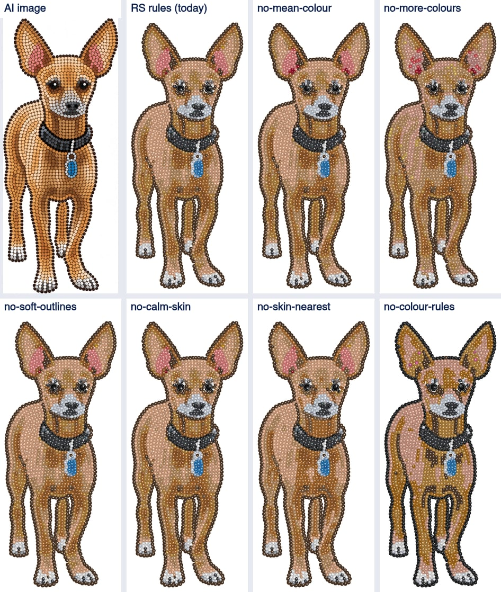

#### cat

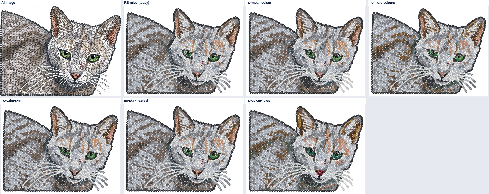

### Recommended rule set (not applied)

**Today's rules with `soft_outlines` off.** It is the only rule whose removal lowers ΔE on the
designs where it acts (woman −0.71, portrait −0.17, dog −0.10) and it changes nothing elsewhere.
On the woman it turns 94 black outline stones on the skin into smoked topaz, which the AI drew
black. Keep `more_colours` (removing it costs 0.5–1.2 everywhere), `skin_nearest` (costs
0.02–0.37) and `mean_colour` (mixed: helps car and cat by 0.2, costs portrait 0.26; small either
way). `calm_skin` and `skin_no_wine` are neutral; keep them.

That set moves the flagged designs by less than 1 ΔE. The large gains are elsewhere, and both
are outside `rules.py`:

1. the renderer's dark lift and 85 % tint (spec section 8): woman, leopard, dog;
2. the first pick's neutral block and chroma penalty in `snap_colours`: car (light blue →
   aquamarine) and portrait (highlights → silk, outlines → graphite/grey).

Both need a decision from Alex before anyone touches them.

## 3. Eyes

Close-ups at 30 px per mm, plain and tinted. (a) is the service's answer with no size cap; (b)
is today's SS16 cap. The middle option, "pupils SS20", is what IS now does.

| Design | report.face | Service pupils | (a) | SS20 rule | (b) SS16 |
| --- | --- | --- | --- | --- | --- |
| woman | human | 6.32 mm ×2 | SS30 | SS20 | SS16 |
| portrait | human | 3.46 mm ×2 | SS10 | SS10 | SS10 |
| dog | human (dlib fires on the dog) | 7.6 mm ×2 | SS30 | SS20 | SS16 |

### woman

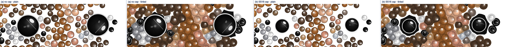
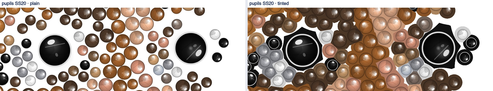

### dog

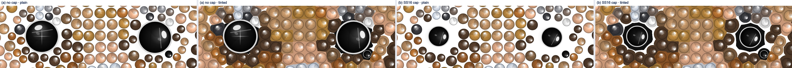
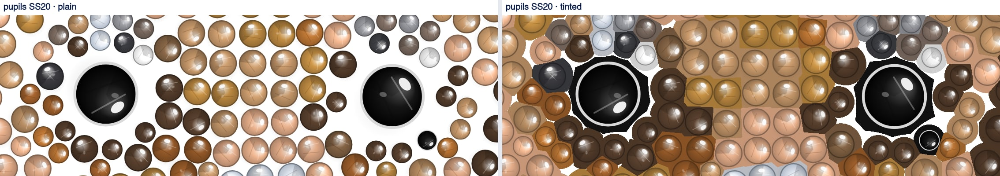

### portrait

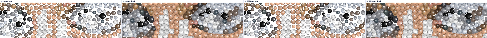

**(a) is clearly better.** The service keeps a gap around each pupil that fits its full size.
Capped to SS16, the pupil sits small in the middle of that gap: in plain stones it looks lost,
and in the tinted view the gap is painted black around it, so the eye becomes a black octagon
with a small stone inside. The SS20 rule halves that ring; at SS30 there is none.

**Implemented** (spec D2 and 7.5 updated): when `report.face` is set and exactly two pupils are
reported in the new `report.pupilsAtMm`, the stones at those centres are capped at SS20 instead
of SS16 (an SS30 pupil becomes SS20). Every other stone above SS16 is still capped at SS16. A
layout without `pupilsAtMm` (every saved one) keeps the SS16 cap. The cap only shrinks stones,
so it adds no overlap. On all 21 re-run designs (the 12 RS layouts and the 9 IS-03b designs) the
gap check passes with 0 cleanup removals. 11 designs now keep two SS20 pupils. RS Jesus and parrot
(one pupil each) still have their pupil capped to SS16.

**Portrait (open):** its pupils are SS10, so no cap touches them. The problem is colour: the eye
area is grey and silver patches (iris and eye-white stones snapped to grey/silver/hematite), and
the skin around them is light. The size rule cannot help it. It belongs with the first-pick
question above.

## 4. Non-face subjects

**Rule** (`plausible_eyes`, in IS's strass copy, on by default): after the service's pupil search,
the pupils must be **at most two**. Two pupils must be **one plausible pair**:

- diameters within a factor 1.6 (before the service equalises them; that is the service's own
  equalising limit);
- vertical offset at most half the horizontal one (about 27°);
- centres at most 0.45 × the subject mask's width apart.

Otherwise the design has no face: no pupil, catch-light, iris or lash stone is placed,
`soften_outlines` does not run, `report.face` is `null` and `pupilsMm` is empty.

The thresholds come from the 11 two-pupil designs on hand: equalised size ratio always 1.0, dy/dx
at most 0.17, distance at most 0.32 × width. Each threshold has margin over every real face.

### Car

| | before (RS rules) | after |
| --- | --- | --- |
| report.face / pupils | animal / 19 | null / 0 |
| service stones / violations | 3716 / 148 | 3531 / 0 |
| SS16-capped stones | 15 | 0 |
| **removed by the cleanup** | **79 (2.1 %)** | **0** |
| delivered stones | 3637 | 3531 |
| coverage after the cleanup | 0.624 | 0.626 |
| ΔE (b) / (c) | 11.24 / 13.65 | 9.38 / 12.44 |

The 19 "pupils" were the wheel spokes' dark gaps (15), plus 4 on the windows and the roof. Each
got an SS20 jet stone with rings of SS4 around it, which crowded the spokes. That is where the 148
violations and the 79 cleanup removals came from.

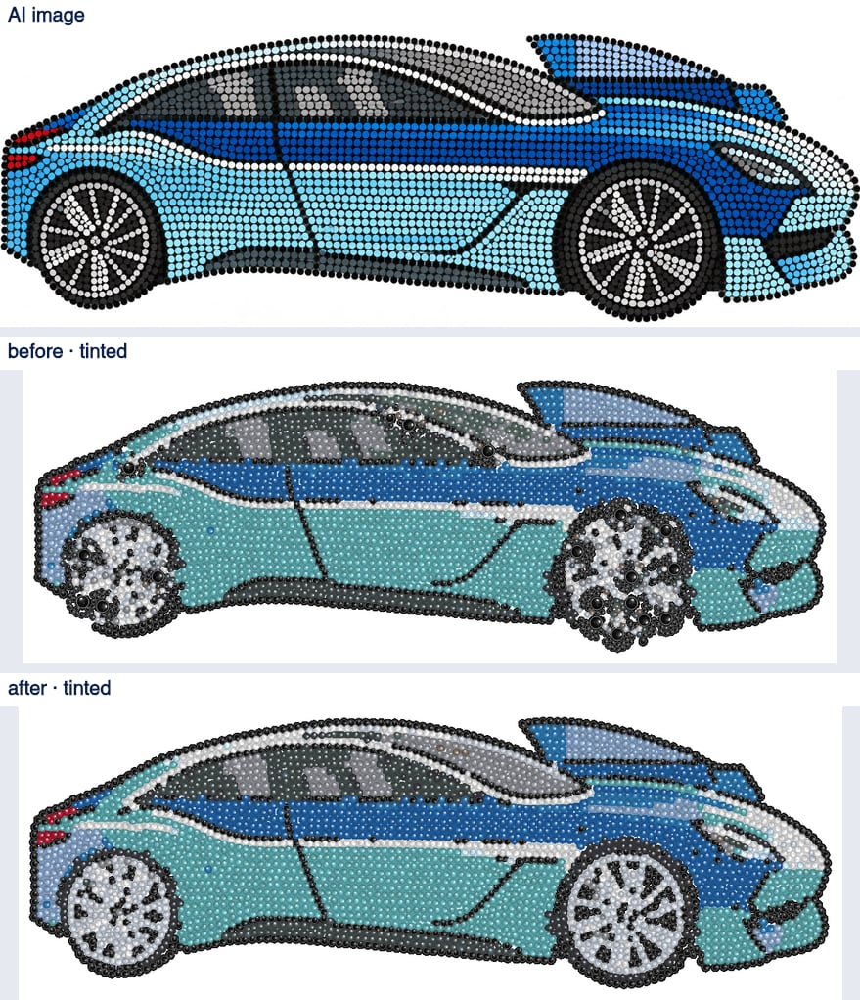

Rear wheel (before plain, before tinted, after plain, after tinted, 14 px per mm):

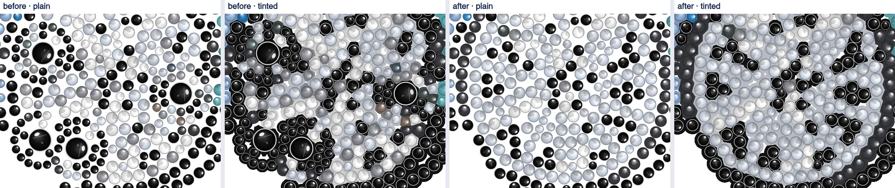

Front wheel:

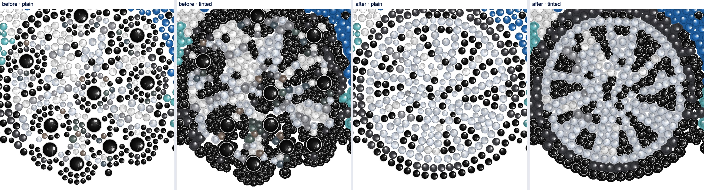

After the change the wheels read as wheels: a dark tyre, light spokes and dark gaps between them,
as in the AI image. The body colour (teal for light blue) is the first-pick issue of section 2
and is unchanged.

### Unchanged designs

`default` (with the rule) against the RS rules, stone for stone:

| Design | face | pupils | identical |
| --- | --- | --- | --- |
| IS-03b dog-rule, dog-norule | human | 2 | yes |
| IS-03b cat-rule, cat-norule | animal | 2 | yes |
| IS-03b dachshund-rule | animal | 2 | yes |
| IS-03b mug-rule, mug-norule | animal | 0 | yes |
| RS cat, dog, leopard | animal | 2 | yes |
| RS einstein, portrait, woman | human | 2 | yes |
| RS jesus, parrot | animal | 1 | yes |
| RS lake | human | 0 | yes |
| RS logo, rose, tulips | animal | 0 | yes |
| IS-03b car-rule | animal → null | 19 → 0 | no (above) |
| **IS-03b giraffe-rule** | animal → null | 4 → 0 | **no** (below) |

The only change in their reports is the new `pupilsAtMm` key.

### Giraffe (not in the brief, affected by the rule)

The giraffe reported 4 pupils: SS20 on an ossicone, SS16 on the neck, and SS16 + SS10 at the two
eyes. With the rule it has no eye stage: 2314 → 2274 service stones, and the eyes are plain small
jet stones.

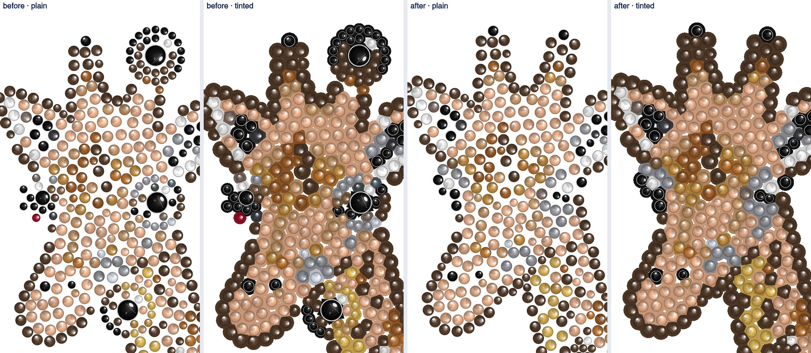

The false pupils on the ossicone and the neck are gone, which is cleaner, but the eyes lose their
large pupil and catch-light. The two real eyes (ratio 1.43, level, 21 mm apart) would pass as a
plausible pair. A possible refinement is to keep the best plausible pair when more than two
pupils are found, instead of none. It is not implemented, because the brief says more than two
means no face. Alex to decide.

## 5. Changes made

- `tools/tinted-comparison.mjs`, `docs/IS-05-tinted-comparison*`: AI column (docs only).
- Service (`services/strass`, recorded in `ORIGIN.md` as divergences from RS 38cd831): rule
  `plausible_eyes` (on in `DEFAULT`), `_plausible_pupils` in `post.py`, `report.pupilsAtMm`,
  `report.face` may be `null`; contract test, README, new `tests/test_is05b.py`; diagnosis script
  `scripts/is05b_runs.py`.
- IS: `capStoneSizes(stones, pupils)` and `pupilCentres(layout)` in `src/pipeline/tiers.js`, used
  by `naturalLayout` and `cleanedLayout`; test in `tools/test-pipeline-parts.mjs`; spec D2 and
  7.5.
- Diagnosis tools: `tools/colour-diff.mjs` (Lab, ΔE2000), `tools/is05b-measure.mjs`,
  `tools/is05b-results.mjs`.
- Colour rule defaults: **unchanged**, as asked.
