# IS-05b — colour, eyes and non-face subjects

19 Oct 2026, branch `is-05b-quality`. No provider call: everything below is made from the saved AI
images (the 12 RS test images, which are themselves model outputs, and the IS-03b provider outputs
of 18 Oct) and the strass service run locally.

How to reproduce (the IS-03b AI images are the fixtures in `tools/fixtures/is03b-ai/`):

```
# layouts with rule variants, plus each stone's colour after every colour step (services/strass)
.venv/bin/python scripts/is05b_runs.py <runs> <variants> <name>=<AI png> ...
# images and numbers (docs/IS-05b-results/, numbers.json); IS05B_PARTS picks the parts
node tools/is05b-results.mjs <runs> [<runs of the first IS-05b service>]
# the gap-rule tuning of section 6.4 (docs/IS-05b-results/tint-tune.json)
node tools/is05b-tint.mjs <runs>
# the comparison document with the AI column
node tools/tinted-comparison.mjs <runs>
# section 7 (second follow-up): needs the "default-no-sample" and "default" runs
node tools/is05b-followup2.mjs <runs>
```

Sections 1 to 5 are the first IS-05b round, as written then (old renderer, RS colour rules).
**Section 6** is the follow-up on Alex's decisions: soft outlines off, the tinted renderer
revised, the giraffe's eyes kept, and the before/after numbers. **Section 7** is the second
follow-up (20 Oct 2026): colours read at the delivered stones, the stones' central highlight held
to their colour, 8 L\* gaps on near-white, renders off the main thread, and the leak test.

Re-running the service with the RS 38cd831 rules on a saved AI image reproduces the saved layout
exactly (checked on all 21 designs: 6 below plus 15 in section 4), so the runs below compare like
with like.

## Summary

| Question | Answer |
| --- | --- |
| Where does the colour drift come from? | Two places, about equally. **The tinted renderer** is the biggest single stage on woman, leopard and dog (+4 to +6 ΔE). **The service's first colour pick** (its own sampling and `snap_colours` penalties, not a rule) is the biggest on car and portrait (+2 to +4 ΔE). The tone-separation step adds 0.1–0.4. |
| Which colour rules to keep? | All except `soft_outlines` (recommended set below). No rule is a big lever: switching any one off moves the mean ΔE by at most 0.7. **Defaults not changed.** |
| Eyes: no cap or SS16? | No cap is clearly better (woman, dog). **Implemented:** a face's two pupils may stay SS20. Portrait's pupils are SS10, so its eyes are not a size problem (see 3). |
| Non-face subjects | **Implemented** in the service (`plausible_eyes`). Car: wheels now read as wheels; cleanup removes 0 stones instead of 79; service violations 148 → 0. Unchanged stone for stone: dog, cat, all 12 RS layouts and every other IS-03b design except the giraffe. |

## 1. Comparison with the AI image

[`IS-05-tinted-comparison.md`](IS-05-tinted-comparison.md) now shows four columns per row:
original, AI image, plain stones, tinted. The AI column is docs only (spec D4: the app never shows
it). On the RS rows the original *is* the AI image (the RS test images are model outputs; there is
no other original), so columns 1 and 2 match there.

## 2. Colour diagnosis

### Method

For every delivered stone (after the SS16 cap and the overlap cleanup), the AI image colour under
the stone is the mean CIE Lab of the opaque pixels within 60 % of the stone's radius
(`tools/is05b-measure.mjs`). Its CIE ΔE2000 (kL = kC = kH = 1; checked against skimage to 3·10⁻⁵)
is measured to:

- **(a)** the nearest catalogue colour (plain ΔE2000 over all 47 catalogue fills): the best the
  catalogue allows;
- **(b)** the colour the service assigned (its catalogue fill);
- **(c)** the stone as rendered in the tinted view (mean Lab of the inner 60 % of the rendered
  disc, at 24 px per mm);
- **(t)** for reference, the tint painted around the stone (fill × 0.85, spec 8 step 3).

Designs: RS portrait, woman, leopard; IS-03b car; IS-03b dog and cat (the `-rule` designs of the
IS-05 eye close-ups) as controls.

### Per stage

Mean / 90th percentile ΔE2000:

| Design | Stones | (a) nearest | (b) assigned | (c) rendered | (t) tint | (a) ≠ (b) |
| --- | --- | --- | --- | --- | --- | --- |
| portrait | 3995 | 5.7 / 10.3 | 8.2 / 15.5 | 9.5 / 16.5 | 10.8 / 18.3 | 1033 |
| woman | 2612 | 6.4 / 10.5 | 7.7 / 12.0 | **13.7 / 20.1** | 9.3 / 15.8 | 497 |
| leopard | 2431 | 5.1 / 10.4 | 5.9 / 10.8 | **9.8 / 17.9** | 7.8 / 16.1 | 343 |
| car | 3629 | 6.7 / 12.3 | **11.2 / 17.5** | 13.7 / 22.2 | 12.7 / 20.9 | 959 |
| dog (control) | 2049 | 7.2 / 13.0 | 7.8 / 13.4 | **11.9 / 24.4** | 11.0 / 15.2 | 352 |
| cat (control) | 3573 | 5.6 / 9.6 | 6.4 / 10.5 | 7.4 / 13.9 | 9.4 / 15.0 | 520 |

Drift added by each stage (mean ΔE): service (a → b) / renderer (b → c):

| | portrait | woman | leopard | car | dog | cat |
| --- | --- | --- | --- | --- | --- | --- |
| service | **+2.5** | +1.3 | +0.8 | **+4.5** | +0.6 | +0.8 |
| renderer | +1.3 | **+6.0** | **+3.9** | +2.5 | **+4.1** | +1.0 |

**Which stage causes most of the drift:** the renderer on woman, leopard and dog; the service on
car and portrait. Over the four designs Alex flagged, the two are about equal: service +2.3,
renderer +3.4 on average.

### Inside the service

`scripts/is05b_runs.py` records each stone's colour after every colour step. Mean ΔE from the AI
colour, after each step (the step's number of changed stones in brackets):

| Design | (a) | first pick | darkdots | family fix | distinct tones | skin nearest | soft outlines | calm skin = (b) |
| --- | --- | --- | --- | --- | --- | --- | --- | --- |
| portrait | 5.7 | **7.65** | 7.83 (29) | 7.83 | 8.23 (354) | 8.09 (301) | 8.25 (44) | 8.23 (40) |
| woman | 6.4 | **7.14** | 7.19 (2) | 7.19 | 7.23 (45) | 7.01 (166) | **7.72** (94) | 7.73 (28) |
| leopard | 5.1 | **5.86** | 5.86 | 5.86 | 5.95 (278) | 5.87 (77) | 5.87 | 5.87 (2) |
| car | 6.7 | **10.78** | 10.82 (3) | 10.82 | 11.24 (409) | 11.24 | 11.24 | 11.24 |
| dog | 7.2 | **7.67** | 7.67 | 7.67 | 8.02 (350) | 7.65 (405) | 7.76 (11) | 7.76 (25) |
| cat | 5.6 | **6.22** | 6.23 (2) | 6.23 | 6.37 (167) | 6.35 (76) | 6.35 | 6.35 (1) |

The **first pick** (the colour each stone gets from `stone_colours` + `snap_colours` before any
rule runs) is most of the service's drift on every design: 2.0 of portrait's 2.5 and 4.1 of the
car's 4.5. Its most frequent changes from the nearest colour:

- **car**: crystal → aquamarine 73, jet → hematite 60, light-sapphire → sapphire 57,
  jet → aquamarine 47, light-sapphire → aquamarine 40, hematite → jet 38. The AI's light blue
  becomes aquamarine; `snap_colours` blocks the neutral colours for any sample with chroma ≥ 18
  and penalises catalogue colours less saturated than the sample. That is the car's teal body.
- **portrait**: crystal-clear → silk 160, jet → graphite 78, jet → hematite 48, jet → grey 44.
  The skin highlights and the outlines lose contrast.
- **woman**: silk → rose-gold 182, rose-gold → copper 74, colorado-topaz → smoked-topaz 65. The
  skin is pushed one step darker and redder.

These are not rules in `rules.py`, so switching rules off cannot fix them (next section).

### The 10 most frequent changes from (a) to (b)

- **portrait**: crystal-clear → silk 160, grey → silver 101, jet → graphite 80, jet → smoked-topaz 61, jet → hematite 46, graphite → grey 45, jet → grey 44, silk → light-peach 40, grey → greige 28, silk → golden-shadow 27
- **woman**: silk → rose-gold 144, jet → smoked-topaz 103, colorado-topaz → smoked-topaz 78, rose-gold → copper 63, copper → colorado-topaz 42, hematite → jet 18, rose-gold → colorado-topaz 11, silk → golden-shadow 7, jet → crystal-clear 3, crystal-clear → grey 3
- **leopard**: light-topaz → gold 122, crystal-clear → silver 28, gold → metallic-sunshine 26, colorado-topaz → smoked-topaz 19, crystal-clear → silk 19, jet → smoked-topaz 17, silver → crystal-clear 11, hematite → jet 10, jet → hematite 9, light-topaz → metallic-sunshine 7
- **car**: hematite → jet 98, crystal → aquamarine 73, silver → crystal-clear 67, grey → black-diamond 58, jet → hematite 58, silver → grey 49, jet → aquamarine 47, graphite → jet-hematite 41, light-sapphire → aquamarine 40, jet → silver 34
- **dog**: jet → smoked-topaz 100, golden-shadow → light-colorado 53, light-colorado → copper 27, silk → golden-shadow 21, light-colorado → golden-shadow 11, grey → silver 10, colorado-topaz → smoked-topaz 10, copper → colorado-topaz 9, silver → grey 8, copper → light-colorado 8
- **cat**: crystal-clear → silver 150, silver → grey 34, grey → greige 25, grey → silver 21, silver → crystal-clear 17, grey → graphite 16, crystal-clear → grey 15, light-smoked-topaz → smoked-topaz 15, grey → golden-shadow 14, greige → grey 14

### The renderer

The renderer's own fidelity, measured on a patch of 36 SS6 stones per colour
(`numbers.json` → `renderer`): it **lifts dark stones and darkens light cells**, compressing the
contrast:

| Colour | fill L\* | stone L\* (rendered) | cell L\* (stone + tint) | ΔE fill → stone |
| --- | --- | --- | --- | --- |
| jet | 6 | 18 | 23 | 7.2 |
| indian-siam | 19 | 35 | 23 | 13.0 |
| hematite | 27 | 42 | 30 | 12.8 |
| smoked-topaz | 29 | 43 | 32 | 11.9 |
| graphite | 41 | 52 | 38 | 10.8 |
| copper | 55 | 61 | 48 | 7.7 |
| rose-gold | 66 | 68 | 55 | 5.1 |
| silk | 77 | 77 | 70 | 4.3 |
| silver | 88 | 85 | 77 | 2.0 |
| crystal-clear | 97 | 91 | 78 | 3.5 |

Across all 47 colours, the rendered stone is 10–16 L\* lighter than the fill for every colour
below L\* 45, and the 85 % tint takes 8–19 L\* off every colour above L\* 60. So dark hair and
outlines turn grey-brown, and light skin turns mid-brown. That is the woman's dark look
(`colours-woman.jpg` below). The renderer and the tint are spec section 8 and were unchanged in
this round; section 6.4 revises them.
They are a separate lever (tint brightness, or how the faceted renderer shades dark colours),
for Alex to decide.

### Rules switched off one at a time

Each run re-lays out the saved AI image with one colour rule of `strass_layout/rules.py` off (the
RS 38cd831 rules otherwise). Mean ΔE (b) assigned / (c) rendered, with the number of stones whose
colour changed in brackets; "=" means identical to today, stone for stone:

| Rule off | portrait | woman | leopard | car | dog | cat |
| --- | --- | --- | --- | --- | --- | --- |
| *none (today)* | 8.23 / 9.52 | 7.73 / 13.68 | 5.87 / 9.82 | 11.24 / 13.65 | 7.76 / 11.92 | 6.35 / 7.42 |
| extra_colours | = | = | = | = | = | = |
| mean_colour | 8.49 / 9.84 (318) | 7.72 / 13.64 (14) | 5.91 / 9.78 (395) | **10.99** / 13.56 (431) | 7.73 / 11.83 (48) | **6.18** / 7.22 (379) |
| real_colours | = | = | = | = | = | = |
| more_colours | 9.41 / 10.31 (1863) | 8.20 / 13.94 (262) | 6.37 / 10.17 (314) | 12.47 / 14.49 (466) | 8.71 / 12.52 (495) | 7.30 / 7.95 (720) |
| skin_no_wine | 8.23 / 9.52 (2) | 7.73 / 13.68 (1) | = | = | = | = |
| soft_outlines | **8.06** / 9.28 (44) | **7.02** / 12.91 (94) | = | = | **7.66** / 11.81 (11) | = |
| calm_skin | 8.25 / 9.54 (40) | 7.72 / 13.67 (28) | 5.87 / 9.83 (2) | = | 7.76 / 11.91 (25) | 6.35 / 7.42 (1) |
| skin_nearest | 8.40 / 9.74 (277) | 7.95 / 13.81 (163) | 5.95 / 9.93 (75) | = | 8.13 / 12.18 (410) | 6.37 / 7.45 (76) |
| *all eight* | 10.58 / 11.08 (2632) | 8.60 / 13.45 (953) | 9.22 / 11.63 (986) | 13.08 / 15.16 (1866) | 11.76 / 11.91 (1704) | 7.67 / 8.14 (1182) |

Notes:

- `extra_colours` and `real_colours` have no effect while `more_colours` is on (`palette()` then
  ignores them). They are dead flags in the shipped rules.
- `mean_colour` also changes the geometry slightly (woman +1 stone, portrait +1), because the
  ordered layout uses the colour.
- (c) is measured on each run's own render, so it also moves with (b).

A/B images: the AI image (cropped to the stones), today's tinted view, then the tinted view with
each rule off. Rules that change nothing are left out.

#### portrait


#### woman


#### leopard


#### car


#### dog


#### cat


### Recommended rule set (applied in the follow-up, section 6.2)

**Today's rules with `soft_outlines` off.** It is the only rule whose removal lowers ΔE on the
designs where it acts (woman −0.71, portrait −0.17, dog −0.10) and it changes nothing elsewhere.
On the woman it turns 94 black outline stones on the skin into smoked topaz, which the AI drew
black. Keep `more_colours` (removing it costs 0.5–1.2 everywhere), `skin_nearest` (costs
0.02–0.37) and `mean_colour` (mixed: helps car and cat by 0.2, costs portrait 0.26; small either
way). `calm_skin` and `skin_no_wine` are neutral; keep them.

That set moves the flagged designs by less than 1 ΔE. The large gains are elsewhere, and both
are outside `rules.py`:

1. the renderer's dark lift and 85 % tint (spec section 8): woman, leopard, dog;
2. the first pick's neutral block and chroma penalty in `snap_colours`: car (light blue →
   aquamarine) and portrait (highlights → silk, outlines → graphite/grey).

Both need a decision from Alex before anyone touches them.

## 3. Eyes

Close-ups at 30 px per mm, plain and tinted. (a) is the service's answer with no size cap; (b)
is today's SS16 cap. The middle option, "pupils SS20", is what IS now does.

| Design | report.face | Service pupils | (a) | SS20 rule | (b) SS16 |
| --- | --- | --- | --- | --- | --- |
| woman | human | 6.32 mm ×2 | SS30 | SS20 | SS16 |
| portrait | human | 3.46 mm ×2 | SS10 | SS10 | SS10 |
| dog | human (dlib fires on the dog) | 7.6 mm ×2 | SS30 | SS20 | SS16 |

### woman


### dog


### portrait


**(a) is clearly better.** The service keeps a gap around each pupil that fits its full size.
Capped to SS16, the pupil sits small in the middle of that gap: in plain stones it looks lost,
and in the tinted view the gap is painted black around it, so the eye becomes a black octagon
with a small stone inside. The SS20 rule halves that ring; at SS30 there is none.

**Implemented** (spec D2 and 7.5 updated): when `report.face` is set and exactly two pupils are
reported in the new `report.pupilsAtMm`, the stones at those centres are capped at SS20 instead
of SS16 (an SS30 pupil becomes SS20). Every other stone above SS16 is still capped at SS16. A
layout without `pupilsAtMm` (every saved one) keeps the SS16 cap. The cap only shrinks stones,
so it adds no overlap. On all 21 re-run designs (the 12 RS layouts and the 9 IS-03b designs) the
gap check passes with 0 cleanup removals. 11 designs now keep two SS20 pupils. RS Jesus and parrot
(one pupil each) still have their pupil capped to SS16.

**Portrait (open):** its pupils are SS10, so no cap touches them. The problem is colour: the eye
area is grey and silver patches (iris and eye-white stones snapped to grey/silver/hematite), and
the skin around them is light. The size rule cannot help it. It belongs with the first-pick
question above.

## 4. Non-face subjects

**Rule** (`plausible_eyes`, in IS's strass copy, on by default): after the service's pupil search,
the pupils must be **at most two**. Two pupils must be **one plausible pair**:

- diameters within a factor 1.6 (before the service equalises them; that is the service's own
  equalising limit);
- vertical offset at most half the horizontal one (about 27°);
- centres at most 0.45 × the subject mask's width apart.

Otherwise the design has no face: no pupil, catch-light, iris or lash stone is placed,
`soften_outlines` does not run, `report.face` is `null` and `pupilsMm` is empty.

The thresholds come from the 11 two-pupil designs on hand: equalised size ratio always 1.0, dy/dx
at most 0.17, distance at most 0.32 × width. Each threshold has margin over every real face.

### Car

| | before (RS rules) | after |
| --- | --- | --- |
| report.face / pupils | animal / 19 | null / 0 |
| service stones / violations | 3716 / 148 | 3531 / 0 |
| SS16-capped stones | 15 | 0 |
| **removed by the cleanup** | **79 (2.1 %)** | **0** |
| delivered stones | 3637 | 3531 |
| coverage after the cleanup | 0.624 | 0.626 |
| ΔE (b) / (c) | 11.24 / 13.65 | 9.38 / 12.44 |

The 19 "pupils" were the wheel spokes' dark gaps (15), plus 4 on the windows and the roof. Each
got an SS20 jet stone with rings of SS4 around it, which crowded the spokes. That is where the 148
violations and the 79 cleanup removals came from.


Rear wheel (before plain, before tinted, after plain, after tinted, 14 px per mm):


Front wheel:


After the change the wheels read as wheels: a dark tyre, light spokes and dark gaps between them,
as in the AI image. The body colour (teal for light blue) is the first-pick issue of section 2
and is unchanged.

### Unchanged designs

`default` (with the rule) against the RS rules, stone for stone:

| Design | face | pupils | identical |
| --- | --- | --- | --- |
| IS-03b dog-rule, dog-norule | human | 2 | yes |
| IS-03b cat-rule, cat-norule | animal | 2 | yes |
| IS-03b dachshund-rule | animal | 2 | yes |
| IS-03b mug-rule, mug-norule | animal | 0 | yes |
| RS cat, dog, leopard | animal | 2 | yes |
| RS einstein, portrait, woman | human | 2 | yes |
| RS jesus, parrot | animal | 1 | yes |
| RS lake | human | 0 | yes |
| RS logo, rose, tulips | animal | 0 | yes |
| IS-03b car-rule | animal → null | 19 → 0 | no (above) |
| **IS-03b giraffe-rule** | animal → null | 4 → 0 | **no** (below) |

The only change in their reports is the new `pupilsAtMm` key.

### Giraffe (not in the brief, affected by the rule)

The giraffe reported 4 pupils: SS20 on an ossicone, SS16 on the neck, and SS16 + SS10 at the two
eyes. With the rule it has no eye stage: 2314 → 2274 service stones, and the eyes are plain small
jet stones.


The false pupils on the ossicone and the neck are gone, which is cleaner, but the eyes lose their
large pupil and catch-light. The two real eyes (ratio 1.43, level, 21 mm apart) would pass as a
plausible pair. A possible refinement is to keep the best plausible pair when more than two
pupils are found, instead of none. It is not implemented, because the brief says more than two
means no face. Alex to decide. (Decided and implemented in section 6.5.)

## 5. Changes made

- `tools/tinted-comparison.mjs`, `docs/IS-05-tinted-comparison*`: AI column (docs only).
- Service (`services/strass`, recorded in `ORIGIN.md` as divergences from RS 38cd831): rule
  `plausible_eyes` (on in `DEFAULT`), `_plausible_pupils` in `post.py`, `report.pupilsAtMm`,
  `report.face` may be `null`; contract test, README, new `tests/test_is05b.py`; diagnosis script
  `scripts/is05b_runs.py`.
- IS: `capStoneSizes(stones, pupils)` and `pupilCentres(layout)` in `src/pipeline/tiers.js`, used
  by `naturalLayout` and `cleanedLayout`; test in `tools/test-pipeline-parts.mjs`; spec D2 and
  7.5.
- Diagnosis tools: `tools/colour-diff.mjs` (Lab, ΔE2000), `tools/is05b-measure.mjs`,
  `tools/is05b-results.mjs`.
- Colour rule defaults: **unchanged**, as asked.

## 6. Follow-up: Alex's decisions (19 Oct 2026)

Same rules as before: no provider call. Every layout below was made again by the strass service
from its saved AI image (`scripts/is05b_runs.py`), and every image was rendered by IS.

### 6.1 Fixtures

The nine IS-03b AI images are now test fixtures in `tools/fixtures/is03b-ai/`. They come from CC0
photos, and their sources are listed in the README there. Each PNG carried a C2PA metadata chunk
naming the provider, so every ancillary chunk was stripped before the commit. The decoded pixels
are unchanged: the car re-runs to the same layout stone for stone. The copies of the nine layouts
that came with them were byte-identical to `tools/fixtures/is03b*/`, so they were not added.
`tools/tinted-comparison.mjs` and `tools/is05b-results.mjs` now read the images from the fixture
folder and need no work dir.

### 6.2 Soft outlines off

`soft_outlines` is now off in the service's `DEFAULT` (recorded in `services/strass/ORIGIN.md`).
It only changes the colours of outline stones on human faces. Mean ΔE (b), RS rules → today:
woman 7.73 → 7.02, portrait 8.23 → 8.06, dog 7.76 → 7.66. On einstein, lake and dog-norule it
changes 30, 20 and 6 stones. Nothing else changes.

### 6.3 First colour pick: the hex values do not differ

- **The prompt** gives the AI each catalogue colour's `previewColor`, which `CrystalColors.js`
  sets equal to `fill`.
- **The service** matches against `fill`. `DEFAULT` has `more_colours` and `skin_no_wine`, so
  `palette()` returns `PLUS_REAL_SKIN`, whose fills come from `fill` (real colours). The
  `prototypeFill` values (17 colours) are used only by the BASE/FULL palettes of the prototype and
  builds E–F. Every `snap_colours` call in the service (first pick, eye stones, gap check,
  distinct tones) uses `palette(rules)`.
- The service's `catalogue.json` and IS's catalogue have the same 47 ids, and every `fill` equals
  the prompt's hex.

So nothing was changed (as asked). **What else causes the drift.** Three experiments changed only
the first pick (`rs-pick-*` in `is05b_runs.py`, RS rules otherwise). Mean ΔE from the AI colour:

| Design | (a) nearest | first pick, today | no penalties (plain nearest) | sampled as measured (inner 60 % mean) | both |
| --- | --- | --- | --- | --- | --- |
| portrait | 5.66 | 7.65 | 7.49 | 7.72 | 7.51 |
| woman | 6.36 | 7.14 | 7.13 | 6.69 | 6.68 |
| leopard | 5.12 | 5.86 | 5.81 | 5.94 | 5.74 |
| car | 6.66 | 10.78 | 10.73 | 10.74 | 10.69 |
| dog | 7.24 | 7.67 | 7.63 | 7.61 | 7.56 |
| cat | 5.59 | 6.22 | 6.22 | 6.05 | 6.01 |

`snap_colours`' penalties and blocks and the sampling rule explain at most 0.5 of the gap (woman
0.46, portrait 0.16, car 0.09). What is left:

1. **Position.** The first pick reads each colour at the stone's *detection*. The ordered layout
   then delivers the stone in its row, sometimes elsewhere. On the car, 18 % of the delivered stones
   are more than 0.5 mm from their detection (90th percentile 0.96 mm), and the AI colour there
   differs from the colour at the detection by ΔE 3.3 on average. That matches the 3.5 the car
   keeps after both experiments (10.14 on detected stones vs 6.66). Portrait: 10 % of stones over
   0.5 mm, ΔE 1.3 between the two places, against 1.6 left. On woman, leopard, dog and cat fewer
   than 3 % of the stones move that far (ΔE 0.5–0.7).
2. **Filled stones.** Stones the service adds to fill holes take the colour of the nearest
   detection, not their own pixels: ΔE 14–65 on average (car 88 stones at 32, portrait 31 at 34,
   leopard 10 at 64). They are few, so they add 0.1–0.6 to the mean.

The lever would be to sample the AI image at each delivered stone's own position (and fill
stones at theirs) after the layout. That is a change in the service's ordered layout, outside
this item's scope, so it was not made. **Stopped here, as asked.**

### 6.4 Tinted renderer (spec section 8, IS code only)

`src/render/tinted.js`; the RS file `CrystalStoneRenderer.js` is unchanged.

**Stones.** After the faceted stones are drawn, each stone's mean L\* (over the pixels whose centre
lies inside its disc) is brought to within 2 of its catalogue fill's L\*. A stone that is too light
has its linear RGB scaled down; one that is too dark is screened towards white. Either way the
facets, highlights and sparkle keep their relative contrast. A stone already within 2 is left as
drawn, so the per-stone brightness variety stays. Test: every stone of every colour, at 6 and 16
px per mm, is within 2.5 L\* (2 plus 8-bit rounding; the brief allows 3). The facet spread (5th to
95th percentile L\* inside a stone) is still 9 for crystal and 27–54 for the other colours.

Renderer fidelity on the IS-05b patch (36 SS6 stones per colour). The stone column is the
**inner 60 %** of the disc, the measure of section 2's (c):

| Colour | fill L\* | stone L\* before / after | cell L\* before / after | ΔE fill → stone before / after |
| --- | --- | --- | --- | --- |
| jet | 6 | 18 / 7 | 23 / 14 | 7.2 / 0.6 |
| indian-siam | 19 | 35 / 32 | 23 / 20 | 13.0 / 11.1 |
| hematite | 27 | 42 / 40 | 30 / 27 | 12.8 / 10.4 |
| smoked-topaz | 29 | 43 / 41 | 32 / 30 | 11.9 / 11.0 |
| graphite | 41 | 52 / 52 | 38 / 38 | 10.8 / 10.7 |
| copper | 55 | 61 / 62 | 48 / 51 | 7.7 / 9.0 |
| rose-gold | 66 | 68 / 71 | 55 / 62 | 5.1 / 7.7 |
| silk | 77 | 77 / 81 | 70 / 73 | 4.3 / 7.8 |
| silver | 88 | 85 / 90 | 77 / 83 | 2.0 / 2.4 |
| crystal-clear | 97 | 91 / 97 | 78 / 92 | 3.5 / 0.1 |

**Read this with care.** The rule holds the *whole* stone's mean L\* to the catalogue. The RS
renderer puts its highlight in the inner part of the stone and darkens the rim. So the inner 60 %
of a mid-dark stone still reads about 13 L\* light (hematite 40 against 27) while the whole stone
averages 27–29. Only jet was lifted as a whole stone (by its light rim and highlights), and only
jet is fixed on both measures. Holding the inner 60 % to the catalogue instead would make whole
mid-dark stones darker than their colour. I kept the whole-stone reading, which is what "a stone's
average" means; **Alex to confirm.** The cell (stone + gap) is now within 5 L\* of the fill for
every colour above, against 8–19 before.

**Gaps.** The flat 85 % is replaced by a darkening in CIE L\*. The fill's linear RGB is scaled so
the gap is darker by `minStep + slope · max(0, L − fromL)` L\* (hue kept), with `darkBelow`: fills
darker than that get a gap lighter by `minStep` instead. 8-bit rounding never reduces the step.

Tuning (`tools/is05b-tint.mjs`, `tint-tune.json`): the downsampled tinted render against the AI
image on the 21 designs (today's layouts), in 2 mm cells. Mean ΔE2000 per design, then the mean
over the designs. **The AI cell is the mean colour of the AI's stones** (pixels within 80 % of a
stone's radius), not of everything it drew. Most AI images ignore the prompt and paint the gaps
opaque and dark: mug, gap L\* 14 between stones of L\* 78; portrait, 23 between 53; car, 31
between 47. Compared with those, darker tints always "win" (the first pass, on all opaque pixels,
put its best rule at the edge of the grid). That is the AI's artefact, not a colour of the design.

| Gap rule | mean cell ΔE |
| --- | --- |
| no darkening (gaps invisible; not allowed) | 8.50 |
| **4 L\* + 0.05 per L\* above 80 (chosen, best of the grid)** | **8.66** |
| flat 4 L\* | 8.67 |
| 4 L\* + 0.2 per L\* above 40 | 9.25 |
| flat 6 / flat 8 L\* | 8.77 / 8.90 |
| 4 L\*, very dark fills (L\* < 12 or < 20) lighter by 4 | 9.23 / 9.23 |
| 85 % (before), same stones | 9.25 |

Grid: minStep 4, 5, 6, 8; slope 0–0.4; fromL 0–80; darkBelow 0, 8, 12, 16, 20; 720 rules. Only
rules whose every gap is at least 4 L\* darker (or lighter) were eligible.

The tuning says: darken as little as the visibility limit allows. A darkening that grows with
lightness does not help (the chosen rule beats flat 4 by 0.007; crystal's gap gets 4.9 L\*, every
fill of L\* 80 or below gets 4). Lightening the gaps of jet costs 0.6, because jet is common and its
grey gaps show. Gap steps over the 47 colours: 4.0 to 5.6 L\* darker (jet 4.1, crystal 4.9).

Fill reach, with the chosen rule (same cells): 1.4 → 9.12, 1.5 → 8.80, **1.6 → 8.66**,
1.7 → 8.60, 1.8 → 8.58. The gain beyond 1.6 is under 0.1, not a clear signal, so the reach stays
1.6.

Spec section 8 is updated with the final rule (steps 3 and 6).

### 6.5 Giraffe: the one plausible pair is kept

**Rule** (`_plausible_pupils` in `post.py`): with more than two pupils, every pair is put to the
pair test. If **exactly one** pair passes, it is kept and the other pupils are laid out as ordinary
stones. If none or several pass, there is no face. (Alex chose "exactly one" over "the best pair",
because the car's 19 wheel "pupils" give 31 passing pairs, and "the best pair" would put two SS20
pupils on one wheel.)

Giraffe: 4 candidates (5.56 mm on an ossicone, 3.96 on the neck, 3.95 and 3.34 at the eyes). Only
the eyes pass (ratio 1.18, level, 21 mm apart). Today it has `face` animal and two 3.65 mm pupils
(SS20 after the cap, 0 capped, 0 removed by the cleanup), 2286 service stones, 0 violations.

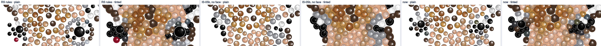

Unchanged elsewhere. Every design's layout today was compared with the first IS-05b service's,
which had soft outlines on:

| | stone positions and sizes | face, pupils | colours |
| --- | --- | --- | --- |
| giraffe | changed (above) | animal, 2 (was null, 0) | |
| the 12 RS layouts, the other 8 IS-03b designs incl. the car | identical | identical (car: still null, 0) | identical, except on the 6 human-face designs: soft outlines (6.2) |

On the 5 designs that have an "RS rules with soft outlines off" run (woman, portrait, leopard,
dog, cat), today's layout equals it stone for stone, so the only change there is 6.2.

### 6.6 Before and after

**Before** is the start of this branch: the saved layouts (RS 38cd831 rules) and the old renderer
(85 % tint, stones as drawn). **After** is today: the service with soft outlines off and the
pupil pair rule, and the revised renderer. **Layout only** is today's layout with the old
renderer.

Per stone (delivered stones; (a) nearest, (b) assigned, (c) rendered, inner 60 % of the disc as in
section 2), mean ΔE2000:

| Design | stones | (a) | (b) before / after | (c) before / after | (c) layout only | (c) p90 before / after |
| --- | --- | --- | --- | --- | --- | --- |
| woman | 2612 | 6.36 | 7.73 / 7.02 | 13.68 / **11.69** | 12.91 | 20.1 / 18.6 |
| portrait | 3995 | 5.66 | 8.23 / 8.06 | 9.52 / **8.25** | 9.28 | 16.5 / 16.0 |
| leopard | 2431 | 5.12 | 5.87 / 5.87 | 9.82 / **8.12** | 9.82 | 17.9 / 17.5 |
| car | 3531 | 6.73 | 11.24 / 9.38 | 13.65 / **11.14** | 12.44 | 22.2 / 18.9 |
| giraffe | 2282 | 10.22 | 11.21 / 11.10 | 14.59 / **13.37** | 14.60 | 22.4 / 21.5 |
| dog | 2049 | 7.24 | 7.76 / 7.66 | 11.92 / 12.13 | 11.81 | 24.4 / 23.3 |

The dog's (c) mean rises by 0.3 while its 90th percentile falls. Its jet and smoked-topaz stones
improve (−5.4 and −1.2 per stone). Its tan stones (golden shadow, light colorado, silk, copper)
now show their catalogue lightness, and the AI image is darker than the colours the service gave
them there. That is the service's pick ((b), section 6.3), which the renderer no longer hides.

Downsampled (2 mm cells, section 6.4's measure). "AI stones" is the AI's stone colours; "AI as
drawn" includes its painted gaps:

| Design | AI stones: before | layout only | after | AI as drawn: before | after |
| --- | --- | --- | --- | --- | --- |
| dog-rule | 11.0 | 11.0 | **9.5** | 7.6 | 8.6 |
| dog-norule | 10.8 | 10.8 | **9.2** | 7.6 | 7.7 |
| cat-rule | 8.5 | 8.5 | **6.1** | 6.0 | 8.0 |
| cat-norule | 8.5 | 8.5 | **6.5** | 8.2 | 10.8 |
| mug-rule | 10.2 | 10.2 | **6.0** | 13.2 | 18.2 |
| mug-norule | 10.1 | 10.1 | **6.6** | 12.5 | 17.0 |
| giraffe-rule | 13.9 | 13.9 | **11.8** | 10.6 | 9.3 |
| dachshund-rule | 11.2 | 11.2 | **10.7** | 10.7 | 10.3 |
| car-rule | 12.9 | 12.3 | **10.4** | 11.2 | 12.3 |
| rs-cat | 8.4 | 8.4 | **6.5** | 7.4 | 5.8 |
| rs-dog | 9.5 | 9.5 | **6.1** | 4.8 | 5.8 |
| rs-einstein | 10.4 | 10.3 | **9.0** | 8.9 | 8.0 |
| rs-jesus | 10.1 | 10.1 | **7.6** | 8.3 | 6.4 |
| rs-lake | 10.7 | 10.7 | **9.6** | 9.2 | 8.6 |
| rs-leopard | 11.3 | 11.2 | **9.0** | 9.0 | 7.3 |
| rs-logo | 11.4 | 11.4 | **6.2** | 10.7 | 5.9 |
| rs-parrot | 12.8 | 12.8 | **11.9** | 9.1 | 10.6 |
| rs-portrait | 10.4 | 10.3 | **7.7** | 9.6 | 10.4 |
| rs-rose | 11.7 | 11.7 | **11.5** | 11.5 | 11.4 |
| rs-tulips | 12.3 | 12.3 | **11.9** | 10.0 | 10.4 |
| rs-woman | 10.9 | 10.6 | **8.8** | 9.3 | 7.9 |
| **mean** | 10.8 | 10.7 | **8.7** | 9.3 | 9.5 |

Against the AI's stone colours, all 21 designs improve (mean 10.8 → 8.7). Nearly all of that is
the renderer; the layout changes add 0.05. Against the AI image as drawn, the mean goes from 9.3
to 9.5. It worsens most where the AI painted dark gaps: mug 13.2 → 18.2, cat-norule 8.2 → 10.8.
It improves where the AI's gaps are transparent: logo 10.7 → 5.9, woman 9.3 → 7.9.

Images: the AI image (cropped to the stones), before tinted, after tinted.

#### woman

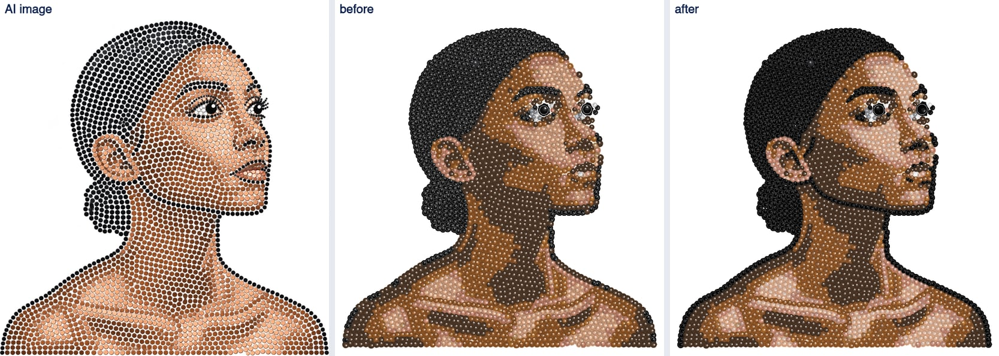

#### portrait

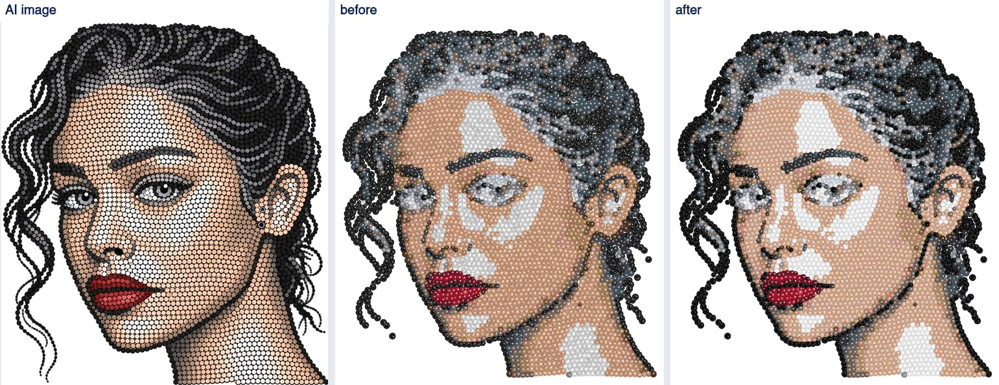

#### leopard

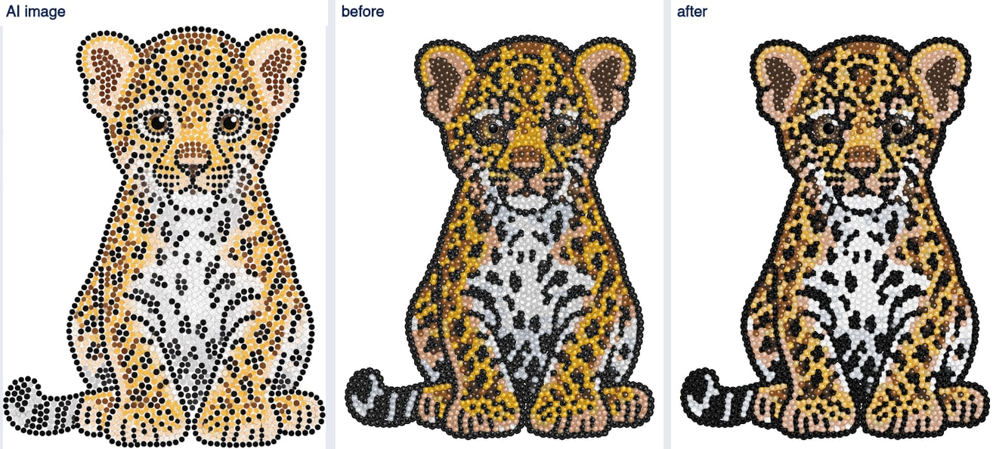

#### car

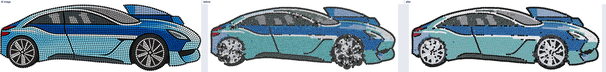

#### giraffe

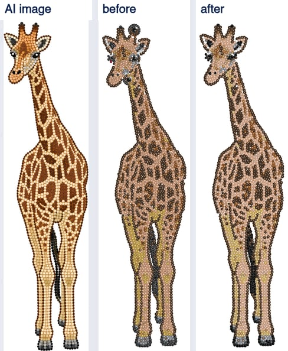

#### dog

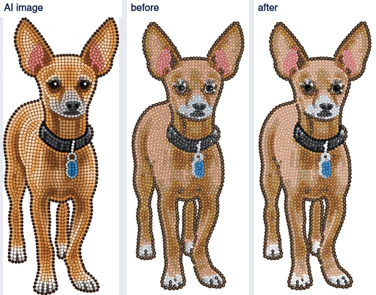

[`IS-05-tinted-comparison.md`](IS-05-tinted-comparison.md) is re-rendered with the final
settings: today's layouts and renderer, for all 21 designs.

### 6.7 Changes made in the follow-up

- `tools/fixtures/is03b-ai/`: the 9 AI images (metadata stripped) and a README with the sources.
- Service (`services/strass`, recorded in `ORIGIN.md`): `soft_outlines` off in `DEFAULT`;
  `_plausible_pupils` keeps the one plausible pair of more than two (`_plausible_pair`);
  `test_build_j.py` compares with `BUILD_I` with soft outlines off; tests in `test_is05b.py`;
  first-pick experiments in `scripts/is05b_runs.py`.
- IS: `src/render/tinted.js`: gap rule `GAP_RULE` (`gapRgb`), stone lightness step
  (`keepStoneLightness`, `STONE_L_TOLERANCE`), `nearestStones` split out; `TINT_BRIGHTNESS` is
  gone. Tests in `tools/test-exports.mjs`. Spec section 8 (steps 3 and 6, why) and 7.5 (the kept
  pair).
- Tools: `tools/is05b-tint.mjs` (the old renderer for before/after, the cell comparison, the grid
  search); `tools/is05b-measure.mjs` (the 21 designs, a pluggable renderer);
  `tools/is05b-results.mjs` (parts `picks`, `giraffe-eyes`, `unchanged`, `before-after`,
  `renderer-after`); `tools/tinted-comparison.mjs` (fixtures, runs dir).

## 7. Second follow-up: Alex's decisions (20 Oct 2026)

No provider call. Every layout below was made again by the strass service from its saved AI image
(`scripts/is05b_runs.py`, variants `default-no-sample` and `default`); numbers and images by
`tools/is05b-followup2.mjs` (`numbers-2.json`). The `default-no-sample` layouts are identical,
stone for stone, to the `default` layouts of section 6 on all 21 designs, so "before" below is the
start of this round.

### 7.1 Colours read at the delivered stones

**Change** (IS's strass copy, recorded in `services/strass/ORIGIN.md`): new rule `sample_delivered`,
on in `DEFAULT`, off in `PROTOTYPE` and the `BUILD_*` rules (so the equivalence test against the
prototype is unchanged). Each stone's colour is read from the AI image at its **delivered** position
after the ordered layout, from the **inner 60 % of its radius**, instead of at the detection it came
from; fill stones read their own pixels too, instead of the nearest detection's colour (first fill)
or their neighbours' most common colour (second fill). A tiled big stone's catch-light keeps its
colour. The keep-or-drop decisions still read the detections, so no stone moves.

**Why the inner 60 %.** The first version read the whole disc of the delivered stone (the rule the
detections are read with). That made the mug much worse: its AI image paints the gaps dark (L\* 14
between stones of L\* 78), and a full SS6 disc, larger than the stone the AI drew or moved off it,
reaches into them. Mean ΔE (b) / cells, on four designs:

| | at the detections (before) | whole disc | inner 60 % (chosen) | inner 80 % |
| --- | --- | --- | --- | --- |
| mug-rule | 3.25 / 6.40 | 7.14 / 10.08 | 3.22 / 6.36 | 3.27 / 6.39 |
| cat-rule | 6.35 / 6.25 | 7.29 / 6.88 | 6.29 / 6.45 | 6.36 / 6.39 |
| car-rule | 9.38 / 10.23 | 7.86 / 9.40 | 6.89 / 8.72 | 7.08 / 8.79 |
| rs-portrait | 8.06 / 7.77 | 6.84 / 7.62 | 6.71 / 6.81 | 6.62 / 6.82 |

(cells here with today's renderer.) 60 % and 80 % tie on the cells; 60 % is how this document reads
"the AI colour under a stone" (section 2).

**Unchanged** (`default-no-sample` against `default`, all 21 designs): stone positions and sizes,
`face`, `pupilsMm`, `pupilsAtMm`, `bySize`, `violations`, `coverage`, `minGapMm` and
`largestEmptyCircleMm` are identical on every design. Only colours change (column "colours changed"
below). Test: `tests/test_is05b.py` `SampleDelivered` (cat and woman).

**Per stone** (delivered stones, section 2's measures; (c) is the inner 60 % of the rendered stone).
"Before" is the layout before this round with the renderer before this round; "sampling only" is
the new layout with the same renderer; "after" is the new layout with today's renderer (7.2, 7.3):

| Design | stones | colours changed | (a) | (b) before / after | (c) before / sampling only / after | (c) p90 before / after |
| --- | --- | --- | --- | --- | --- | --- |
| dog-rule | 2049 | 38 | 7.24 | 7.66 / 7.58 | 12.13 / 12.08 / **9.83** | 23.3 / 16.8 |
| dog-norule | 2092 | 25 | 6.50 | 6.92 / 6.90 | 11.21 / 11.23 / **9.28** | 19.3 / 13.8 |
| cat-rule | 3573 | 445 | 5.59 | 6.35 / 6.29 | 7.06 / 6.78 / **5.85** | 12.8 / 9.9 |
| cat-norule | 3141 | 602 | 6.74 | 8.08 / 7.60 | 7.85 / 7.79 / **6.96** | 12.6 / 11.2 |
| mug-rule | 1751 | 17 | 3.18 | 3.25 / 3.22 | 4.25 / 4.25 / **3.87** | 14.5 / 12.2 |
| mug-norule | 2224 | 124 | 3.01 | 3.20 / 3.38 | 5.47 / 5.57 / **4.65** | 14.1 / 11.6 |
| giraffe-rule | 2282 | 82 | 10.22 | 11.10 / 10.93 | 13.37 / 13.31 / **11.98** | 21.5 / 17.3 |
| dachshund-rule | 1626 | 5 | 8.70 | 9.04 / 9.04 | 16.74 / 16.73 / **13.45** | 22.2 / 16.4 |
| car-rule | 3531 | 376 | 6.73 | **9.38 / 6.89** | 11.14 / 8.56 / **7.32** | 18.9 / 13.4 |
| rs-cat | 2150 | 68 | 4.88 | 5.50 / 5.40 | 8.82 / 8.71 / **6.81** | 15.8 / 11.3 |
| rs-dog | 1671 | 37 | 3.64 | 4.32 / 4.20 | 6.56 / 6.46 / **4.99** | 13.7 / 11.5 |
| rs-einstein | 3590 | 120 | 5.85 | 7.04 / 7.01 | 12.12 / 12.30 / **9.69** | 18.7 / 15.2 |
| rs-jesus | 3296 | 109 | 5.17 | 5.94 / 5.81 | 8.76 / 8.78 / **7.13** | 18.3 / 14.0 |
| rs-lake | 4087 | 547 | 7.71 | 8.59 / 8.53 | 13.16 / 12.67 / **10.36** | 24.2 / 19.1 |
| rs-leopard | 2431 | 169 | 5.12 | 5.87 / 5.56 | 8.12 / 7.67 / **6.68** | 17.5 / 14.9 |
| rs-logo | 833 | 30 | 3.42 | 3.57 / 3.42 | 5.43 / 5.49 / **4.18** | 11.0 / 7.4 |
| rs-parrot | 2542 | 239 | 8.64 | 9.35 / 8.99 | 13.51 / 12.83 / **11.68** | 18.8 / 17.1 |
| rs-portrait | 3995 | 420 | 5.66 | **8.06 / 6.71** | 8.25 / 6.42 / **6.02** | 16.0 / 10.8 |
| rs-rose | 1846 | 37 | 7.95 | 8.05 / 7.98 | 16.03 / 16.01 / **13.49** | 19.2 / 14.8 |
| rs-tulips | 2673 | 135 | 9.14 | 9.38 / 9.34 | 15.92 / 15.85 / **13.41** | 27.8 / 22.3 |
| rs-woman | 2612 | 10 | 6.36 | 7.02 / 7.01 | 11.69 / 11.67 / **9.84** | 18.6 / 15.4 |
| **mean** | | | 6.26 | 7.03 / 6.75 | 10.36 / 10.05 / **8.45** | |

The service's colours (b) improve or stay on 20 of 21 designs; mug-norule is 0.18 worse. Section
6.3 predicted the gain where stones move: the car (−2.5) and the portrait (−1.4) close most of
their gap to the nearest catalogue colour (a). Elsewhere few stones move, and the change is small.

**Downsampled** (2 mm cells against the AI's stone colours, section 6.4's measure):

| Design | AI stones: before | sampling only | after | AI as drawn: before | after |
| --- | --- | --- | --- | --- | --- |
| dog-rule | 9.46 | 9.41 | **9.26** | 8.58 | 8.30 |
| dog-norule | 9.15 | 9.15 | **9.02** | 7.69 | 7.48 |
| cat-rule | 6.06 | 6.25 | **6.45** | 8.01 | 7.37 |
| cat-norule | 6.54 | 6.39 | **6.37** | 10.78 | 10.55 |
| mug-rule | 6.03 | 6.00 | **6.36** | 18.15 | 17.81 |
| mug-norule | 6.58 | 6.53 | **6.89** | 16.96 | 16.71 |
| giraffe-rule | 11.83 | 11.76 | **11.68** | 9.28 | 9.32 |
| dachshund-rule | 10.65 | 10.64 | **10.52** | 10.28 | 10.14 |
| car-rule | 10.38 | 8.84 | **8.72** | 12.29 | 10.33 |
| rs-cat | 6.50 | 6.43 | **6.47** | 5.78 | 5.72 |
| rs-dog | 6.12 | 6.04 | **6.23** | 5.80 | 5.40 |
| rs-einstein | 9.03 | 9.03 | **8.86** | 7.98 | 7.81 |
| rs-jesus | 7.61 | 7.58 | **7.47** | 6.36 | 6.18 |
| rs-lake | 9.65 | 9.69 | **9.56** | 8.62 | 8.35 |
| rs-leopard | 8.96 | 8.87 | **8.82** | 7.35 | 7.20 |
| rs-logo | 6.19 | 6.13 | **6.00** | 5.93 | 5.83 |
| rs-parrot | 11.88 | 11.65 | **11.63** | 10.63 | 9.92 |
| rs-portrait | 7.73 | 6.72 | **6.81** | 10.45 | 8.91 |
| rs-rose | 11.49 | 11.55 | **11.66** | 11.37 | 11.56 |
| rs-tulips | 11.87 | 11.74 | **11.59** | 10.36 | 10.07 |
| rs-woman | 8.79 | 8.79 | **8.90** | 7.87 | 7.85 |
| **mean** | 8.69 | 8.53 | **8.54** | 9.55 | 9.18 |

The sampling change alone takes the cell mean from 8.69 to 8.53 (car −1.5, portrait −1.0; cat-rule
+0.2 is the one clear loss). The renderer changes (7.2, 7.3) are neutral on this measure overall
(8.53 → 8.54): darker centres help the dark designs, the 8 L\* near-white gaps cost the mug +0.4,
as darker gaps always do on this measure (section 6.4). Against the AI image as drawn the mean goes
9.55 → 9.18.

Images: AI image, plain and tinted, before (top) and after (bottom) the sampling change; both
tinted with today's renderer, so only the colours differ.

#### car

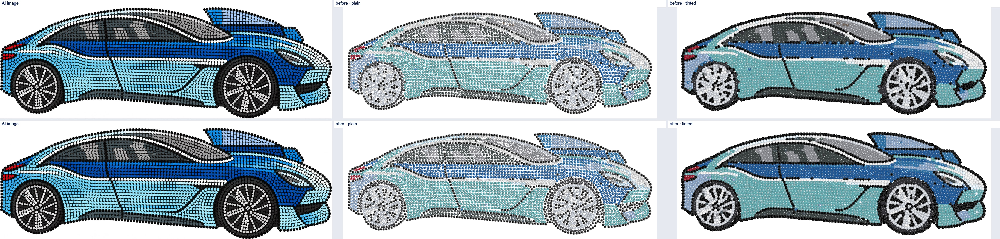

The wheels, door lines and window frames are darker and read as in the AI image.

#### dog

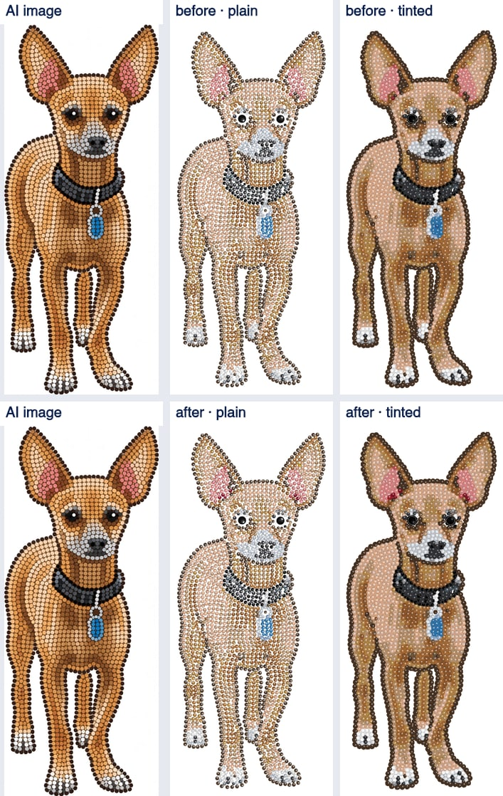

#### portrait

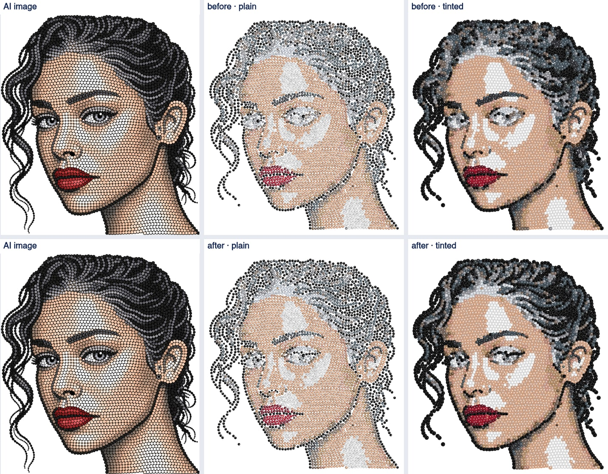

The hair is dark with defined curls instead of grey patches.

#### woman

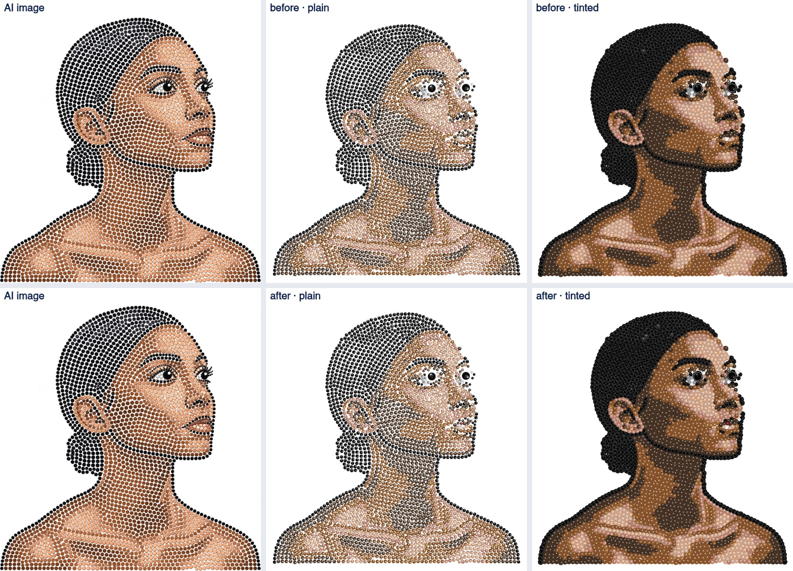

10 stones change; the woman's stones barely move in the ordered layout.

### 7.2 Tinted stones: the central highlight

**Change** (`src/render/tinted.js`, spec section 8 step 6): the lightness step now works in two
zones. First the **inner 60 %** of the radius, where the RS renderer puts its highlight: its mean
L\* is brought to within 4 of the catalogue fill's. Then the **whole stone** to within 2, by
changing the stone evenly when that keeps the inner zone within 4, else only outside it. Darkening
scales linear RGB, lightening screens towards white; the change fades out over 0.2 radii, so no
ring shows. The RS renderer is unchanged.

Renderer fidelity per colour (patch of 36 SS6 stones at 16 px per mm; mean L\* of the inner 60 %
and of the whole stone; facet spread = 5th to 95th percentile L\* inside a stone):

| Colour | fill L\* | inner 60 % before / after | whole before / after | spread before / after |
| --- | --- | --- | --- | --- |
| jet | 6 | 7.4 / **5.2** | 8.3 / 8.3 | 49 / 49 |
| indian-siam | 19 | 31.7 / **23.4** | 21.4 / 18.6 | 55 / 42 |
| hematite | 27 | 39.5 / **30.7** | 28.7 / 25.5 | 55 / 42 |
| smoked-topaz | 29 | 41.4 / **33.0** | 30.7 / 27.3 | 55 / 42 |
| graphite | 41 | 51.6 / **44.7** | 41.1 / 38.6 | 53 / 42 |
| copper | 55 | 62.1 / **58.5** | 53.0 / 52.8 | 45 / 38 |
| rose-gold | 66 | 71.4 / **68.0** | 63.6 / 63.6 | 38 / 32 |
| silk | 77 | 81.4 / **80.0** | 74.9 / 74.9 | 31 / 29 |
| silver | 88 | 90.5 / **90.8** | 85.9 / 85.9 | 23 / 23 |
| crystal | 96 | 96.8 / **97.1** | 94.4 / 94.4 | 14 / 14 |

Over all 47 colours, the worst single stone's inner 60 % is 4.2 L\* from its fill (13.6 before) and
its whole stone 2.05 (2.11 before). The facet spread stays at 13–49 L\* (crystal, the palest, 13), so
facets, highlight and sparkle stay visible; on mid-dark stones it drops from about 55 to 42 because
the highlight is less bright. Test (`tools/test-exports.mjs`): every stone of every colour at 6 and
16 px per mm within 3 L\* as a whole and 5 in its inner 60 %, spread at least 5.

Per stone, (c) on the 21 designs: mean 10.05 → 8.45, every design better (table in 7.1, "sampling
only" → "after", which also includes 7.3).

Eye close-ups at 30 px per mm: plain, tinted before, tinted after (same layout):

#### portrait

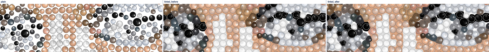

#### woman

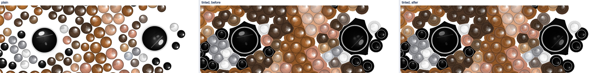

The brown and grey stones around the eyes lose their pale centres; the hair and skin read as their
catalogue colours. Jet and the light skin stones barely change.

### 7.3 Gaps on near-white

**Change** (spec section 8 step 3, `GAP_RULE.lightAbove` 85, `lightMinStep` 8): a fill above
L\* 85 gets a gap at least 8 L\* darker; the rest of the rule is kept (4 L\* + 0.05 per L\* above 80).
Three catalogue colours are affected:

| Colour | fill L\* | gap step before | after |
| --- | --- | --- | --- |
| crystal clear | 96.5 | −4.9 | −8.1 |
| crystal | 96.4 | −4.8 | −8.0 |
| silver | 87.9 | −5.6 | −9.3 |

(Silver's step is past 8 by 8-bit rounding.) The mug, the design with the most near-white stones
(1237 of 1751), before and after (same layout and stones, only the gap rule differs):

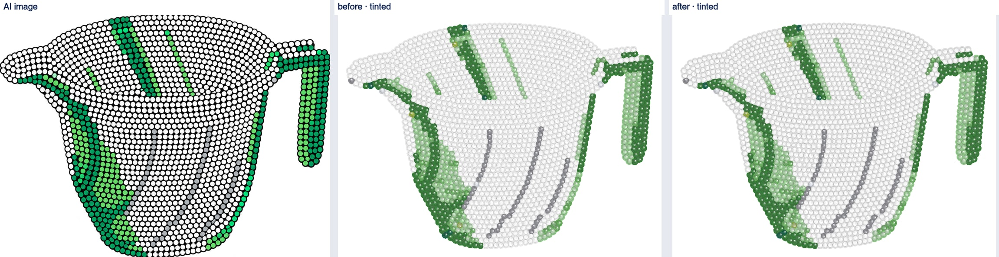

Close-up, 16 mm square at 30 px per mm:

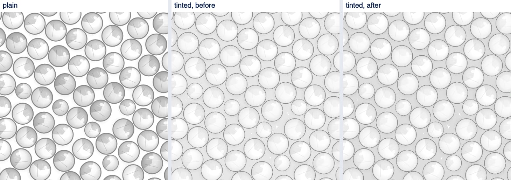

The stones now read as separate stones. On the cell measure the mug pays +0.4 (7.1), the cost
section 6.4 found for any darker gap.

### 7.4 Rendering off the main thread

`src/render/offthread.js` runs the full tinted render (the "Preparing files" stage), the browser's
preview and the delivery ZIP build in one worker thread (`worker_threads`,
`src/render/offthread-worker.js`); jobs queue in the worker. The worker starts on the first job and
does not keep the process alive when idle; a worker that dies fails its pending jobs and the next
job starts a new one. The design pipeline and the web routes await it.

On the fake layout (2150 stones) those jobs take 3.8 s (full render), 0.7 s (preview) and 0.3 s
(ZIP files) of CPU, all on the event loop before. The keep-alive workaround in
`tools/test-pipeline.mjs` (`server.keepAliveTimeout = 60_000`) is removed: the server no longer
stalls. New test there: polls every 20 ms during the design's render, a cold preview render and the
ZIP build; every poll must be answered within 200 ms (with the render on the main thread no poll is
answered during it, and the test fails).

### 7.5 Leak test and AI image metadata

`tools/test-no-provider-leak.mjs` (part of `npm test`, word list `tools/leak-words.mjs`):

- a fake design (colour and black & white) end to end over HTTP: every page and static file under
  `public/`, `/api/config`, `/health`, upload, session, Create design and every poll, the tinted
  and original views, "Use this design", the download states, the ZIP, and refusals (the test
  requires at least 40 responses). Every body and header is checked;
- every file by type: PNG (every chunk; text, iTXt/XMP, zTXt and iCCP inflated; any metadata chunk
  fails: tEXt, zTXt, iTXt, eXIf, iCCP, tIME, caBX/C2PA, anything not pixels, `pHYs` or the canvas's
  numeric `sRGB`/`sBIT`), JPEG (APP and comment segments), PDF (every stream inflated, no XMP
  metadata stream, Producer and Creator `IS`), ZIP (entry names, comments, extra fields, every entry
  by its type), text (SVG/HTML comments, DXF 999 comments, PostScript `%` lines);
- a scripted provider whose PNG carries tEXt, XMP, EXIF and C2PA chunks naming it, and whose
  failed and declined errors name it: nothing reaches the browser, and its archived `ai.png` holds
  only `IHDR`, `IDAT`, `IEND`;
- nothing is written under `public/`.

Sanity checks: a planted word in the ZIP's README fails the test; the scanners find planted words
in an SVG comment and in each metadata chunk.

**AI image metadata.** `src/prep/pngmeta.js`: the AI image is archived with only the chunks of its
pixels (`IHDR`, `PLTE`, `tRNS`, `IDAT`, `IEND`), byte for byte, so the decoded pixels are unchanged
(tested); an answer that is not a PNG is re-encoded as one without metadata. The layout service gets
the same stripped PNG. Spec 4.2 and 12 updated.

**Not changed, for Alex:** the 12 RS test images in `services/strass/prototype/img/` (unchanged RS
copies, used by the equivalence and golden tests) carry a C2PA `caBX` chunk. They are never sent
to a buyer; stripping them would change files `ORIGIN.md` lists as unchanged copies.

### 7.6 Changes made

- Service (`services/strass`, `ORIGIN.md`): rule `sample_delivered` (on in `DEFAULT`),
  `SAMPLE_SHARE`, `delivered_lab`, `_delivered_colours` in `ordered.py`, the second fill in
  `post.py`; `test_build_j.py` compares with the rule off; `SampleDelivered` in `test_is05b.py`;
  variant `default-no-sample` in `scripts/is05b_runs.py`.
- IS: `src/render/tinted.js` (two-zone `keepStoneLightness`, `STONE_LIGHTNESS`, `GAP_RULE`
  near-white step; `nearestStones` returns the scale); `src/render/offthread.js` and
  `offthread-worker.js`, used by `src/pipeline/design.js` and `src/server/webapp.js`;
  `src/prep/pngmeta.js`, used by `design.js`.
- Tests: `tools/test-exports.mjs` (gap rule, inner 60 %), `tools/test-pipeline.mjs` (poll latency,
  keep-alive workaround removed), new `tools/test-no-provider-leak.mjs`.
- Tools: `tools/is05b-followup2.mjs`; `prepareDesign` takes a run variant; the comparison
  document re-rendered (`docs/IS-05-tinted-comparison.md`).
- Spec: 4.2, 7.4, 8 (steps 3 and 6, why, implementation), 9, 12.

