# IS-05c — eyes and skin (experiment)

20 Oct 2026, branch `is-05c-eyes`, run on Alex's laptop (Apple Silicon, macOS 26). Sections 0–4
are the experiment, with `DEFAULT` unchanged. **Section 5** (21 Oct 2026) applies Alex's decisions:
`human_iris` off, the new rule `skin_nearest_inner`, and the tinted renderer's fill margin and Jet
rim. No provider call: everything is laid out from saved AI images
(the RS test images in `services/strass/prototype/img/` and `tools/fixtures/is03b-ai/cat-rule-output.png`).
Variants are compared with each other on this laptop only.

Designs: rs-woman, rs-portrait, rs-einstein, rs-jesus (faces), rs-dog and cat-rule (controls).

How to reproduce:

```
# sections 1-3: layouts with rule variants (services/strass); "eyes" and "skin" are the two variant
# groups; IS05C_BASE=before makes them relative to the IS-05b DEFAULT, as these runs were made
IS05C_BASE=before .venv/bin/python scripts/is05c_runs.py <runs> eyes,skin,skin-nearest-inner,skin-nearest-inner-kl2 \
  woman=prototype/img/N2_woman.png portrait=prototype/img/N2_portrait.png \
  einstein=prototype/img/N2_einstein.png jesus=prototype/img/N2_jesus.png dog=prototype/img/N2_dog.png \
  cat=../../tools/fixtures/is03b-ai/cat-rule-output.png
# images and numbers (docs/IS-05c-results/, numbers.json); IS05C_PARTS=eyes,skin,rs picks the parts
node tools/is05c-results.mjs <runs>
# section 5: "before" (the IS-05b DEFAULT) and "default" layouts of the 21 designs, under the run names
# of tools/is05b-measure.mjs (dog = dog-rule, cat = cat-rule, woman = rs-woman, rs-dog, ...)
.venv/bin/python scripts/is05c_runs.py <runs2> before,default dog=../../tools/fixtures/is03b-ai/dog-rule-output.png ...
IS05C_PARTS=after node tools/is05c-results.mjs <runs2>
node tools/tinted-comparison.mjs <runs2>
```

## Summary

| Question | Answer |
| --- | --- |
| Strass service on Apple Silicon | Installs with **every pin unchanged** (no Apple Silicon requirements file needed). `/health` ok, `/layout` 32 s. Unit tests: section 0. Stone counts equal to the iMac's on 4 of 6 designs, ±1 stone on jesus and dog. |
| Where do the goggles come from? | Three layers. (1) **`human_iris`** (RS build F) replaces the AI's SS6 stones around a person's pupil with two rings of SS4 stones coloured from the eye white, which snap to grey and silver: the silver ring. (2) The **RS prototype's eye** itself: one big pupil stone (SS30, capped to SS20 by IS) with an SS4 crystal catch-light *beside* it, where the AI draws the highlight *on* the pupil. (3) The **tinted view**: the big jet stone claims its whole gap, so it sits in a black octagon, and the RS renderer draws jet with a light rim. |
| Eye recommendation | `DEFAULT` with **`human_iris` off**. Removes the silver ring; eye-area ΔE woman 15.7 → 11.1, portrait 14.2 → 10.5, einstein 14.0 → 12.6; animals unchanged stone for stone. Skipping the eye stage scores lower ΔE but loses the pupils of Einstein, the dog and the cat (section 1.4). |
| Where do the dark skin patches come from? | A **catalogue gap**. The AI's shadow skin on rs-woman is L\* 33 at chroma 43; the nearest stones are Smoked Topaz (L\* 29, chroma 17, ΔE 11.9) and Colorado Topaz (L\* 47, chroma 45, ΔE 12.9), a near tie. The first pick splits the shadow about 50/50; then **`skin_nearest`** turns 90 more stones into Smoked Topaz (63 first picked lighter, 27 that tone separation had made Colorado Topaz), because it reads the whole stone disc, which takes in the AI's black gaps. |
| Skin recommendation | Keep `skin_nearest`, but have it read the **inner 60 %** of each stone (as `sample_delivered` does). Skin ΔE better or equal on all six designs (woman 7.93 → 7.32, jesus 7.68 → 6.54, cat 6.75 → 6.54). Switching it off instead costs the dog 2.7. The remaining patches need a catalogue or dithering decision (section 2.4). |
| Does a fix go back to RS? | **Yes.** RS's own outputs have the same eyes: the prototype's expected woman has two SS30 pupils with the catch-light beside them; the RS 38cd831 service adds the silver ring (section 3). `skin_nearest` is RS build J code too. |

## 0. Strass service on this Mac

`services/strass/scripts/setup_mac.sh` ran unchanged with `python3.12` (Homebrew, arm64). Every
package of `requirements.txt` installed at its pinned version from a binary wheel, including
`tensorflow==2.16.2`, `dlib-bin==19.24.6` (no source build of dlib), `onnxruntime==1.23.2` and
`rembg==2.0.69`. **Pin changes: none**, so there is no Apple Silicon requirements file.
TensorFlow runs on the CPU (no Metal plug-in installed, as on the iMac). The dlib model's SHA-256
matched; both background models (birefnet-general, isnet-general-use) downloaded and loaded.

`caffeinate -i services/strass/scripts/start.sh`: `GET /health` →
`{"ok":true,"modelsLoaded":true,"version":"1.2.0","busy":false}`. `POST /layout` with
`prototype/img/N2_woman.png` (all catalogue ids, pitch 2.1): 2612 stones (ss4 218, ss6 2392,
ss30 2), 0 violations, min gap 0.1004 mm, coverage 0.672, face human, pupils 6.32 mm ×2, 32.5 s
(detect 21.0 s). The `is05c_runs.py` default run gives the same stone list.

Unit tests (`python -m unittest -v`, equivalence test included, under `caffeinate -i`): **96 tests, OK,
none skipped**, 4026 s. The equivalence test finds the package and the prototype identical, stone
for stone and in order, on all 12 images; the golden test passes (counts within 1 % and coverage
within 3 % of `prototype/expected/`). The iMac's test output is not recorded in the repository; the
IS-04 and IS-05b commits report the suite passing there with no skipped tests, so there is no
difference in outcome. `npm test`: 142 tests, all pass.

Stone counts against the iMac (`docs/IS-05b-results/numbers-2.json`, the `DEFAULT` runs of IS-05b
section 7):

| Design | iMac | this laptop |
| --- | --- | --- |
| rs-woman | 2612 | 2612 |
| rs-portrait | 3995 | 3995 |
| rs-einstein | 3591 | 3591 |
| rs-jesus | 3298 | 3297 |
| rs-dog | 1671 | 1670 |
| cat-rule | 3573 | 3573 |

The one-stone differences are the expected CPU differences (StarDist and TensorFlow on another
CPU). Every number below compares runs made on this laptop only.

## 1. Eyes

### 1.1 The eye rules

Rules in `services/strass/strass_layout/rules.py` (all on in `DEFAULT`):

| Rule | From | What it does |
| --- | --- | --- |
| `pupil_core_only` | RS build E | A pupil candidate is the dark blob itself; off, it is the blob plus the dark iris around it (measured by rays), so pupils come out larger. |
| `pupil_inscribed` | RS build G | Also finds a pupil that touches other dark stones, as the largest dark disc around a highlight (an animal's needs a level partner). |
| `human_iris` | RS build F | People get the iris rings animals get: up to two rings of SS4 stones around the pupil, coloured from the AI image just outside it; ring stones that come out dark are dropped. |
| `eye_keep` | RS build F | Around the eye stones, only the layout stones that overlap them are removed, instead of every stone in the eye-zone circle. |
| `lively_eyes` | RS build I | A person's fallback pupil (landmarks found, no pupil candidate) fills small highlight holes, takes the dark disc with a highlight nearest the eye centre, without the ×1.15 size; the catch-light points at the AI's highlight (`glint_angles`), the same way for both eyes. |
| `plausible_eyes` | IS-05b | Pupils that are not one plausible pair give no face and no eye stage (spec 7.5). |

Not rules, always on: the pupil stone (the largest of SS30/20/16/10/6 not above the pupil's
diameter + 0.3 mm) and an SS4 crystal catch-light beside it (`eyes.build_eye_copy`); the two pupils'
diameters equalised; **lash stones** (SS4 jet at dark detections in each eye box, people only); the
IS cap of a face's pupils at SS20 (spec 7.5). Variants tried besides the rules: `eye-no-lashes` (lash
stones not added), `eye-rules-off` (all six rules off) and `eye-skip` (no eye stage, the path a
non-face takes: `post._plausible_pupils` returns no face).

### 1.2 Stones inside the eye area

The eye area is a circle around each pupil of the default layout, radius pupil radius + 4 mm (two
rings of SS6). Classes by catalogue fill: dark (L\* < 30), white (neutral, L\* ≥ 80), grey
(neutral, L\* 30–80), colour (the rest). "AI" classifies the AI colour under each default stone
(mean of its inner 60 %). ΔE: mean ΔE2000 between that AI colour and each stone's fill. "=" means
the layout is identical to the default, stone for stone (rule not acting).

**woman** (AI colours under the default's eye stones: dark 21, white 6, grey 1, colour 29)

| Variant | Stones | Face | Pupils (mm) | Eye-area stones | SS4 / SS6 / larger | dark / white / grey / colour | ΔE |
| --- | --- | --- | --- | --- | --- | --- | --- |
| default | 2612 | human | 6.32, 6.32 | 57 | 45 / 10 / 2 | 25 / 6 / 6 / 20 | 15.69 |
| eye-no-pupil-core-only | = | | | | | | |
| eye-no-pupil-inscribed | = | | | | | | |
| eye-no-human-iris | 2613 | human | 6.32, 6.32 | 59 | 33 / 24 / 2 | 24 / 8 / 0 / 27 | 11.07 |
| eye-no-eye-keep | 2607 | human | 6.32, 6.32 | 54 | 42 / 10 / 2 | 26 / 6 / 6 / 16 | 16.66 |
| eye-no-lively-eyes | 2611 | human | 6.32, 6.32 | 56 | 43 / 11 / 2 | 24 / 6 / 6 / 20 | 14.06 |
| eye-no-plausible-eyes | = | | | | | | |
| eye-no-lashes | 2611 | human | 6.32, 6.32 | 56 | 43 / 11 / 2 | 24 / 6 / 6 / 20 | 15.99 |
| eye-rules-off | 2604 | human | 6.32, 6.32 | 50 | 24 / 24 / 2 | 22 / 6 / 0 / 22 | 9.08 |
| eye-skip | 2624 | none | – | 70 | 36 / 34 / 0 | 28 / 11 / 0 / 31 | 7.95 |

**portrait** (AI colours under the default's eye stones: dark 23, white 2, grey 28, colour 0)

| Variant | Stones | Face | Pupils (mm) | Eye-area stones | SS4 / SS6 / larger | dark / white / grey / colour | ΔE |
| --- | --- | --- | --- | --- | --- | --- | --- |
| default | 3995 | human | 3.46, 3.46 | 53 | 41 / 10 / 2 | 15 / 15 / 21 / 2 | 14.17 |
| eye-no-pupil-core-only | 3989 | human | 3.84, 3.84 | 45 | 36 / 7 / 2 | 12 / 11 / 20 / 2 | 16.97 |
| eye-no-pupil-inscribed | = | | | | | | |
| eye-no-human-iris | 3990 | human | 3.46, 3.46 | 49 | 24 / 23 / 2 | 16 / 23 / 10 / 0 | 10.45 |
| eye-no-eye-keep | 3991 | human | 3.46, 3.46 | 48 | 38 / 8 / 2 | 16 / 5 / 25 / 2 | 14.17 |
| eye-no-lively-eyes | 3990 | human | 4.18, 4.18 | 46 | 28 / 17 / 1 | 13 / 19 / 13 / 1 | 13.38 |
| eye-no-plausible-eyes | = | | | | | | |
| eye-no-lashes | 3994 | human | 3.46, 3.46 | 54 | 42 / 10 / 2 | 16 / 15 / 21 / 2 | 14.01 |
| eye-rules-off | 3980 | human | 4.56, 4.56 | 42 | 21 / 20 / 1 | 15 / 17 / 10 / 0 | 9.74 |
| eye-skip | 3989 | none | – | 49 | 21 / 28 / 0 | 15 / 22 / 12 / 0 | 9.04 |

**einstein** (AI colours under the default's eye stones: dark 31, white 2, grey 2, colour 29)

| Variant | Stones | Face | Pupils (mm) | Eye-area stones | SS4 / SS6 / larger | dark / white / grey / colour | ΔE |
| --- | --- | --- | --- | --- | --- | --- | --- |
| default | 3591 | human | 5.62, 5.62 | 65 | 59 / 4 / 2 | 37 / 6 / 0 / 22 | 13.99 |
| eye-no-pupil-core-only | 3591 | human | 6.03, 6.03 | 65 | 59 / 4 / 2 | 37 / 4 / 0 / 24 | 12.88 |
| eye-no-pupil-inscribed | = | | | | | | |
| eye-no-human-iris | 3590 | human | 5.62, 5.62 | 64 | 38 / 24 / 2 | 40 / 3 / 0 / 21 | 12.63 |
| eye-no-eye-keep | 3591 | human | 5.62, 5.62 | 64 | 61 / 1 / 2 | 38 / 6 / 0 / 20 | 14.62 |
| eye-no-lively-eyes | 3591 | human | 5.62, 5.62 | 65 | 59 / 4 / 2 | 36 / 6 / 0 / 23 | 14.48 |
| eye-no-plausible-eyes | = | | | | | | |
| eye-no-lashes | 3591 | human | 5.62, 5.62 | 65 | 58 / 5 / 2 | 37 / 6 / 0 / 22 | 13.97 |
| eye-rules-off | 3585 | human | 6.03, 6.03 | 59 | 33 / 24 / 2 | 39 / 2 / 0 / 18 | 14.31 |
| eye-skip | 3601 | none | – | 75 | 44 / 31 / 0 | 46 / 2 / 2 / 25 | 9.94 |

**jesus** (AI colours under the default's eye stones: dark 9, white 1, grey 4, colour 20)

| Variant | Stones | Face | Pupils (mm) | Eye-area stones | SS4 / SS6 / larger | dark / white / grey / colour | ΔE |
| --- | --- | --- | --- | --- | --- | --- | --- |
| default | 3297 | animal | 4.9 | 34 | 33 / 0 / 1 | 12 / 2 / 2 / 18 | 14.79 |
| eye-no-pupil-core-only | = | | | | | | |
| eye-no-pupil-inscribed | = | | | | | | |
| eye-no-human-iris | = | | | | | | |
| eye-no-eye-keep | 3297 | animal | 4.9 | 34 | 33 / 0 / 1 | 12 / 2 / 2 / 18 | 14.79 |
| eye-no-lively-eyes | 3297 | animal | 4.9 | 34 | 33 / 0 / 1 | 12 / 2 / 2 / 18 | 14.38 |
| eye-no-plausible-eyes | = | | | | | | |
| eye-no-lashes | = | | | | | | |
| eye-rules-off | 3297 | animal | 4.9 | 34 | 33 / 0 / 1 | 12 / 2 / 2 / 18 | 14.38 |
| eye-skip | 3296 | none | – | 35 | 23 / 12 / 0 | 14 / 2 / 4 / 15 | 7.08 |

**dog (control)** (AI colours under the default's eye stones: dark 19, white 0, grey 12, colour 46)

| Variant | Stones | Face | Pupils (mm) | Eye-area stones | SS4 / SS6 / larger | dark / white / grey / colour | ΔE |
| --- | --- | --- | --- | --- | --- | --- | --- |
| default | 1670 | animal | 6.66, 6.66 | 77 | 75 / 0 / 2 | 10 / 9 / 9 / 49 | 16.81 |
| eye-no-pupil-core-only | 1671 | animal | 7, 7 | 78 | 76 / 0 / 2 | 19 / 9 / 5 / 45 | 14.11 |
| eye-no-pupil-inscribed | = | | | | | | |
| eye-no-human-iris | = | | | | | | |
| eye-no-eye-keep | 1670 | animal | 6.66, 6.66 | 77 | 75 / 0 / 2 | 10 / 9 / 9 / 49 | 16.81 |
| eye-no-lively-eyes | 1671 | animal | 6.66, 6.66 | 78 | 76 / 0 / 2 | 10 / 9 / 9 / 50 | 16.37 |
| eye-no-plausible-eyes | = | | | | | | |
| eye-no-lashes | = | | | | | | |
| eye-rules-off | 1671 | animal | 7, 7 | 78 | 76 / 0 / 2 | 18 / 9 / 5 / 46 | 13.87 |
| eye-skip | 1674 | none | – | 83 | 41 / 42 / 0 | 54 / 2 / 0 / 27 | 10.28 |

**cat-rule (control)** (AI colours under the default's eye stones: dark 20, white 9, grey 11, colour 32)

| Variant | Stones | Face | Pupils (mm) | Eye-area stones | SS4 / SS6 / larger | dark / white / grey / colour | ΔE |
| --- | --- | --- | --- | --- | --- | --- | --- |
| default | 3573 | animal | 5.5, 5.5 | 72 | 69 / 1 / 2 | 23 / 9 / 4 / 36 | 15.61 |
| eye-no-pupil-core-only | 3565 | animal | 6.34, 6.34 | 72 | 70 / 0 / 2 | 16 / 10 / 3 / 43 | 22.06 |
| eye-no-pupil-inscribed | = | | | | | | |
| eye-no-human-iris | = | | | | | | |
| eye-no-eye-keep | 3573 | animal | 5.5, 5.5 | 72 | 69 / 1 / 2 | 23 / 9 / 4 / 36 | 15.6 |
| eye-no-lively-eyes | 3572 | animal | 5.5, 5.5 | 71 | 68 / 1 / 2 | 23 / 8 / 4 / 36 | 15.71 |
| eye-no-plausible-eyes | = | | | | | | |
| eye-no-lashes | = | | | | | | |
| eye-rules-off | 3565 | animal | 6.34, 6.34 | 72 | 70 / 0 / 2 | 16 / 10 / 3 / 43 | 22.37 |
| eye-skip | 3566 | none | – | 65 | 14 / 51 / 0 | 21 / 15 / 0 / 29 | 7.07 |

Stones per colour in the eye area, default and `human_iris` off (the full list for every variant
is in `IS-05c-results/numbers.json`, `eyes.<design>.rows[].byColour`):

| Design | default | `human_iris` off |
| --- | --- | --- |
| woman | smoked-topaz 16, jet 9, colorado-topaz 6, grey 6, crystal-clear 5, golden-shadow 4, light-smoked-topaz 4, rose-gold 3, greige 2, silver 1, silk 1 | smoked-topaz 13, jet 11, colorado-topaz 10, crystal-clear 8, golden-shadow 6, silk 5, rose-gold 3, light-smoked-topaz 2, copper 1 |
| portrait | grey 17, jet 13, silver 11, crystal-clear 4, graphite 3, hematite 2, greige 2, jet-hematite 1 | silver 19, jet 11, grey 7, hematite 5, crystal-clear 4, graphite 2, jet-hematite 1 |
| einstein | smoked-topaz 33, colorado-topaz 16, copper 5, jet 4, crystal-clear 4, silver 2, vintage-rose 1 | smoked-topaz 38, colorado-topaz 14, copper 7, crystal-clear 3, jet 2 |

On jesus, dog and cat `human_iris` changes nothing.

### 1.3 Close-ups

AI image, plain stones and tinted view of the same window (both pupils plus 7 mm, 30 px per mm),
one row per variant; variants identical to the default are left out.

#### woman

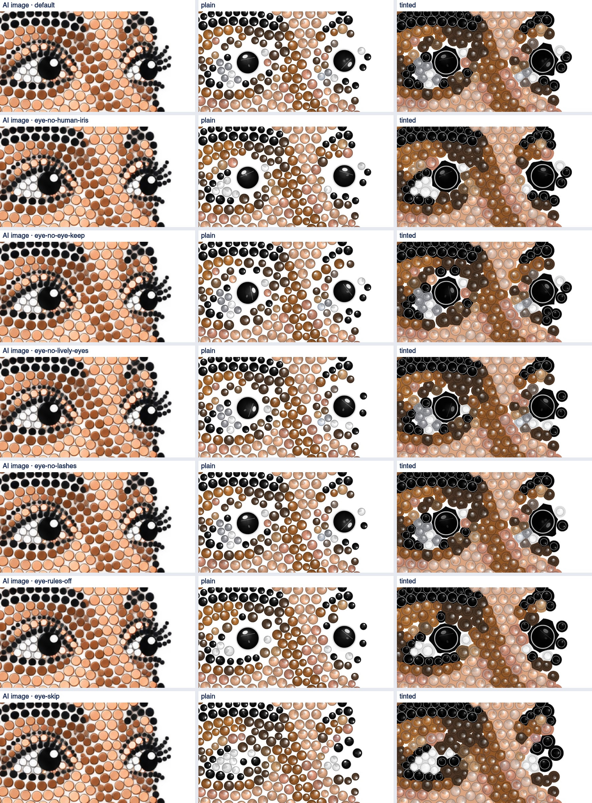

#### portrait

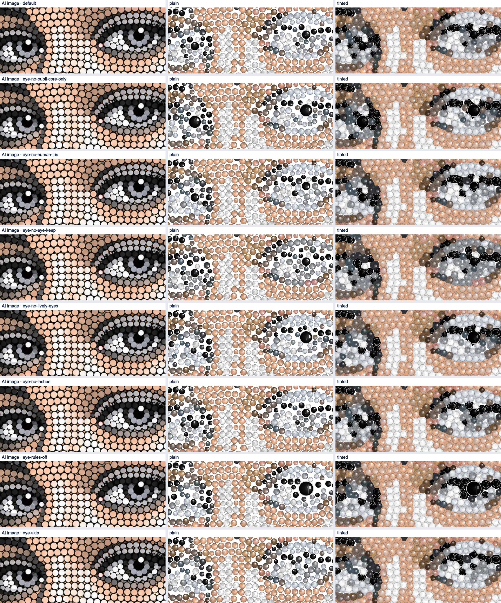

#### einstein

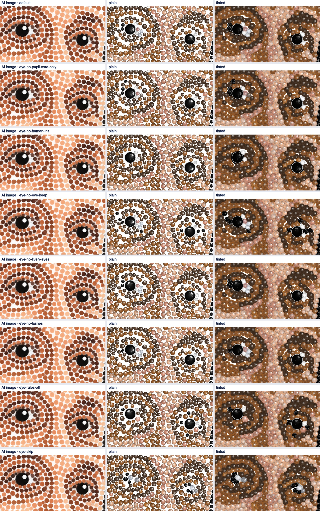

#### jesus

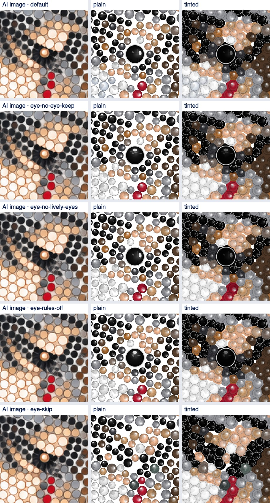

#### dog (control)

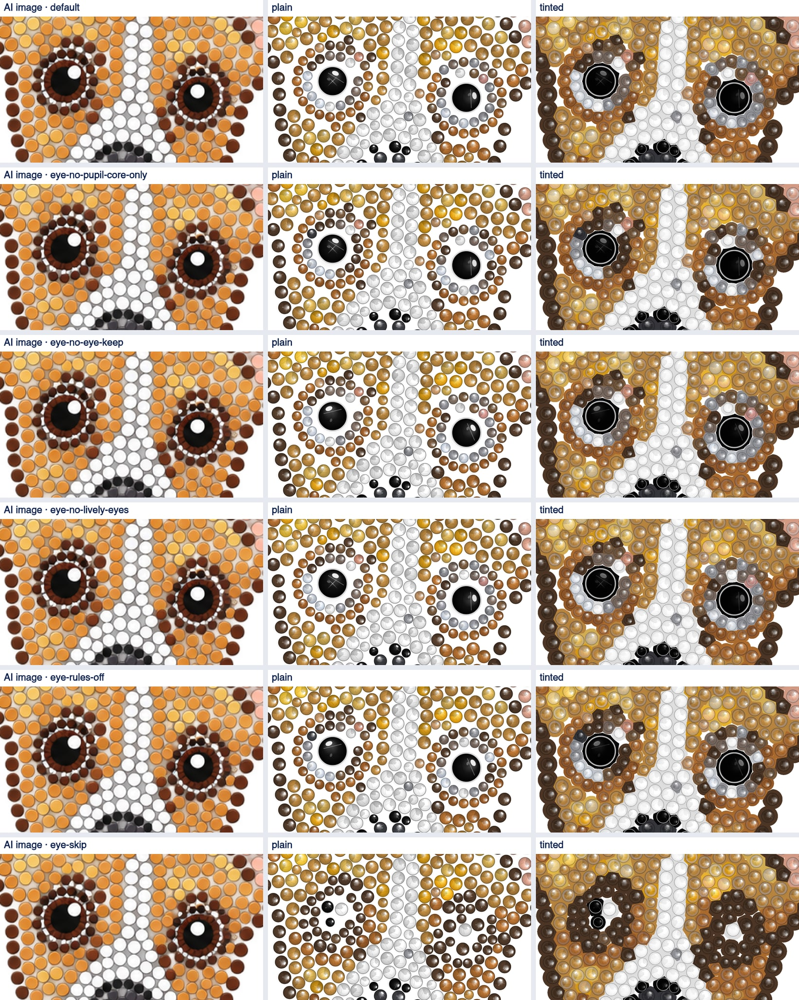

#### cat-rule (control)

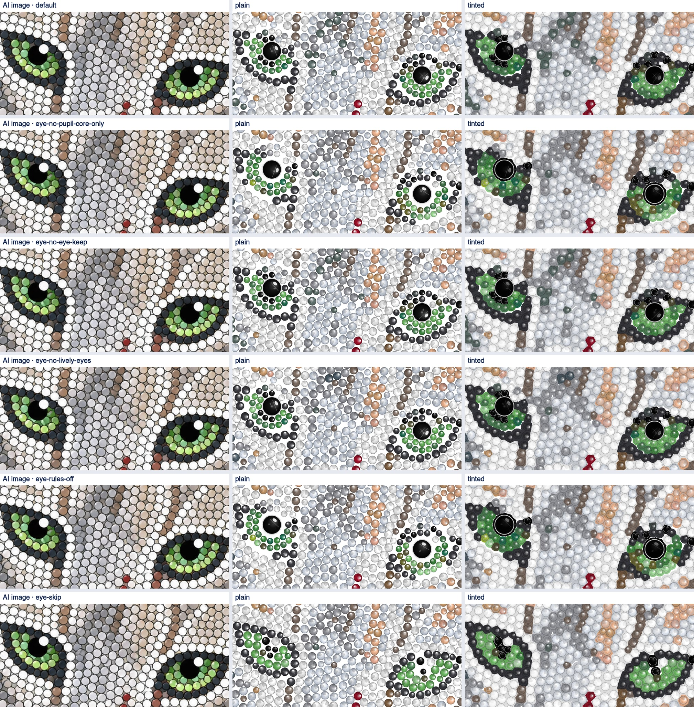

### 1.4 Findings

- **`human_iris` makes the silver ring.** On the woman it swaps 14 SS6 stones around each pair of
  eyes for SS4 rings (eye area: 24 SS6 / 33 SS4 without it, 10 / 45 with it), sampled where the AI
  drew the eye white, which snaps to Grey and Silver (6 grey stones; the AI has 1). Off, the ring
  is gone, the AI's own stones stay (crystal, skin tones, jet lashes) and the eye-area ΔE falls by
  4.6 (woman), 3.7 (portrait) and 1.4 (einstein). It acts only on people: dog, cat and jesus (dlib
  finds no face, so it is laid out as an animal) are identical without it.
- **`pupil_core_only`, `pupil_inscribed`, `plausible_eyes`** do nothing on these faces, or make
  the pupil larger (`pupil_core_only` off: portrait 3.46 → 3.84 mm, cat ΔE 15.6 → 22.1). Keep.
- **`eye_keep` off** clears the whole eye zone and gives the area to the iris rings: worse on woman
  and einstein. Keep.
- **`lively_eyes` off** changes little (portrait's fallback pupil grows to 4.18 mm). Keep.
- **Lashes** change one or two stones. Neutral.
- **All six off** reads well on woman and portrait but makes the cat's pupils larger and its eye
  ΔE worse (15.6 → 22.4). Not recommended.
- **Skipping the eye stage** has the lowest ΔE everywhere (woman 7.95, cat 7.07), but the
  close-ups show why: without the eye stage the AI's big pupil is tiled into SS6 jet stones that
  the colour clean-up partly recolours. Einstein's and the dog's pupils almost vanish, and the cat
  keeps three small dark stones. The ΔE measures colour per stone, not whether an eye reads as an
  eye. Not recommended.
- **What `human_iris` off does not fix**: the pupil stays one SS20 jet stone with its catch-light
  outside it, and in the tinted view the pupil claims its whole gap (a black octagon) and has the
  renderer's light rim. The AI draws a pupil of about the same size (woman 6.3 mm) with the
  highlight on it, so the size is right; the catch-light position and the tinted ring are what
  still look "set apart". Both are outside `rules.py`: `build_eye_copy` (RS prototype code) and the
  renderer (spec section 8, RS `CrystalStoneRenderer` unchanged). Not tried here; a decision for
  Alex.

### 1.5 Recommended eye rule set

**`DEFAULT` with `human_iris=False`.** Faces lose the silver ring and keep their pupils; animals and
non-faces are unchanged stone for stone. Not applied (experiment only).

## 2. Skin (rs-woman)

### 2.1 The skin rules

| Rule / step | Where | What it does |
| --- | --- | --- |
| `skin_nearest` (rule, RS build J) | `faces.skin_nearest` | Every SS4/SS6 stone in a skin colour gets the skin colour (Topaz excepted) nearest its mean Lab, read over the **whole disc** (radius 0.5 D). |
| `calm_skin` (rule, RS build I) | `faces.calm_skin` | A lone skin stone takes the shade at least 60 % of its neighbours share, when that shade is within 15 ΔE. |
| `skin_no_wine` (rule, RS build I) | `colour.PLUS_REAL_SKIN` | Indian Siam blocked for warm colours of hue ≥ 30°. |
| `soft_outlines` (rule, RS build I; off in IS) | `faces.soften_outlines` | A person's jet stones on skin become Smoked Topaz. |
| family fix (no rule) | `colsmooth.family_fix` | Red stones among browns become the nearest brown. |
| tone separation (no rule) | `distinct.distinct_tones` | k-means on the stone colours; clearly different tones of one family get different catalogue colours (skin stays in skin). |
| dark dots (no rule) | `darkdots.clean` | One or two isolated dark stones in a light area take their neighbours' colour. |
| first pick (no rule) | `colour.snap_colours` | Warm colours never snap to a neutral; Topaz blocked for warm colours of chroma < 50; no chroma penalty for warm colours. |

### 2.2 Which colours the mid-browns get, and which step darkens them

Skin stones: AI colour (inner 60 %) of warm hue (30–78°), chroma 12–60, L\* ≥ 25. Per L\* band of
the AI colour, on the default design: dL is the stone fill's L\* minus the AI's (negative = the
stone is darker), "nearest" the same for the plain ΔE2000-nearest catalogue colour.

| AI L\* | Stones | dL (stone) | dL (nearest) | ΔE |
| --- | --- | --- | --- | --- |
| 25–40 | 694 | 2.38 | 4.38 | 10.3 |
| 40–50 | 368 | 3.33 | 3.33 | 6.19 |
| 50–60 | 100 | -4.99 | -1.43 | 8.24 |
| 60–70 | 165 | -5.28 | -0.01 | 7.94 |
| 70–90 | 418 | -4.51 | -0.32 | 5.44 |

The AI's softer mid-browns (L\* 40–60, 468 stones) get colorado-topaz (L* 47) 441, copper (L* 55) 21, rose-gold (L* 66) 2, light-smoked-topaz (L* 44) 2, greige (L* 49) 1, silver (L* 88) 1 (the plain nearest: colorado-topaz (L* 47) 395, copper (L* 55) 62, rose-gold (L* 66) 5, hyacinth (L* 55) 3, light-smoked-topaz (L* 44) 2, greige (L* 49) 1). 50
of them are more than 3 L\* darker than their nearest catalogue colour; the step that last changed
their colour: skin_nearest 37, distinct 5, calm_skin 4, start 4 (first pick = `start`).

**But the dark patches Alex saw are not the mid-browns.** They are the cheek, jaw and neck shadow,
which the AI drew as a saturated mid-dark brown: the face-and-neck stones with AI L\* 25–40 (523
stones) average Lab (33.4, 25.7, 34.1), L\* 33 at chroma 43. On the AI image it reads as warm
mid-brown because the AI's stones carry highlights. The catalogue has nothing near it:

| Catalogue colour | Lab | Chroma | ΔE2000 to the AI shadow |
| --- | --- | --- | --- |
| Smoked Topaz | 29, 8, 15 | 17 | 11.9 |
| Colorado Topaz | 47, 21, 40 | 45 | 12.9 |
| Light Smoked Topaz | 44, 9, 22 | 24 | 13.7 |
| Light Siam | 34, 55, 26 | 61 | 16.5 |

So each shadow stone is a near tie between a dull dark brown and a light warm brown. What happens to
those 523 stones, step by step:

| Path | Stones |
| --- | --- |
| First pick Smoked Topaz, kept | 230 |
| First pick Colorado Topaz, kept | 201 |
| First pick Colorado Topaz → **`skin_nearest`** → Smoked Topaz | 60 |
| First pick Smoked Topaz → tone separation → Colorado Topaz → **`skin_nearest`** → Smoked Topaz | 27 |
| others | 5 |

The plain nearest colour splits them 263 Colorado / 260 Smoked; the delivered design has 201 / 320.
`skin_nearest` is the step that darkens them: it reads each stone over its whole disc (radius
0.5 D), which on the woman reaches into the AI's dark gaps, while every other colour read in the
service now uses the inner 60 % (`sample_delivered`, IS-05b). With `skin_nearest` reading the inner
60 % the split becomes 260 / 260, the nearest colour's.

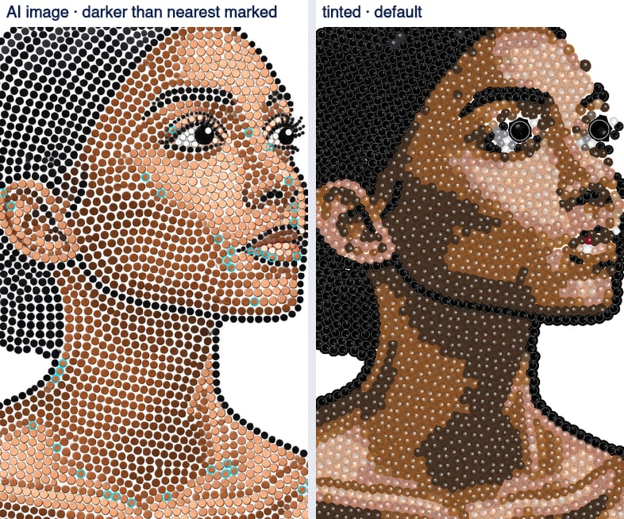

### 2.3 Variants

Face and neck of rs-woman (window 77 × 123 mm), skin stones only: ΔE mean ΔE2000 (AI colour vs
stone fill), dL mean stone L\* minus AI L\*; "mid" the AI L\* 40–60 stones; "changed" stones whose
colour differs from the default. Two variants that are not switches were added because of 2.2:
`skin-nearest-inner` (`skin_nearest` reads the inner 60 %) and `skin-nearest-inner-kl2` (the same,
with lightness weighted half in its ΔE2000, kL = 2, which favours the warmer colour).

| Variant | Changed | Skin ΔE | Skin dL | Mid ΔE | Mid dL | Mid darker than nearest |
| --- | --- | --- | --- | --- | --- | --- |
| default | 0 | 8.1 | -0.28 | 6.83 | 1.62 | 35 |
| skin-no-skin-nearest | 405 | 7.64 | 2.82 | 6.65 | 2.33 | 9 |
| skin-no-calm-skin | 28 | 8.1 | -0.29 | 6.81 | 1.61 | 34 |
| skin-no-skin-no-wine | 2 | 8.1 | -0.29 | 6.83 | 1.62 | 35 |
| skin-soft-outlines-on | 92 | 8.1 | -0.28 | 6.83 | 1.62 | 35 |
| skin-no-family-fix | 0 | 8.1 | -0.28 | 6.83 | 1.62 | 35 |
| skin-no-distinct | 24 | 8.1 | -0.28 | 6.83 | 1.62 | 35 |
| skin-no-darkdots | 2 | 8.1 | -0.28 | 6.83 | 1.62 | 35 |
| skin-rules-off | 386 | 7.5 | 2.43 | 6.65 | 2.56 | 4 |
| skin-nearest-inner | 354 | 7.43 | 2.37 | 6.63 | 2.5 | 5 |
| skin-nearest-inner-kl2 | 589 | 8 | 4.85 | 6.81 | 2.1 | 29 |

(1248 skin stones in the window, 288 of them mid-brown.)

Every skin and fur stone (same definition, whole design) on all six designs, mean ΔE2000 / dL, and
the number of Smoked Topaz stones among them:

| Variant | woman | portrait | einstein | jesus | dog | cat-rule |
| --- | --- | --- | --- | --- | --- | --- |
| default | 7.93 / -0.23 (442) | 7.71 / -6.68 (3) | 7.67 / 0.33 (102) | 7.68 / -4.01 (274) | 8.49 / -1.15 (9) | 6.75 / -2.4 (25) |
| skin-no-skin-nearest | 7.48 / 2.69 (327) | 7.35 / -5.44 (0) | 7.94 / 0.89 (126) | 6.76 / -0.75 (270) | 11.16 / -4.48 (35) | 7.2 / -1.58 (6) |
| skin-no-calm-skin | 7.91 / -0.22 (442) | 7.76 / -6.79 (3) | 7.63 / 0.33 (102) | 7.67 / -4.07 (271) | 8.49 / -1.08 (9) | 6.78 / -2.53 (26) |
| skin-no-skin-no-wine | 7.93 / -0.24 (441) | 7.71 / -6.68 (3) | 7.58 / -0.25 (47) | 7.67 / -4.04 (274) | 10.53 / -4.13 (5) | 6.75 / -2.4 (25) |
| skin-soft-outlines-on | 7.93 / -0.23 (442) | – | – | – | – | – |
| skin-no-family-fix | 7.93 / -0.23 (442) | – | – | – | – | – |
| skin-no-distinct | 7.93 / -0.23 (442) | – | – | – | – | – |
| skin-no-darkdots | 7.93 / -0.23 (442) | – | – | – | – | – |
| skin-rules-off | 7.36 / 2.3 (363) | – | – | – | – | – |
| skin-nearest-inner | 7.32 / 2.26 (367) | 7.27 / -5.54 (0) | 7.64 / 0.53 (92) | 6.54 / -0.98 (268) | 8.32 / -1.15 (11) | 6.54 / -1.27 (15) |
| skin-nearest-inner-kl2 | 7.92 / 4.75 (138) | 7.46 / -4.8 (0) | 7.99 / 1.3 (19) | 6.8 / -1.02 (254) | 8.3 / -1.24 (10) | 7.08 / -2.24 (35) |

The variants marked – were run on rs-woman only (they change nothing on its skin).

(`skin-no-skin-no-wine` moves one stone on einstein, which shifts the stone list; its "changed" count
there is not comparable.)

AI image, tinted view and per-stone ΔE map (green < 5, yellow < 10, orange < 15, red < 20, dark red
≥ 20; skin stones only), one row per variant that changes something:

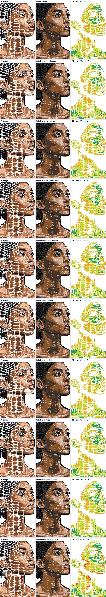

### 2.4 Findings

- `skin_nearest` **off** helps the woman (7.93 → 7.48), the portrait and jesus, but costs the dog
  (8.49 → 11.16), einstein and the cat. As shipped it is reading the wrong pixels on AI images with
  dark gaps.
- `skin_nearest` **reading the inner 60 %** is better or equal on all six designs (woman 7.93 →
  7.32, portrait 7.71 → 7.27, einstein 7.67 → 7.64, jesus 7.68 → 6.54, dog 8.49 → 8.32, cat 6.75 →
  6.54) and removes 75 Smoked Topaz stones from the woman's skin. It is the best variant tried.
- With kL = 2 the shadow patches shrink most, but the neck turns red in the ΔE map (the shadow
  becomes Colorado Topaz, 14 L\* too light). Woman ΔE back to 7.92. Not recommended.
- `calm_skin`, `skin_no_wine`, `soft_outlines` (on), family fix, tone separation and dark dots
  move the skin ΔE by at most 0.05 on the woman. Keep them as they are.
- **The patches do not go away with any rule.** With the inner read the shadow is half Smoked
  Topaz, half Colorado Topaz, as the plain nearest colour says, and the Smoked Topaz half still
  reads as dark grey-brown next to Colorado Topaz. Two ways out, both decisions for Alex and not
  tried: (a) a catalogue stone between the two (a warm brown near L\* 35, chroma 35–45), if the
  supplier has one; (b) mixing the two on purpose in such areas (error-diffusion between Smoked
  and Colorado Topaz), so the shadow reads as a mid-brown texture instead of hard patches.

### 2.5 Recommended skin rule set

**`DEFAULT` as it is, with `skin_nearest` reading each stone's inner 60 %** (`ordered.SAMPLE_SHARE`,
the radius `sample_delivered` uses) instead of its whole disc. The other skin rules stay. This is a
change of `skin_nearest`'s sampling, not a switch: it needs a code change in
`strass_layout/pipeline.py` (the `lab` passed to `finish_faces`), behind a new rule so `BUILD_J`
and the tests stay as they are. Not applied (experiment only).

## 3. Rhinestone Studio's own outputs

The same eye windows for the RS prototype's expected output (`prototype/expected/N2_*_final_rs.json`,
the research pipeline the service was ported from) and the RS 38cd831 service layouts
(`tools/fixtures/layouts/`), drawn with the RS tinted view (85 % fill in the gaps), next to IS
today. RS caps nothing, so its pupils are SS30.

| Design | Layout | Eye-area stones | Pupil size | dark / white / grey / colour |
| --- | --- | --- | --- | --- |
| woman | RS prototype (expected) | 49 | 6.4 mm ×2 | 16 / 6 / 0 / 27 |
| woman | RS 38cd831 service | 57 | 6.4 mm ×2 | 25 / 6 / 6 / 20 |
| woman | IS default | 57 | 4.7 mm ×2 | 25 / 6 / 6 / 20 |
| portrait | RS prototype (expected) | 42 | 4.7 mm ×1 | 12 / 10 / 19 / 1 |
| portrait | RS 38cd831 service | 52 | 2.8 mm ×2 | 6 / 20 / 21 / 5 |
| portrait | IS default | 53 | 2.8 mm ×2 | 15 / 15 / 21 / 2 |
| einstein | RS prototype (expected) | 58 | 4.7 mm ×2 | 44 / 2 / 0 / 12 |
| einstein | RS 38cd831 service | 66 | 4.7 mm ×2 | 38 / 6 / 0 / 22 |
| einstein | IS default | 65 | 4.7 mm ×2 | 37 / 6 / 0 / 22 |
| jesus | RS prototype (expected) | 32 | 4.7 mm ×1 | 17 / 4 / 1 / 10 |
| jesus | RS 38cd831 service | 34 | 4.7 mm ×1 | 13 / 2 / 1 / 18 |
| jesus | IS default | 34 | 4 mm ×1 | 12 / 2 / 2 / 18 |
| dog | RS prototype (expected) | 80 | 6.4 mm ×2 | 43 / 15 / 4 / 18 |
| dog | RS 38cd831 service | 77 | 6.4 mm ×2 | 8 / 10 / 9 / 50 |
| dog | IS default | 77 | 4.7 mm ×2 | 10 / 9 / 9 / 49 |

#### woman

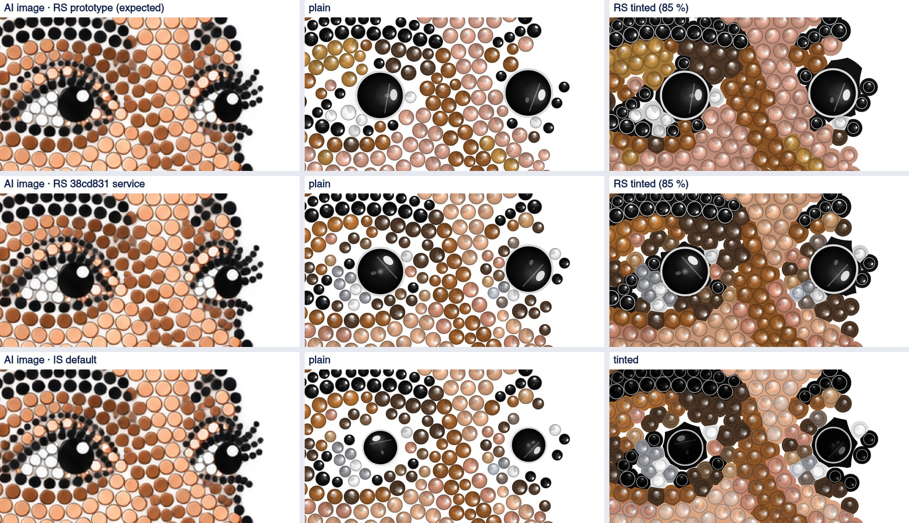

#### portrait

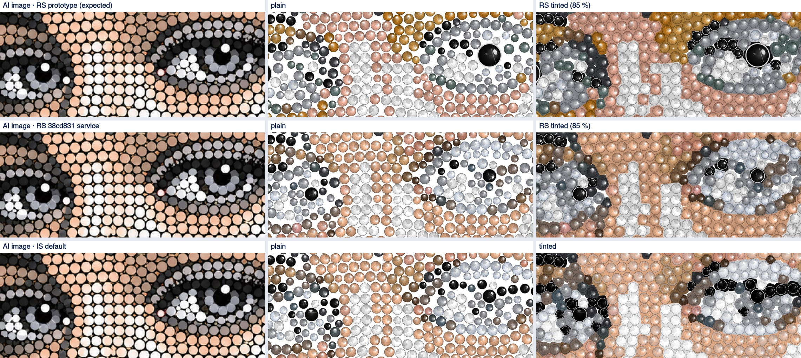

#### einstein

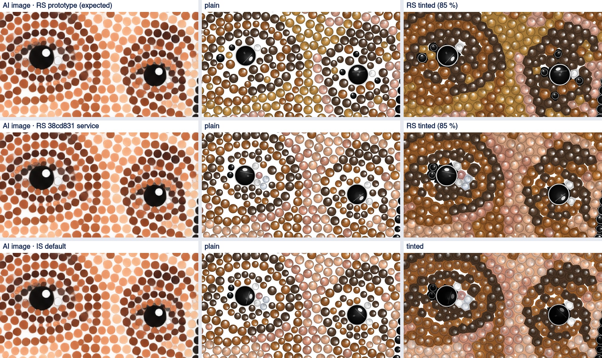

#### jesus

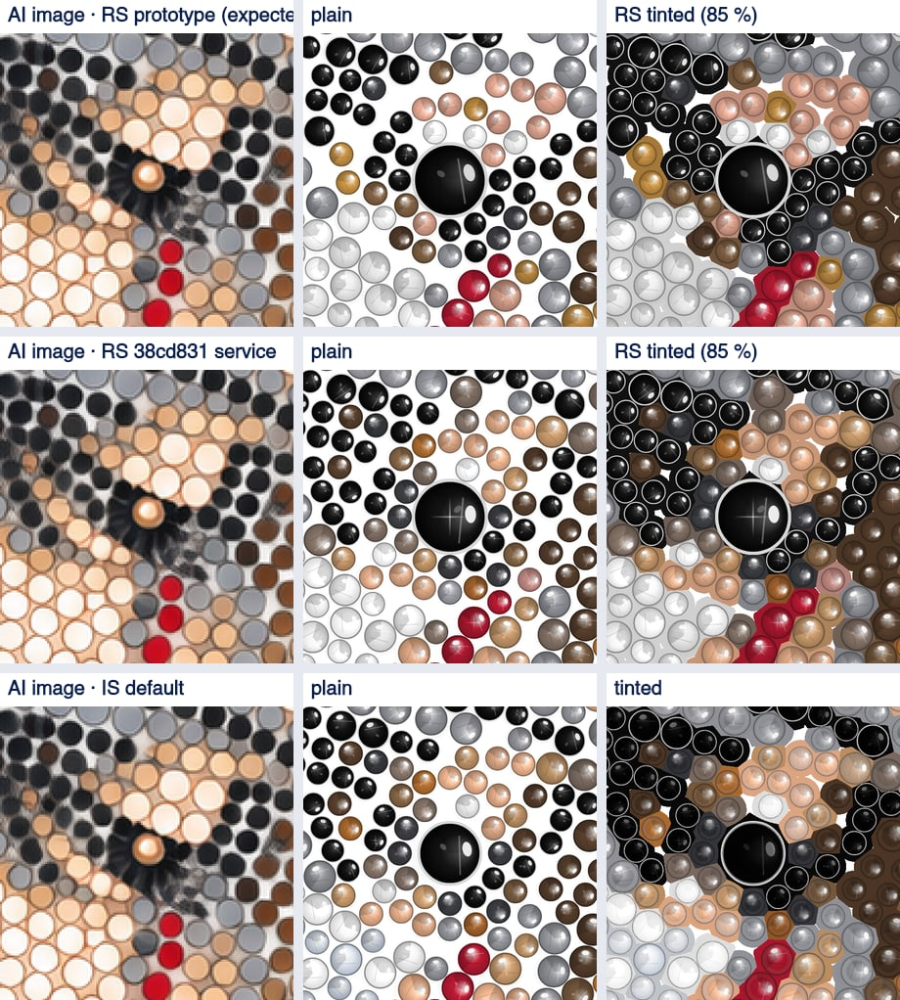

#### dog

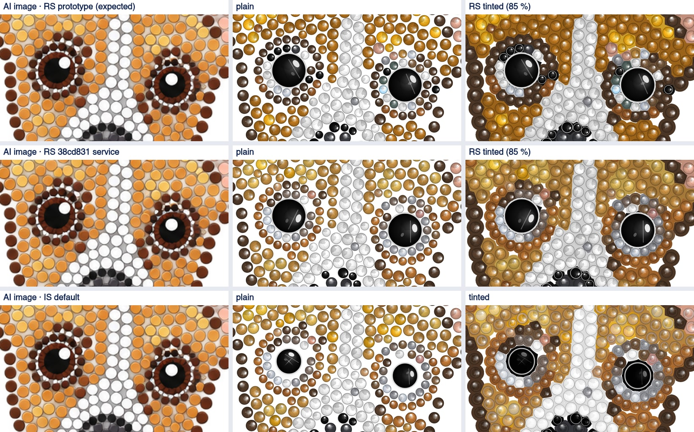

**RS has the same goggle eyes.** The prototype already lays a person's eye out as one big pupil
stone (woman: SS30 ×2) with the catch-light beside it; the RS 38cd831 service adds the silver iris
ring (`human_iris`, build F: woman 6 grey stones in the eye area, prototype 0). IS differs from the
RS service only by the SS20 cap and the IS colour rules. So **both recommendations belong in RS
too**: `human_iris` off in RS's shipped rules, and `skin_nearest` reading the inner part of each
stone (RS reads colours at the detections, so the same dark-gap effect applies there).

## 4. Files

- `services/strass/scripts/is05c_runs.py` (new, IS diagnosis only): the variants above, on top of
  `scripts/is05b_runs.py`'s colour-step recorder. Nothing in the service changed.
- `tools/is05c-results.mjs` (new): the images and `docs/IS-05c-results/numbers.json`.
- `docs/IS-05c-results/`: the images and numbers.

## 5. Alex's decisions applied (21 Oct 2026)

### 5.1 What changed

1. **Eyes** (`services/strass`, IS's copy): `DEFAULT` has `human_iris=False`. A person's pupil gets
   no SS4 iris rings; animals keep theirs. Recorded in `services/strass/ORIGIN.md`.
2. **Skin** (`services/strass`): new rule `skin_nearest_inner`, on in `DEFAULT`, off in `PROTOTYPE`
   and `BUILD_E` … `BUILD_I`: `skin_nearest` reads each stone's colour from the inner 60 % of its
   radius (`ordered.SAMPLE_SHARE`) instead of its whole disc (`strass_layout/pipeline.py`). Recorded
   in `ORIGIN.md`.
3. **Tinted renderer** (`src/render/tinted.js`, spec section 8 steps 4 and 5):
   - fill reach: a pixel is filled up to **0.6 mm beyond its nearest stone's edge**
     (`FILL_MARGIN_MM`, 0.6 × an SS6 stone's 1 mm radius) for every size, instead of 1.6 × the
     stone's own radius. Same as before for SS6; an SS20 pupil's fill ring goes from 1.41 mm to
     0.6 mm, an SS16's from 1.2 to 0.6, an SS4's from 0.45 to 0.6 mm.
   - Jet rim: the light ring is the RS renderer's "crisp outer edge", stroked 0.09 radii wide in
     Jet's catalogue stroke colour `#d9d9d9` (RS code, `CrystalStoneRenderer.js`, unchanged). The IS
     wrapper `drawStone` redraws it for a stone above SS6 whose stroke is lighter than its fill
     (only Jet in the catalogue): the RS edge band is painted over (inside with the stone's edge
     colour, outside with its gap colour) and the edge stroked again at an SS6 stone's width.
     Measured at 30 px/mm, light pixels within 0.4 mm of the edge per px of circumference: SS6
     2.9 px; SS10, SS16, SS20 before 3.9, 5.5, 6.4 px, now 2.8–2.9 px. The stone's mean L\* is
     unchanged (8.3).
   - With `{ fillReach: 1.6, ss6Rim: false }` (tools only) `renderTinted` gives the renderer before
     IS-05c bit for bit (checked on three designs); the "before" images and numbers below use it.
   - Spec section 8 (steps 4 and 5, the implementation note), 7.4 and the header updated.

### 5.2 Eyes, before and after

"Before" is the IS-05b `DEFAULT` layout drawn by the renderer before IS-05c; "after" is today's
`DEFAULT` drawn by today's renderer. Same eye area as section 1.2; ΔE per stone is between the AI
colour under each stone and (fill) its catalogue fill or (rendered) the rendered stone's inner 60 %;
the last column is the share of the eye area's pixels darker than L\* 20 (the AI image's in
brackets).

| Design | Eye-area stones | dark / white / grey / colour | ΔE per stone (fill) | ΔE per stone (rendered) | Pixels darker than L\* 20 (AI) |
| --- | --- | --- | --- | --- | --- |
| woman | 57 → 59 | 25 / 6 / 6 / 20 → 20 / 8 / 0 / 31 | 15.69 → 9.37 | 17.41 → 11.41 | 27.93 → 28.11 % (23.5 %) |
| portrait | 53 → 49 | 15 / 15 / 21 / 2 → 16 / 23 / 10 / 0 | 14.17 → 10.45 | 14.8 → 11.32 | 26.1 → 25.47 % (48.51 %) |
| einstein | 64 → 64 | 37 / 6 / 0 / 21 → 40 / 3 / 0 / 21 | 13.99 → 12.5 | 17.05 → 16.38 | 21.27 → 25.28 % (16.66 %) |
| jesus | 34 → 34 | 12 / 2 / 2 / 18 → 12 / 2 / 2 / 18 | 14.79 → 14.38 | 14.35 → 13.94 | 28.36 → 29.58 % (17.69 %) |
| rs-dog (control) | 77 → 77 | 10 / 9 / 9 / 49 → 12 / 9 / 9 / 47 | 16.81 → 16.18 | 18.7 → 18.24 | 14.63 → 15.69 % (21.13 %) |
| cat-rule (control) | 72 → 72 | 23 / 9 / 4 / 36 → 23 / 9 / 4 / 36 | 15.61 → 15.61 | 15.12 → 15.12 | 23.63 → 24.52 % (27.77 %) |

The dark-pixel share hardly moves on the woman: the black octagon is gone, but its pixels now show
the lash stones and their own gaps instead. On the portrait the AI's eye area is half dark (its iris
is dark grey), so the share stays below the AI's. The ΔE columns are the better measure here.

Still open on the portrait: the AI draws a grey iris ring around each pupil; without the iris rings
its stones are the layout's own, and they come out as Silver and Crystal more than Grey, so the iris
reads lighter than the AI's. That is the first-pick question of IS-05b (section 3, "Portrait"), not
an eye rule.

#### woman

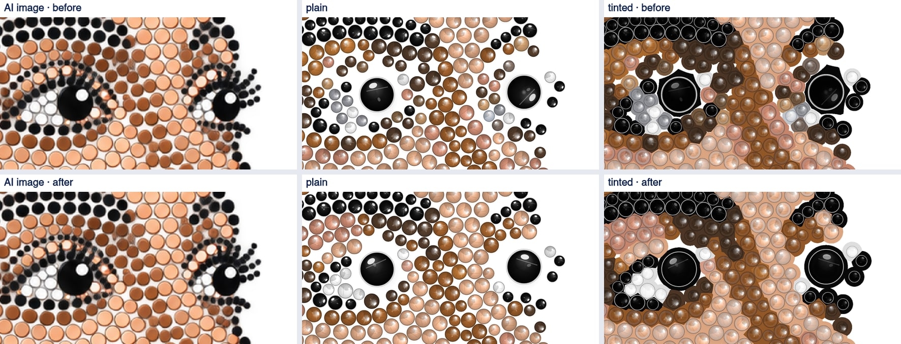

#### portrait

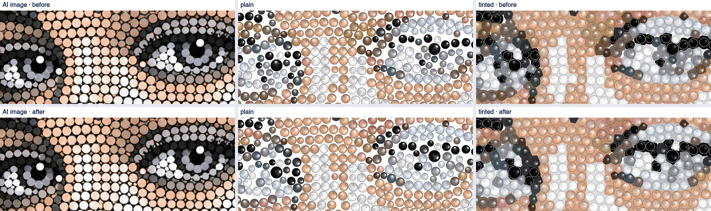

#### einstein

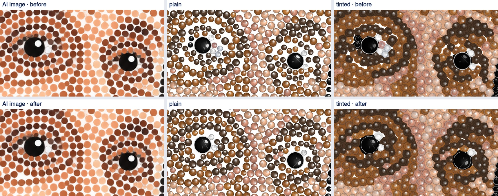

#### jesus

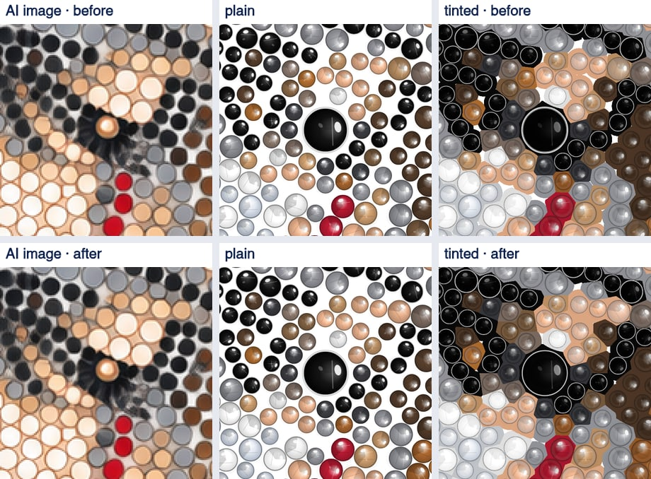

#### rs-dog (control)

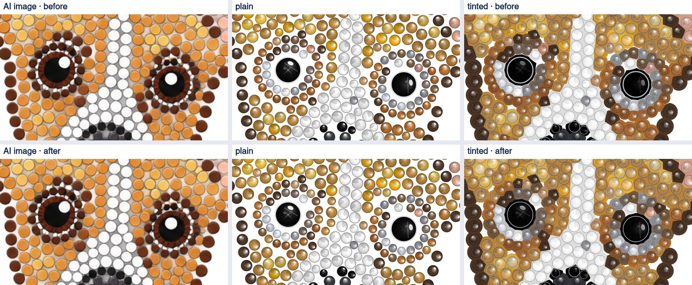

#### cat-rule (control)

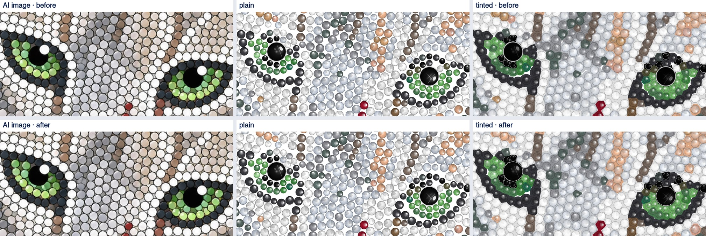

### 5.3 rs-woman face and neck

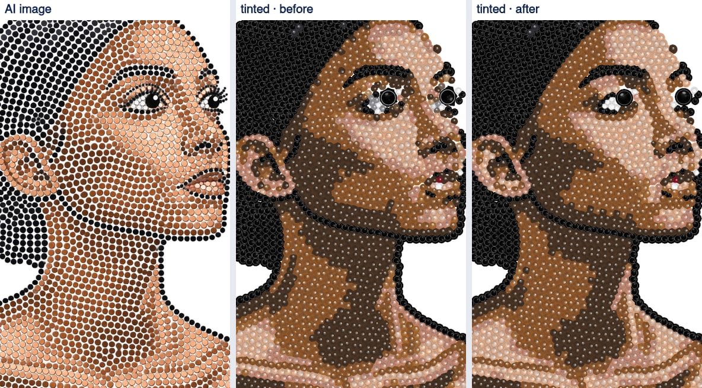

The shadow patches are smaller (Smoked Topaz on the woman 594 → 518 stones in the whole design,
`tests/test_is05c.py`), but they remain: the AI's shadow brown lies between two catalogue colours
(section 2.4). Removing them needs the catalogue or dithering decision of section 2.4.

### 5.4 Every design: what changed

The 21 designs of the IS-05 comparison, "before" against "after". "Positions and sizes": the
stone list without colours, compared stone for stone. "Colour changes": stones whose colour differs
(only meaningful when the positions are the same). "Render pixels changed by the renderer alone":
today's layout drawn by both renderers at 900 px, share of pixels that differ.

| Design | Face | Stones | Positions and sizes | Colour changes | ΔE per stone (fill) | ΔE per stone (rendered) | Render pixels changed by the renderer alone | SS4 / above SS6 |
| --- | --- | --- | --- | --- | --- | --- | --- | --- |
| dog-rule | human | 2039 | **changed** | (list shifted) | 7.58 → 7.46 | 9.83 → 9.85 | 0.28 % | 86 / 2 |
| dog-norule | human | 2071 | **changed** | (list shifted) | 6.9 → 6.76 | 9.28 → 9.38 | 0.25 % | 63 / 2 |
| cat-rule | animal | 3573 | same | 45 | 6.29 → 6.27 | 5.86 → 5.85 | 0.27 % | 302 / 2 |
| cat-norule | animal | 3140 | same | 130 | 7.59 → 7.46 | 6.94 → 6.87 | 0.34 % | 380 / 2 |
| mug-rule | animal | 1751 | same | 0 | 3.22 → 3.22 | 3.87 → 3.87 | 0.01 % | 70 / 0 |
| mug-norule | animal | 2224 | same | 0 | 3.35 → 3.35 | 4.64 → 4.64 | 0.01 % | 105 / 0 |
| giraffe-rule | animal | 2286 | same | 94 | 10.93 → 10.85 | 11.98 → 11.94 | 0.29 % | 339 / 2 |
| dachshund-rule | animal | 1628 | same | 48 | 9.04 → 9.02 | 13.45 → 13.49 | 0.28 % | 174 / 2 |
| car-rule | none | 3531 | same | 0 | 6.89 → 6.89 | 7.32 → 7.32 | 0.09 % | 255 / 0 |
| rs-cat | animal | 2150 | same | 40 | 5.4 → 5.39 | 6.81 → 6.76 | 0.49 % | 347 / 2 |
| rs-dog | animal | 1670 | same | 57 | 4.21 → 4.17 | 4.99 → 4.95 | 0.3 % | 140 / 2 |
| rs-einstein | human | 3590 | **changed** | (list shifted) | 7.01 → 6.87 | 9.67 → 9.74 | 0.23 % | 336 / 2 |
| rs-jesus | animal | 3297 | same | 285 | 5.83 → 5.47 | 7.13 → 7.25 | 0.14 % | 416 / 1 |
| rs-lake | human | 4089 | same | 36 | 8.3 → 8.29 | 10.27 → 10.27 | 0.02 % | 162 / 0 |
| rs-leopard | animal | 2433 | same | 42 | 5.58 → 5.53 | 6.68 → 6.65 | 0.29 % | 225 / 2 |
| rs-logo | animal | 833 | same | 0 | 3.42 → 3.42 | 4.18 → 4.18 | 0.01 % | 9 / 0 |
| rs-parrot | animal | 2542 | same | 3 | 8.99 → 8.97 | 11.68 → 11.67 | 0.1 % | 234 / 1 |
| rs-portrait | human | 3990 | **changed** | (list shifted) | 6.72 → 6.42 | 6 → 5.78 | 0.18 % | 404 / 2 |
| rs-rose | animal | 1846 | same | 0 | 7.98 → 7.98 | 13.49 → 13.49 | 0.01 % | 157 / 0 |
| rs-tulips | animal | 2673 | same | 0 | 9.34 → 9.34 | 13.4 → 13.4 | 0.01 % | 126 / 0 |
| rs-woman | human | 2613 | **changed** | (list shifted) | 7.01 → 6.48 | 9.84 → 9.81 | 0.27 % | 203 / 2 |
| **mean of 21** | | | | | 6.74 → 6.65 | 8.44 → 8.44 | | |

- **Positions change only where a person's face is found**: rs-woman, rs-portrait, rs-einstein,
  and the two IS-03b dogs (dog-rule, dog-norule), which dlib takes for a human face (known since
  IS-05b, section 3) and which therefore lose their iris rings too. rs-lake is also "human" but has
  no pupils, so nothing changes there. Face and pupils are the same on all 21.
- **The controls are not unchanged in colour**: rs-dog (57 stones), cat-rule (45), and the other
  animals with fur in skin colours change some SS4/SS6 stones between skin colours through
  `skin_nearest_inner`, as section 2.3 measured (all within the skin colours, checked by
  `tests/test_is05c.py` on the dog). Their positions and sizes are identical. Designs without skin
  colours (mug, car, logo, rose, tulips) are identical stone for stone.
- **The renderer alone** changes 0.01–0.5 % of a render's pixels: around stones above SS6 (pupils,
  SS10/SS16) and, slightly, around SS4 stones, whose fill margin grows from 0.45 to 0.6 mm.
- Per-stone ΔE (fill) improves or stays on all 21 (mean 6.74 → 6.65; woman 7.01 → 6.48, jesus
  5.83 → 5.47, portrait 6.72 → 6.42). Rendered ΔE is the same on average (8.44); it rises by at
  most 0.12 on five designs (jesus +0.12, dog-norule +0.10, einstein +0.07, dachshund +0.04, dog-rule +0.02).

[`IS-05-tinted-comparison.md`](IS-05-tinted-comparison.md) is re-rendered with today's layouts and
renderer.

### 5.5 Tests

- `node --test tools/test-exports.mjs`: the unit fixture now checks 0.5 mm (filled) and 0.7 mm
  (background) beyond every stone's edge and that the SS16 stone's old 1.5 r point is background; new
  test: a Jet stone of SS10, SS16 and SS20 has a light rim within 25 % of an SS6 one's and keeps its
  lightness, and Jet is the only colour with a rim lighter than its fill.
- Strass: new `tests/test_is05c.py` (defaults; woman and portrait lose iris stones, 19 → 10 and
  21 → 8; cat and dog identical with `human_iris` on or off; `skin_nearest_inner` changes only skin
  colours on woman and dog, and the woman's Smoked Topaz 594 → 518); `tests/test_build_j.py` runs
  `DEFAULT` with the two IS-05c rules reverted.
- Full strass suite (`python -m unittest -v`): **102 tests, OK**, none skipped (4245 s); the
  equivalence test finds package and prototype identical on all 12 images. `npm test`: 143 tests, all
  pass.

