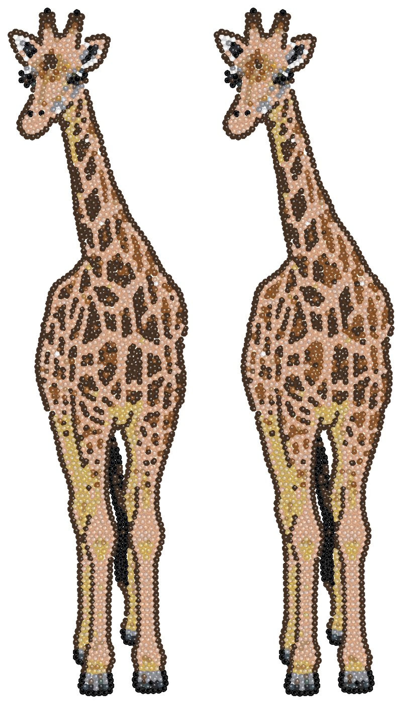
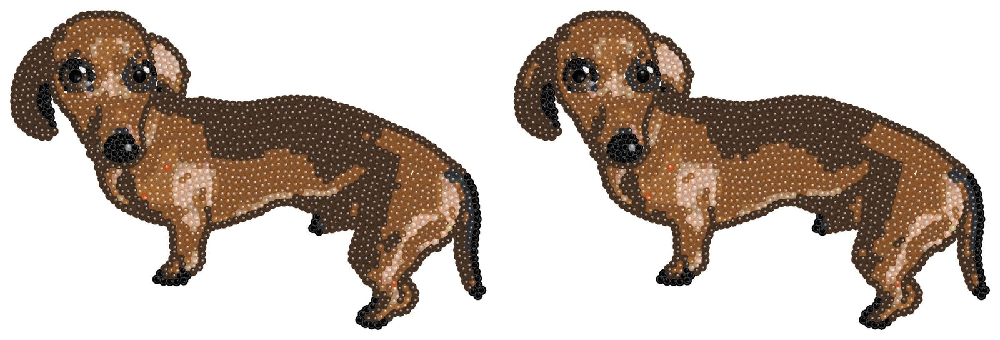
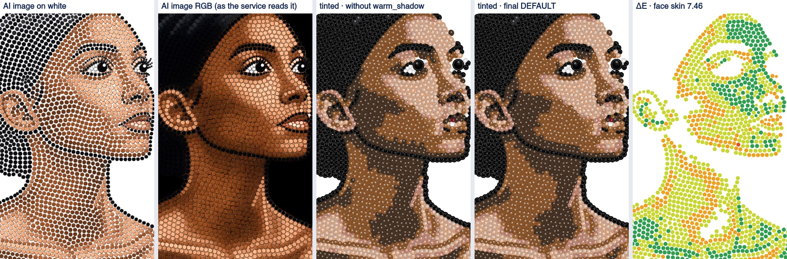

# IS-05d — skin shadow (experiment)

21 Oct 2026, branch `is-05d-skin`, run on Alex's laptop (Apple Silicon). Sections 1–8: the experiment,
with `DEFAULT` unchanged and the new rules off in every rule set. **Follow-up (sections 9–13): Alex
turned variant A on in `DEFAULT` with 3 ΔE**; B stays off everywhere. No provider call: everything is laid out from saved AI
images (`services/strass/prototype/img/` and `tools/fixtures/is03b-ai/cat-rule-output.png`).

Designs: rs-woman, rs-portrait, rs-einstein, rs-jesus (faces), rs-dog and cat-rule (controls).

Strass service restarted on this laptop with today's `DEFAULT` (`caffeinate -i scripts/start.sh`);
`GET /health` → `{"ok":true,"modelsLoaded":true,"version":"1.2.0","busy":false}`.

How to reproduce:

```
# layouts (services/strass)
.venv/bin/python scripts/is05d_runs.py <runs> shadow woman=prototype/img/N2_woman.png \
  portrait=prototype/img/N2_portrait.png einstein=prototype/img/N2_einstein.png \
  jesus=prototype/img/N2_jesus.png dog=prototype/img/N2_dog.png cat=../../tools/fixtures/is03b-ai/cat-rule-output.png
# images and numbers (docs/IS-05d-results/)
node tools/is05d-results.mjs <runs>
```

## Summary

| Question | Answer |
| --- | --- |
| Does any variant remove the woman's dark patch? | **No.** A moves 38 (1.5) or 75 (3) stones from Smoked to Colorado Topaz, 26 / 54 of them in the 521-stone jaw and neck shadow: the patch shrinks a little at its edges. B breaks the patch's hard edges into a texture, but it makes the shadow *darker*, not warmer (193 Colorado → Smoked against 144 the other way). C is B within a few stones: wherever B acts it overrides A. |
| Why does B go darker? | It matches the mix to the colour the service samples, the AI image's RGB (L\* 33.4, chroma 43). In linear light a 1:1 mix of the two stones is L\* ≈ 39, so for most of the shadow 2 Smoked : 1 Colorado matches best. |
| Then why does Alex see "warm mid-brown" in the AI image? | The AI woman is **semi-transparent**: in the middle of the image 36 % of the pixels are transparent and 60 % partly so (einstein 31 / 66 %, jesus 24 / 71 %, dog 23 / 25 %, portrait 0 %). The service reads RGB and ignores alpha. Seen on white, the shadow stones themselves are L\* 36.4, chroma 40, nearer Colorado Topaz than Smoked Topaz for 310 of the 521 stones, and the gaps between them show white, which the tinted preview fills instead. So the target that the eye compares against is lighter and warmer than the one the layout matches. |
| Recommendation | **A with 3 ΔE** (`warm_shadow`, `warm_shadow_de=3`). It acts only on the near ties, always towards the warmer stone, which is the one closer to what the AI image looks like; it costs 0.04 per-stone ΔE on the woman and nothing measurable elsewhere; the controls change by 1 stone (dog) and 0 (cat). It does **not** make the patch go away, and it should not be expected to (see "Open" at the end). |

## 1. The variants

New rules in IS's strass copy (`strass_layout/rules.py`, all default `False`; recorded in
`services/strass/ORIGIN.md`):

| Variant | Rules | What it does |
| --- | --- | --- |
| A 1.5, A 3 | `warm_shadow`, `warm_shadow_de` 1.5 / 3 | In `skin_nearest` (every SS4/SS6 stone in a skin colour): when the nearest skin colour is Smoked Topaz and Colorado Topaz is at most `warm_shadow_de` ΔE2000 further from the sampled colour, the stone takes Colorado Topaz. |
| B | `mixed_shadow` | New step after `calm_skin` (`faces.mixed_shadow`), so `calm_skin` cannot undo the pattern: on SS4/SS6 Smoked and Colorado Topaz stones outside 1.5 eye-zone radii, the local colour is the mean Lab of the stone and its skin-coloured neighbours. Of the shares of Colorado Topaz 0, 1/3, 1/2, 2/3 and 1, mixed in linear light from the two catalogue fills, the one nearest the local colour (ΔE2000) is chosen; for 1/3, 1/2 or 2/3 the stone takes its place in the pattern `C S S`, `C S` or `C C S` along its row. |
| C 1.5, C 3 | A and B | Both. |

Rows: the stones are the AI's own positions pushed apart, not a grid (nearest-neighbour directions
cluster near 0°, 60° and 120°, but rows drift: y modulo the pitch is flat). So `faces._rows` links
each stone to its nearest neighbour to the right (within 27° of horizontal and touching within
0.6 mm), closest pairs first, one link each way; a row is a chain of links. The pattern index is
the chain position plus the chain start's x in link lengths, plus the row number (the chain start's
y in 0.87 link lengths), so neighbouring rows are staggered.

## 2. rs-woman face and neck

Each row: AI image, tinted default, tinted variant, per-stone ΔE map of the skin stones (green < 5,
yellow < 10, orange < 15, red < 20, dark red ≥ 20). Rows: default, A 1.5, A 3, B, C 1.5, C 3.


The jaw and neck shadow: skin stones of the face window (77 × 123 mm) whose AI colour has L\* 25–40
(521 stones, mean AI colour L\* 33.4, chroma 43). Columns:

- **ΔE stone**: per stone, AI colour (inner 60 %, RGB as the service reads it) vs the stone's fill;
- **ΔE 3 mm**: per stone, the light mix of the fills of the skin stones within 3 mm vs the light mix
  of the AI colours under them (what a mix of stones should be judged on);
- **ΔE rendered 3 mm**: the tinted preview against the AI image *as seen on white*, each averaged
  in linear light over a 3 mm disc (gaps and highlights in both); dL is render − AI.

| Variant | Changed | Smoked / Colorado | ΔE stone | ΔE 3 mm | ΔE rendered 3 mm | dL rendered |
| --- | --- | --- | --- | --- | --- | --- |
| default | – | 257 / 263 | 10.10 | 7.68 | 23.47 | −23.5 |
| A 1.5 | 38 | 231 / 289 | 10.12 | 7.77 | 22.95 | −22.9 |
| A 3 | 75 | 203 / 317 | 10.24 | 8.00 | 22.36 | −22.2 |
| B | 337 | 277 / 243 | 11.80 | 6.84 | 24.00 | −23.9 |
| C 1.5 | 337 | 277 / 243 | 11.80 | 6.84 | 24.00 | −23.9 |
| C 3 | 338 | 276 / 244 | 11.80 | 6.84 | 23.99 | −23.9 |

Face window, all 1252 skin stones:

| Variant | ΔE stone | ΔE 3 mm | ΔE rendered 3 mm | Skin stones per colour |
| --- | --- | --- | --- | --- |
| default | 7.40 | 5.58 | 15.17 | colorado-topaz 505, silk 307, smoked-topaz 258, rose-gold 140, copper 39, others 3 |
| A 1.5 | 7.41 | 5.62 | 14.93 | colorado-topaz 531, silk 307, smoked-topaz 232, rose-gold 140, copper 39, others 3 |
| A 3 | 7.46 | 5.71 | 14.66 | colorado-topaz 559, silk 307, smoked-topaz 204, rose-gold 140, copper 39, others 3 |
| B | 8.35 | 5.11 | 15.63 | colorado-topaz 454, smoked-topaz 309, silk 307, rose-gold 140, copper 39, others 3 |
| C 1.5 | 8.35 | 5.11 | 15.63 | as B |
| C 3 | 8.35 | 5.10 | 15.62 | colorado-topaz 455, smoked-topaz 308, (rest as B) |

The measures disagree, and the reason is the target colour:

| Shadow stones, mean L\* | AI inner 60 % | AI stone disc | AI 3 mm | fill | render inner 60 % | render disc | render 3 mm |
| --- | --- | --- | --- | --- | --- | --- | --- |
| default | 33.4 | 32.4 | 32.4 | 38.1 | 42.1 | 36.3 | 36.2 |
| A 3 | 33.4 | 32.4 | 32.4 | 39.9 | 44.0 | 38.1 | 37.7 |
| B | 33.4 | 32.4 | 32.4 | 37.4 | 41.4 | 35.6 | 35.3 |

(Lab means over opaque pixels only, as the service reads them.) Against the AI's RGB the stones are
already 4–6 L\* *too light*, so every measure built on the service's sampling rewards B, which adds
Smoked Topaz. Seen on white, as Alex sees the AI image, the shadow stones are L\* 36.4, chroma 40
(alpha 0.95 inside the stones), Colorado Topaz is the nearer stone (ΔE 10.75 against 12.56 for Smoked
Topaz) for 310 of 521 stones, and the transparent gaps show white: the rendered 3 mm comparison puts
the tinted preview 23 L\* below the AI image. Most of that gap is the gaps (white in the AI image,
filled in the preview, spec section 8), which no stone colour can close; what the stone colour can do
is move towards the lighter, warmer side, and only A does.

## 3. Eye and cheek close-ups

Eye window (both pupils of the default plus 7 mm) and cheek window (as wide, from 2 mm below the
lower pupil, 1.2 times as high), 30 px per mm. Columns: AI image, default, A 1.5, A 3, B, C 1.5, C 3.

#### rs-woman


#### rs-portrait


#### rs-einstein


#### rs-jesus

dlib finds no face on jesus, so the service lays it out as an animal with one pupil; the eye window is
around that one pupil.


No variant changes a pupil, catch-light or lash stone. A changes a few stones around the eyes and on
the cheeks. B skips only stones within 1.5 eye-zone radii: on einstein the AI's brown rings around
both eyes (Smoked and Colorado Topaz) lie outside that and become a speckled Smoked/Colorado
texture, which makes the eye sockets read busier than the AI's smooth brown; on the cheeks B gives
the shadow the same texture.

## 4. Every design: per-stone ΔE, skin ΔE, what changed

Stone positions, sizes, face and pupils are **identical to the default on all six designs for every
variant**; only colours change. Skin: every stone whose AI colour is warm (hue 30–78°, chroma 12–60,
L\* ≥ 25), as in IS-05c. ΔE per stone over the whole design (fill vs AI inner 60 %), then skin ΔE
(same, skin stones), skin ΔE 3 mm and skin ΔE rendered 3 mm (section 2).

| Design | Variant | Changed | ΔE per stone | ΔE rendered | Skin ΔE | Skin ΔE 3 mm | Skin ΔE rendered 3 mm |
| --- | --- | --- | --- | --- | --- | --- | --- |
| rs-woman | default | – | 6.48 | 9.81 | 7.30 | 5.52 | 15.34 |
| | A 1.5 | 38 | 6.49 | 9.84 | 7.31 | 5.56 | 15.07 |
| | A 3 | 75 | 6.52 | 9.87 | 7.36 | 5.65 | 14.82 |
| | B | 337 | 7.24 | 10.35 | 8.29 | 5.12 | 15.78 |
| | C 1.5 / C 3 | 337 / 338 | 7.24 | 10.35 / 10.36 | 8.29 / 8.30 | 5.12 | 15.78 |
| rs-portrait | all | 0 | 6.42 | 5.78 | 7.27 | 6.46 | 3.60 |
| rs-einstein | default | – | 6.87 | 9.74 | 7.57 | 5.65 | 15.66 |
| | A 1.5 | 9 | 6.87 | 9.74 | 7.57 | 5.67 | 15.60 |
| | A 3 | 17 | 6.88 | 9.74 | 7.59 | 5.68 | 15.54 |
| | B | 133 | 7.19 | 9.99 | 8.12 | 5.68 | 15.86 |
| | C 1.5 / C 3 | 135 / 138 | 7.19 | 9.99 | 8.12 / 8.13 | 5.67 | 15.84 / 15.82 |
| rs-jesus | default | – | 5.47 | 7.25 | 6.54 | 4.97 | 11.08 |
| | A 1.5 / A 3 | 1 / 2 | 5.48 | 7.25 | 6.54 | 4.98 / 4.97 | 11.07 / 11.06 |
| | B | 134 | 5.94 | 7.62 | 7.19 | 5.21 | 10.48 |
| | C 1.5 / C 3 | 134 / 135 | 5.94 | 7.62 | 7.19 / 7.20 | 5.21 / 5.20 | 10.48 / 10.47 |
| rs-dog (control) | default | – | 4.17 | 4.95 | 8.32 | 7.90 | 6.63 |
| | A 1.5 / A 3 | 1 | 4.17 | 4.95 | 8.32 | 7.90 | 6.59 |
| | B | 26 | 4.32 | 5.08 | 8.44 | 8.02 | 6.57 |
| | C 1.5 / C 3 | 27 | 4.32 | 5.08 | 8.44 | 8.02 | 6.53 |
| cat-rule (control) | default | – | 6.27 | 5.85 | 6.54 | 5.00 | 4.69 |
| | A 1.5 / A 3 | 0 | 6.27 | 5.85 | 6.54 | 5.00 | 4.69 |
| | B, C 1.5, C 3 | 6 | 6.29 | 5.86 | 6.75 | 5.08 | 4.79 |

Colour changes against the default (all are between the two topazes):

| Design | A 1.5 | A 3 | B | C 3 |
| --- | --- | --- | --- | --- |
| rs-woman | S→C 38 | S→C 75 | C→S 193, S→C 144 | C→S 193, S→C 145 |
| rs-portrait | none | none | none | none |
| rs-einstein | S→C 9 | S→C 17 | C→S 70, S→C 63 | C→S 70, S→C 68 |
| rs-jesus | S→C 1 | S→C 2 | S→C 130, C→S 4 | S→C 131, C→S 4 |
| rs-dog | S→C 1 | S→C 1 | S→C 25, C→S 1 | S→C 26, C→S 1 |
| cat-rule | none | none | S→C 6 | S→C 6 |

(S = Smoked Topaz, C = Colorado Topaz.) Skin-area stones per colour for every design and variant are
in `IS-05d-results/numbers.json` (`<design>.rows[].skinByColour`).

**Controls.** A: cat-rule unchanged; rs-dog one stone Smoked → Colorado Topaz (in its skin area).
B and C: rs-dog 26–27 stones, 24 of them outside the skin area (stones laid as Smoked or Colorado
Topaz whose AI colour is not counted as skin, e.g. darker than L\* 25; B acts on the stone colour,
not the AI colour), cat-rule 6 stones. rs-portrait has no
topaz and is unchanged by every variant.

## 5. Findings

- **A** does what it says and nothing else: it acts only on the closest ties (woman 38 / 75 stones,
  einstein 9 / 17, jesus 1 / 2, dog 1, cat 0), always towards Colorado Topaz. Per-stone ΔE moves by
  at most 0.04, the rendered comparison improves on every design that has topaz (woman shadow
  23.47 → 22.36 at 3 ΔE). Visually the patch is a little smaller at its edges and still there: with
  3 ΔE, 203 of the 521 shadow stones are still Smoked Topaz, because for them Smoked Topaz is
  clearly nearer the colour the service samples.
- **B** turns the hard patch edges into a texture, which is the visible effect Alex asked for, but
  the texture leans dark (2:1 Smoked on most of the woman's shadow), extends Smoked Topaz into areas
  that were Colorado Topaz (left cheek), and costs 0.3–0.8 per-stone ΔE on the faces. Its own
  target measure (ΔE 3 mm) improves (woman shadow 7.68 → 6.84) because it matches the RGB colour; the
  rendered comparison gets worse on woman and einstein and better only on jesus (where B adds
  Colorado Topaz). It also reaches the dog's dark fur. At 2.1 mm pitch a 1:2 or 1:1 pattern of
  stones of L\* 29 and 47 reads as speckle at the preview's size, not as a mid-brown.
- **C** is B within one to four stones: B overrides A wherever B acts, and A's near-ties are
  almost always stones B mixes.
- The patch is not a rule problem. The service matches the AI image's RGB, ignoring that the AI drew
  the woman semi-transparent; on white it looks lighter and warmer than the colour that is matched.

## 6. Recommendation

**A with `warm_shadow_de = 3`** (variant "warm-3"), if one variant is to be shipped. It is the only
variant that moves the woman towards what the AI image looks like, it is near-neutral on per-stone
ΔE, and it leaves the controls alone (dog one stone, cat none). Not applied: `DEFAULT` is unchanged.

Open, for Alex (not tried here):

1. **Composite the AI image on white before sampling colours** (or on the garment colour, if that
   is what the buyer will see). This would change every colour read in the service (detections,
   delivered stones, skin_nearest), not only the shadow, so it is a separate experiment; the woman,
   einstein and jesus AI images are semi-transparent, the portrait is not.
2. B's mix target could be the composited colour of item 1; with it, B would lean towards Colorado
   Topaz instead of Smoked Topaz. Without item 1, B is not recommended.
3. A catalogue stone between the two topazes (IS-05c section 2.4) remains the only way to a flat
   mid-brown.

## 7. Tests

- Strass service (`python -m unittest -v`, equivalence test included, `caffeinate -i`): **109 tests,
  OK, none skipped**, 4336 s. The equivalence test finds the package and the prototype identical on
  all 12 images.
- `npm test`: 143 tests, all pass (the provider-leak test included).

## 8. Files

- `services/strass/strass_layout/rules.py`: `warm_shadow`, `warm_shadow_de`, `mixed_shadow` (off
  everywhere).
- `services/strass/strass_layout/faces.py`: `skin_nearest(..., warm_de)`, `mixed_shadow`, `_rows`,
  `MIX_PATTERNS`; `finish_faces` runs `mixed_shadow` after `calm_skin`.
- `services/strass/strass_layout/pipeline.py`: reads the stone colours for `mixed_shadow` too.
- `services/strass/tests/test_is05d.py` (new); `services/strass/scripts/is05d_runs.py` (new,
  diagnosis only); `tools/is05d-results.mjs` (new); `docs/IS-05d-results/`.

---

## 9. Follow-up: variant A on in `DEFAULT` (3 ΔE)

Alex's decision: `DEFAULT` has `warm_shadow=True`, `warm_shadow_de=3.0`; `mixed_shadow` (B) stays off
in every rule set; `PROTOTYPE` and `BUILD_*` are unchanged (`services/strass/ORIGIN.md`, "IS-05d
decision"; spec 7.4). The runs below lay out all 21 test designs twice with the same detections:
"final" (`DEFAULT`) and "default" (`DEFAULT` with `warm_shadow` off, i.e. the service before this
change).

```
# layouts (services/strass)
.venv/bin/python scripts/is05d_runs.py <runs> final,default <id>=<png> ...   # the 21 designs, ids as below
# transparency (section 10), woman (section 12)
node tools/is05d-transparency.mjs <runs>
node tools/is05d-results.mjs <runs> --final
```

On all 21 designs, stones, sizes, coverage, violations (0), faces and pupils are identical to the
service before the change. Only colours change, on 11 designs:

| Design | Stones changed | What |
| --- | --- | --- |
| giraffe-rule | 97 | Smoked → Colorado Topaz |
| rs-woman | 75 | Smoked → Colorado Topaz |
| dachshund-rule | 65 | Smoked → Colorado Topaz |
| rs-leopard | 33 | Smoked → Colorado Topaz |
| rs-einstein | 17 | Smoked → Colorado Topaz |
| dog-rule | 12 | Smoked → Colorado Topaz 11, Smoked → Light Smoked Topaz 1 |
| dog-norule | 10 | Smoked → Colorado Topaz 9, Copper → Colorado Topaz 1 |
| rs-cat | 7 | Smoked → Colorado Topaz 6, Smoked → Light Smoked Topaz 1 |
| rs-lake | 5 | Smoked → Colorado Topaz |
| rs-jesus | 2 | Smoked → Colorado Topaz |
| rs-dog | 1 | Smoked → Colorado Topaz |
| the other 10 | 0 | – |

(The three changes that are not Smoked → Colorado Topaz are knock-on effects of the later skin steps,
which see the new neighbour.)

**Not seen in the experiment:** the giraffe and the dachshund were not among the IS-05d designs, and
A acts on them more than on any control there. On the giraffe, part of the dark coat patches turn
from Smoked to Colorado Topaz, so those patches are lighter and lower in contrast against the coat;
on the dachshund the darker parts of the hip and ear get a little lighter. Left: before, right: final
`DEFAULT`.





## 10. Transparency inside the stones (21 AI images)

For every delivered stone (after the SS16 cap and the overlap cleanup, final `DEFAULT`), every pixel
of the inner 60 % of its radius in the AI image, counted by alpha (`tools/is05d-transparency.mjs`,
numbers in `IS-05d-results/transparency.json`). "Partly" is alpha 1–254, split 1–127 / 128–239 /
240–254; "deficit" is the mean of 1 − alpha/255 over those pixels (how much of a stone's colour the
background replaces on average).

| Design | Stones | Fully transparent % | Partly % (1–127 / 128–239 / 240–254) | Opaque % | Deficit % |
| --- | --- | --- | --- | --- | --- |
| dog-rule | 2039 | 0 | 99.9 (0 / 0.2 / 99.7) | 0 | 1.9 |
| dog-norule | 2071 | 0 | 100 (0.1 / 1.3 / 98.6) | 0 | 2.9 |
| cat-rule | 3573 | 0 | 100 (0 / 0.1 / 99.9) | 0 | 1.8 |
| cat-norule | 3140 | 0 | 100 (0 / 0.3 / 99.7) | 0 | 1.3 |
| mug-rule | 1751 | 0 | 100 (0 / 0 / 100) | 0 | 0.6 |
| mug-norule | 2224 | 0 | 100 (0 / 0 / 100) | 0 | 0.7 |
| giraffe-rule | 2286 | 0.1 | 99.9 (0.5 / 3.0 / 96.4) | 0 | 2.5 |
| dachshund-rule | 1628 | 0 | 99.9 (1.1 / 23.6 / 75.2) | 0 | 6.1 |
| car-rule | 3531 | 0 | 100 (0 / 0.5 / 99.5) | 0 | 1.4 |
| rs-cat | 2150 | 0 | 100 (0.7 / 6.9 / 92.4) | 0 | 4.4 |
| rs-dog | 1670 | 0 | 100 (0.2 / 3.3 / 96.5) | 0 | 2.6 |
| rs-einstein | 3590 | 0 | 99.9 (0.2 / 16.8 / 82.9) | 0 | 4.8 |
| rs-jesus | 3297 | 0 | 100 (0.2 / 15.2 / 84.6) | 0 | 4.7 |
| rs-lake | 4089 | 0 | 100 (0.3 / 23.1 / 76.6) | 0 | 5.2 |
| rs-leopard | 2433 | 0 | 99.9 (0.5 / 16.0 / 83.4) | 0 | 5.0 |
| rs-logo | 833 | 0 | 99.8 (0.2 / 0.5 / 99.1) | 0.3 | 1.9 |
| rs-parrot | 2542 | 0 | 100 (0.1 / 1.3 / 98.6) | 0 | 2.2 |
| rs-portrait | 3990 | 0 | 100 (0.1 / 0.4 / 99.5) | 0 | 1.2 |
| rs-rose | 1846 | 0 | 99.8 (0 / 1.1 / 98.7) | 0.2 | 2.4 |
| rs-tulips | 2673 | 0 | 99.9 (0.1 / 5.5 / 94.3) | 0.1 | 3.6 |
| rs-woman | 2613 | 0 | 100 (0.2 / 11.7 / 88.1) | 0 | 4.4 |

Where the images come from:

| Images | Pipeline | Prompt | Background setting |
| --- | --- | --- | --- |
| The 9 IS-03b fixtures (`tools/fixtures/is03b-ai/`) | **Current IS pipeline**: IS-03b, 18 Oct 2026 (`tools/measure-is03b.mjs`): IS background removal, model input crop, size auto | IS prompt version 2; `-rule` with the "about 60 stones across" sentence, `-norule` without it. Version 3 (production today) is version 2 without that sentence, so the 3 `-norule` images are what today's request produces | Request `background transparent` (spec 7.3), and the prompt's background rule (transparent, magenta only as a fallback), the same as today |
| The 12 RS test images (`services/strass/prototype/img/N2_*.png`) | **Older RS test images**: made 5 Oct 2026 (C2PA timestamp) through the provider's API for the RS layout prototype, before RS prompt v3; square 1254 px | The RS research prompt "v2" (RS IMG-026, S10), not an IS or RS app prompt | Not recorded. The outputs are RGBA with transparent backgrounds |

What it shows:

- **Not a single stone pixel is fully opaque** (alpha 255) in any of the 21 images, and almost none is
  fully transparent. The provider's "opaque" pixels sit at alpha 240–254 (on cat-rule mostly
  249–252; on mug-rule all 253).
- By the letter of the question every image is ~100 % "partly transparent", so the IS-03b fixtures
  are far above 5 %. By what it does to colour, the transparency inside stones is small: the
  background replaces 0.6–2.9 % of a stone's colour on 8 of the 9 fixtures, and 6.1 % on the
  dachshund, the only fixture with a real share below alpha 240 (24.7 %). The older RS images are
  more transparent (deficit up to 5.2 %, 12–24 % of pixels below 240 on the faces, lake and leopard).
- The woman (IS-05d section 2): the 36 % fully transparent pixels found there lie in the **gaps**
  between the stones, not in them. Inside her stones the deficit is 4.4 %, which on white is enough
  to lift a dark shadow stone by about 3 L\* (IS-05d section 2: L\* 36.4 on white against 33.4 in
  RGB); light stones move by less than 1 L\*. The rest of the difference Alex sees is the white
  showing through the gaps (section 12).
- The layout does not see any of this: the service reads RGB and ignores alpha, so the transparency
  inside stones changes only how the AI image looks on white, never which stone is chosen.

## 11. Step 3 (variant M): triggered, not run — no API key

The IS-03b fixtures are above the 5 % threshold (100 % partly transparent by alpha < 255), so step 3
applies. **It was not run**: the repository has no `.env` at all, so no provider key is set. No
provider call was made and the production request is unchanged.

To run it, put `OPENAI_API_KEY` (and the model and quality settings) in `.env` with `IS_FAKE` empty;
step 3 then needs the 6 calls (dog, cat, mug × current request, variant M).

What to expect, from section 10: since the service ignores alpha, variant M changes the layout only
through whatever the provider draws differently when it is asked for an opaque magenta background;
the alpha deficit itself (0.6–2.9 % on the fixtures, 6.1 % on the dachshund) never reached the
layout. What M would fix is the mismatch between the AI image on white and the stones, up to about
3–4 L\* on dark stones, and it cannot touch the transparent gaps, because IS turns the magenta back
into transparency. Its risks are a magenta fringe on stone edges and magenta inside the subject.
Recommendation: run the 6 calls only if the per-stone RGB itself is expected to change (darker or
lighter stones drawn by the provider), not to fix transparency; the transparency inside stones is
small and does not affect the layout.

## 12. rs-woman face and neck with the final `DEFAULT`

AI image on white (as Alex sees it), the AI image's RGB with alpha ignored (what the service reads),
tinted without `warm_shadow`, tinted with the final `DEFAULT`, and the final per-stone ΔE map of the
skin stones (colours as section 2). The final layout equals variant "A 3" of sections 2–4 exactly:
75 stones Smoked → Colorado Topaz, face skin Colorado Topaz 559 / Smoked Topaz 204, face skin ΔE
7.46.



The RGB panel shows that the dark jaw and neck shadow is in the AI image the service reads; the
tinted preview follows it. The patch is a little smaller at its edges with A, as expected (section 5).

## 13. Follow-up tests

- Strass service (`python -m unittest -v`, equivalence included, `caffeinate -i`): **109 tests, OK, none
  skipped**, 4323 s; the equivalence test finds the package and the prototype identical on all 12 images.
- `npm test`: 143 tests, all pass (the provider-leak test included).

Files: `services/strass/strass_layout/rules.py` (`DEFAULT`), `services/strass/tests/test_is05d.py`,
`services/strass/tests/test_build_j.py`, `services/strass/scripts/is05d_runs.py` ("final"; "default"
is now `warm_shadow` off), `services/strass/ORIGIN.md`, `docs/IS-001-Spec.md` (7.4),
`tools/is05d-transparency.mjs` (new), `tools/is05d-results.mjs` (`--final`), `docs/IS-05d-results/`
(`transparency.json`, `woman-face-final.jpg`, `final-giraffe-rule.jpg`, `final-dachshund-rule.jpg`).
