# exp-faces — eyes, lips and teeth on human faces

Branch `exp-faces`, 24 Oct 2026. Experiment only: production is unchanged. The face-feature module
(`src/pipeline/faces.js`) is not called by the app; it is run by `tools/exp-faces.mjs` on saved AI
images. No provider calls were made.

This document holds the CC0 and RS results (colour only: they have no black & white AI images).
The private portraits (12 photos, each in colour, B&W halftone and B&W stencil) are reported only
under `data/private-portraits/` (`faces.html`, `faces-report.md`); the recommendations below draw on
them without quoting their numbers.

## 1. What was built

| Part | Where |
| --- | --- |
| Landmarks: MediaPipe Face Landmarker (Face Mesh V2, 478 points with irises) | `services/strass/scripts/face_landmarks.py`, own venv `services/strass/.venv-faces` (mediapipe 0.10.21), model `services/strass/models/mediapipe/face_landmarker.task` (SHA-256 checked; both git-ignored) |
| Regions and feature designs, one module, three styles (`colour`, `stencil`, `halftone`) | `src/pipeline/faces.js` (`faceRegions`, `designFaceFeatures`, `finishFaceFeatures`) |
| Unit tests on a synthetic face | `tools/test-faces.mjs` (part of `npm test`) |
| The experiment: layouts, landmarks, designs, likeness, pictures | `tools/exp-faces.mjs private data/private-portraits` / `public data/exp-faces` |

The module takes plain `{ x, y, d, color }` stones in the layout's mm, the faces' landmarks in the
same mm, and readers (the AI image, the photo, the AI's stone discs `report.discsAtMm`, the AI's
pupils `report.pupilsAtMm`). Nothing in it depends on where the landmarks come from, so the
direct path (round 3) can call it with its own landmarks.

Every design goes the way of a delivered one: `cleanedLayout` (cap, cleanup, hole fill), the black
& white mapping for B&W, then `designFaceFeatures` (one feature per variant), the hole fill again
(`fillHoles`, neighbours' colour), `finishFaceFeatures` (the stencil eye band) and the IS gap
check. B&W views use `BW_GAP=crystal`.

## 2. Landmarks

Each image is composited on white; the AI image is blurred with a Gaussian of 0.6 mm (σ), so its
stones merge into a picture. MediaPipe's face detector misses small faces in a large image, so
images over 700 px are also searched in overlapping half-size crops; a face found twice is kept
once, and a mesh whose irises are closer than a quarter of its face width is dropped.

Two sources per design:

- **AI image** (blurred): the mesh of what the AI drew, in the AI image's frame.
- **Prepared photo** (the model input; it has the AI image's shape, so a scale maps it into the AI
  image's frame).

An AI face counts when a prepared-photo face lies within 0.6 eye distances of it (iris centres);
an AI face without one is a false find (hair, a hand, a dog). A photo face with no AI face is used
as mapped. Without a prepared photo (CC0, RS) the AI faces are taken at confidence 0.7 and only
those at least 0.6 of the largest face's eye distance; a design whose original photo has no human
face gets none.

What works (private set; numbers in `faces-report.md`): the AI image's landmarks work in all three
styles once blurred, and the prepared photo's work everywhere; matching them removes the false
finds. The AI moves features: typically a small fraction of the eye distance in colour, more in
the stencil and halftone drawings, and up to about half an eye distance for the small faces of a
group photo. The AI's pupils (the service's `pupilsAtMm`) are the most reliable eye position: the
landmarks of a stone drawing can be a few mm off, and designing at them gave doubled pupils (the
AI's left beside the designed one). The module therefore moves each eye to the service's pupil
when one lies within 1.5 iris radii (at least 1.5 mm) of the landmark iris.

CC0 and RS:

| Image | Original photo | AI image (strict) | Used |
| --- | --- | --- | --- |
| CC0 car, cat, dachshund, dog, giraffe, mug | no human face | – | none (at the default confidence MediaPipe meshes the dog's face; the photo rules it out) |
| RS cat, dog, lake, leopard, logo, parrot, rose, tulips | – | none | none (false meshes at confidence 0.3–0.5) |
| RS jesus | – | none | none: a profile; Face Mesh finds no face at 0.7 and puts the eyes on the forehead at 0.5 |
| RS einstein | – | 1 | 1 |
| RS portrait | – | 1 | 1 |
| RS woman | – | 1 (the ear at 0.5 dropped) | 1 |

## 3. dlib's 68-point model, and MediaPipe in its place

The strass service uses dlib (`strass_layout/models.py`): its HOG frontal face detector and
`shape_predictor_68_face_landmarks.dat`, downloaded by `setup_mac.sh` from the PyPI package
`face_recognition_models==0.3.0`. The landmarks are used only to place the two eye boxes (points
36–47 of the largest face) in which `post.py` looks for pupils.

- **Licence of the 68-point model.** dlib's code is under the Boost Software License, but the model
  is trained on the **iBUG 300-W** dataset, whose licence excludes commercial use. The dlib-models
  README says so and that the trained model therefore can't be used in a commercial product without
  checking with a lawyer or Imperial College London
  (<https://github.com/davisking/dlib-models>). `face_recognition_models` only repackages the same
  file. IS sells designs, so this is a real risk.
- **MediaPipe.** The Face Landmarker model (Face Mesh V2) is licensed under Apache 2.0 (its model
  card, "Licensed under Apache License, Version 2.0"), as is the library. It gives 478 points with
  iris centres and rims; the eye contours replace dlib's points 36–47 directly.
- **Can it replace dlib in the service?** Technically yes, and the eye boxes would come from
  better points. But mediapipe 0.10.21 cannot simply be added to the service's environment: it pulls
  jax 0.7.1, which needs ml_dtypes 0.5, while TensorFlow 2.16 (StarDist) pins ml_dtypes ~0.3.1, and
  it brings opencv-contrib-python next to opencv-python-headless (both install `cv2`). Ways: pin
  jax/jaxlib 0.4.x; or run the `.tflite` models inside `face_landmarker.task` with TensorFlow's own
  `tf.lite.Interpreter`, already in the venv (no new package; the detector's anchors and the mesh's
  crop need writing); or keep a separate process as in this experiment. Replacing dlib changes which
  faces the service finds, so it needs the equivalence and IS-05b tests re-baselined: a build of its
  own.

## 4. Regions

From the mesh (`faceRegions`): each eye's opening (16 contour points), upper lid (9), iris (centre
468/473 and the mean distance to its 4 rim points); the upper lip (outer upper chain + inner upper
chain), the lower lip, the line between them (the mean of the inner chains) and, when the inner
lips are at least 1 mm and 8 % of the mouth width apart at the centre, the opening. The teeth are
the opening's AI pixels with L* ≥ 62; both rows show when, column by column, at least 30 % of the
columns with teeth have two light runs with a dark gap between them (a smile showing only the upper
teeth is one row).

How the AI drew each feature (its stone discs in each zone, read as the style reads them):

| RS | Eye widths | Iris radii | Pupil disc | Iris discs | Eye white discs | Upper lip | Lower lip |
| --- | --- | --- | --- | --- | --- | --- | --- |
| einstein | 13.8 / 10.1 mm | 2.8 / 2.6 mm | 3.5 mm, Jet | 2: Crystal (catch-lights) | 12: Smoked and Colorado Topaz, Crystal | 13: Hematite, Silver (the moustache) | 15: Siam, Indian Siam |
| portrait | 14.4 / 21.8 mm | 4.1 / 4.4 mm | 3.2 mm, Jet | 14: Grey, Jet, Graphite | 22: Crystal, Silver, Grey | 31: Light Siam, Jet, Scarlet | 42: Scarlet, Padparadscha, Light Siam |
| woman | 11.0 / 6.5 mm | 2.1 / 1.7 mm | 3.4 mm (in the iris zone) | 3: Jet, Crystal | 8: Crystal, Jet | 9: Jet, Silk | 8: Smoked Topaz, Light Siam |

The AI draws large dark pupils (the service makes them SS20) in small irises: in two of the three RS
faces and in most private portraits the iris radius is not much more than the radius of an SS16
stone (2 mm), often less.

## 5. Variants

One feature per variant; the other features stay as today.

- **E1** the AI's eye stones kept, cleaned: in the iris every stone takes the AI's iris colour (its
  mid-tone discs' majority; a Crystal catch-light at the upper right kept), in the opening the AI's
  white (its light discs' majority; dark lash stones at the upper lid kept), and the pupil stone
  moved to the centre of the AI's iris discs.
- **E2** designed: SS16 Jet pupil, a ring of SS4 or SS6 iris stones where it falls inside the opening
  (the photo's iris colour, median of mid-tone samples, in colour; Jet in B&W), an SS4 Crystal
  catch-light 0.1 mm from the pupil at the upper right, Crystal white, a lid line of SS4 Jet along
  the upper lid. The AI's large dark stones near the eye are removed.
- **E3** E2 with the pupil a cluster of SS6 Jet stones (four in a square, seven for a wide iris) and
  the catch-light an SS4 Crystal stone in the cluster's upper right place.
- Stencil: with any eye variant, every Jet stone within 3.1 mm of the opening becomes Crystal (with
  E1 beyond the 1 mm lid margin, which keeps the AI's lashes): a row of Crystal between the eye and
  shadows or eyebrows.
- **L1** one tone: colour the AI's lip colour (its discs' majority, not the dark line); stencil and
  halftone solid Jet.
- **L2** colour: upper and lower lip each in the AI's colour, the upper made darker (by 6 L* at least,
  same hue) when it is not, and an SS4 line between them in a darker tone of the same hue; stencil:
  Crystal lips with an SS4 Jet outline and line; halftone: a regular mix on the SS6 lattice (upper 2/3
  Jet, lower 1/3) and a Jet line.
- **T1** the teeth Crystal, the rest of the opening the mouth's dark (the AI's colour; Jet in B&W).
- **T2** T1 and, when both rows show, an SS4 line along the gap (Silver in colour, Jet in B&W).

Two changes came from the first look at the pictures: the photo's lip colour (mostly in shadow)
snapped to browns, so the colours now come from the AI's discs; and the first teeth rule called
any smile two rows and drew a Silver line across the upper teeth.

Every design passes the IS gap check (0 overlaps, 0 pairs below 0.1 mm), private and public.

## 6. Pictures (RS, colour)

Panels: AI image | today | variants (RS has no photo). Face, eyes, mouth, and the whole design.

| RS | Face | Eyes | Mouth | Whole |
| --- | --- | --- | --- | --- |
| einstein | 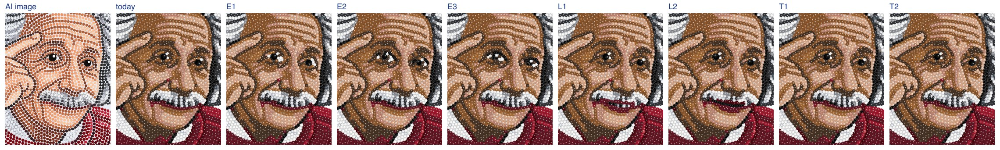 | 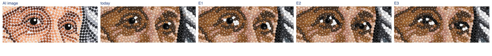 | 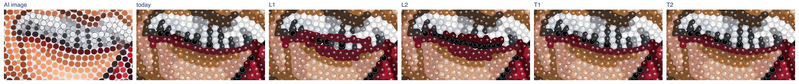 | 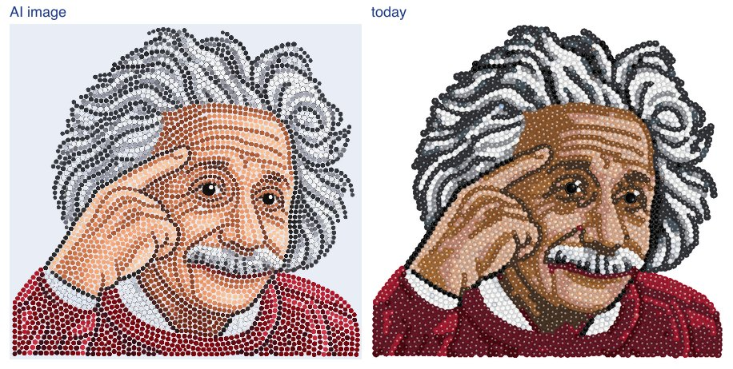 |
| portrait | 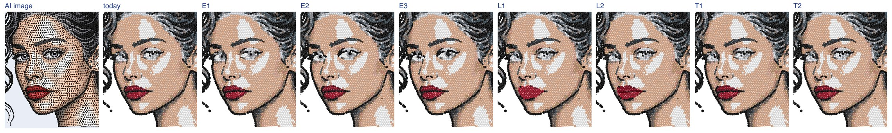 | 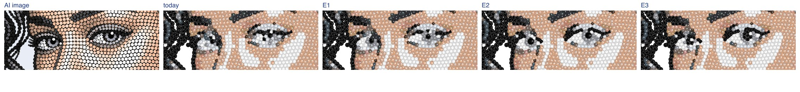 | 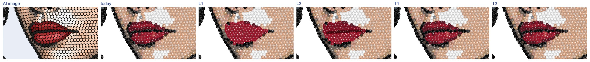 | 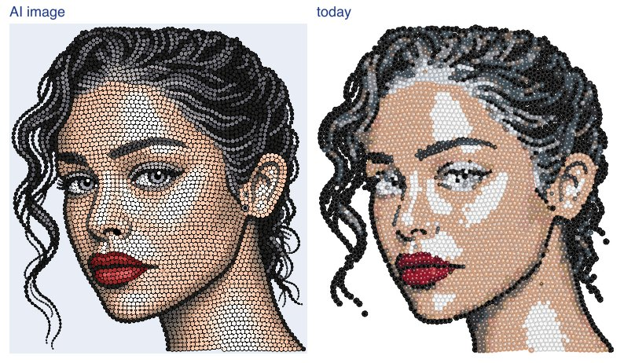 |
| woman | 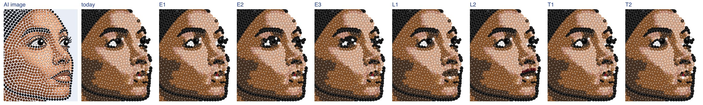 | 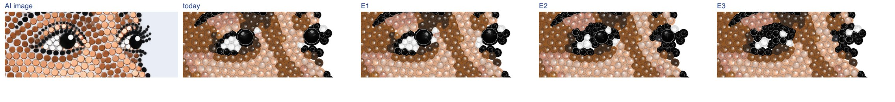 | 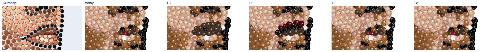 | 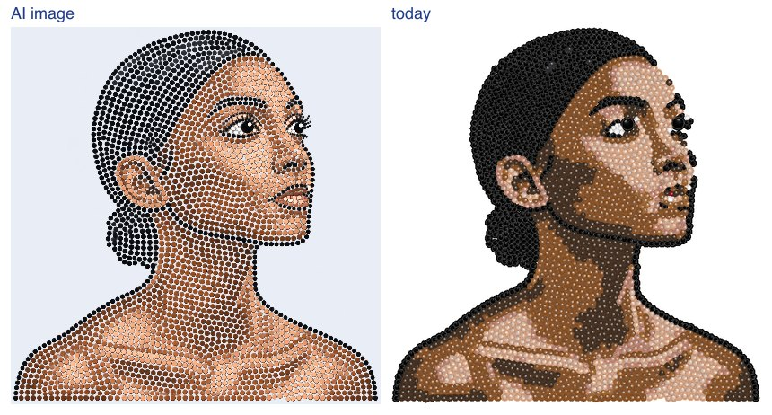 |

## 7. Likeness

Landmarks on the original photo against landmarks on each tinted design (its face view rendered at
14 px/mm and blurred as the AI image): the design's mesh aligned to the photo's by a similarity
transform (least squares over all 478 points), then the mean point distance over the eyes (contours
and irises), the mouth (four lip chains) and all points, in the photo's eye distances. Lower is
closer. RS has no photo, so its reference is the AI image's own mesh.

| RS (all / eyes / mouth) | today | E1 | E2 | E3 | L1 | L2 | T1, T2 |
| --- | --- | --- | --- | --- | --- | --- | --- |
| einstein | 0.030 / 0.031 / 0.039 | 0.031 / 0.032 / 0.050 | 0.033 / 0.020 / 0.065 | 0.030 / 0.027 / 0.055 | 0.033 / 0.035 / 0.047 | 0.029 / 0.020 / 0.052 | as today |
| portrait | 0.015 / 0.017 / 0.014 | 0.018 / 0.022 / 0.015 | 0.015 / 0.015 / 0.015 | 0.016 / 0.018 / 0.015 | 0.020 / 0.015 / 0.026 | 0.017 / 0.015 / 0.019 | as today |
| woman | 0.077 / 0.074 / 0.065 | 0.071 / 0.067 / 0.067 | 0.078 / 0.079 / 0.074 | 0.073 / 0.080 / 0.072 | 0.072 / 0.074 / 0.050 | 0.075 / 0.070 / 0.068 | as today |

The measure is noisy: a variant that changes only the lips moves the eye value, and one that changes
only the eyes the mouth value, by up to about 0.01 eye distances in colour and 0.015 in stencil on the
private set (0.011 on Einstein). Differences below that say nothing. On the private set, above that
noise, only stencil E2 (eyes), stencil L1 and L2 and halftone L2 (mouth) stand out, all as less like
the photo. The rest of the choice is by eye.

## 8. Recommendation

| Style | Eyes | Lips | Teeth |
| --- | --- | --- | --- |
| Colour | **E1** | **L2** | **T1** |
| B&W stencil | **E1** | **today's** (neither L1 nor L2) | **T1** |
| B&W halftone | **E1** | **today's** (neither L1 nor L2) | **T1** |

- **Eyes E1 in every style.** It keeps what the AI drew and removes what spoils it: stray colours in
  the iris and white, an off-centre pupil. E2 and E3 work on large eyes (RS portrait: a clear grey
  iris ring, white and catch-light), but most faces are small: the iris is about as wide as the SS16
  pupil, the ring and lid line crowd the opening, and the eye turns into a dark slit (colour) or a
  scribble (stencil, where E2 is measurably less like the photo). E3's cluster reads as a broken
  pupil at these sizes. Worth a follow-up: E2 only when the iris radius is at least about 3 mm.
- **Lips, colour: L2.** With the AI's own colours it comes closest to the AI's lips (a darker upper
  lip and a line, RS portrait), where L1 flattens them into one red. Caveats: on thin lips the
  mesh's upper lip reaches above the drawn one, so a few stones of the upper colour stick out; under
  a moustache the upper lip's discs are the moustache (Einstein), so its tone comes from the lower
  lip.
- **Lips, B&W: keep today's.** The AI draws B&W lips as a thin Jet mouth line with a light outline;
  solid Jet (L1) is a blob, the outlined Crystal lips (stencil L2) a heavy ring, and the halftone mix
  scattered dots. Both are less like the photo than today.
- **Teeth T1.** It replaces the few, uneven stones of an open mouth with Crystal teeth and the
  mouth's dark; with a closed mouth nothing changes. T2's line never applied in colour (smiles show
  one row); it applied in a few B&W designs, where a Jet line through small teeth reads as a gap.

Open: the module is not wired into the pipeline. That needs a landmark source in production (the
strass service, section 3, or the direct path) and a flag; the decision is Alex's.
