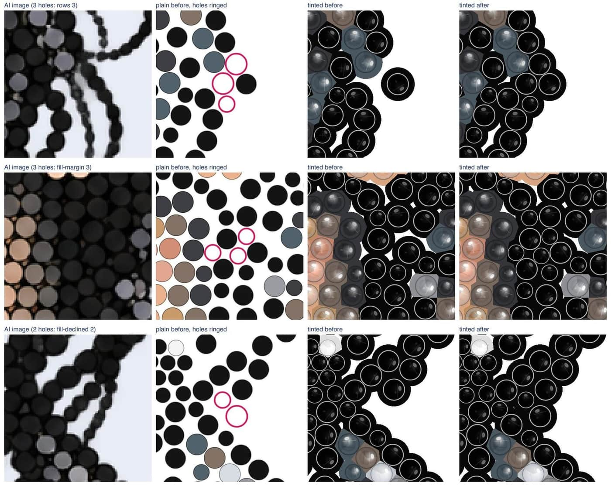
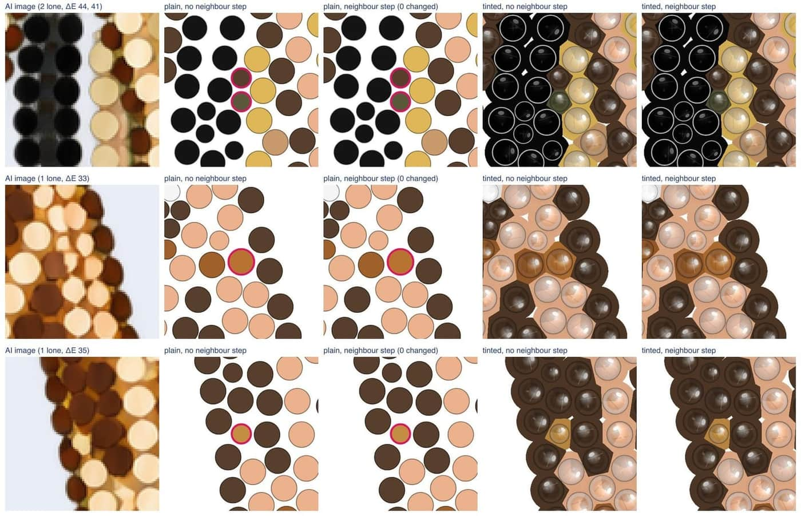
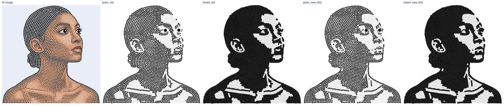

# exp-holes — holes in the designs, and black & white read from the AI image

Status: 24 Oct 2026, branch `exp-holes`. First round (23 Oct): experiment, everything behind flags.
Alex's decisions on it (24 Oct), now built:

1. The IS hole fill is on in production (`IS_FILL_HOLES=0` turns it off), with a neighbour step for
   filled stones (section 5). Spec 7.5. The strass rules `fill_exact` and `fill_cover_mask` stay off
   everywhere.
2. Black & white reads every delivered stone from the AI image (section 6). Spec 7.6.
3. Two crashes on AI images whose subject touches the image's edge are fixed in IS's strass copy
   (section 7, `services/strass/ORIGIN.md`).

Designs measured here: the 9 CC0 AI images of IS-03b (`tools/fixtures/is03b-ai/`) and the 12 RS
test images (`services/strass/prototype/img/`), each laid out again with `DEFAULT` (no provider
call). The private portraits were measured the same way (colour and B&W); their pictures, numbers
and reports stay in `data/private-portraits/` (`holes.html`, `bw.html`) and are not part of this file.

Reproduce: `services/strass/scripts/holes_trace.py OUT default NAME=PNG ...` (layouts and stage
traces), then `node tools/exp-holes.mjs data/exp-holes/manifest.json docs/exp-holes` and `node
tools/exp-bw.mjs data/exp-holes/manifest.json docs/exp-holes`. The pictures in
[`docs/exp-holes/`](exp-holes/) were then reduced to 1400 px wide (JPEG quality 66);
`results.json` and `bw-results.json` there hold every number below.

## 1. What a hole is

A spot inside the subject where an SS6 stone, or failing that an SS4 stone, fits with at least
0.1 mm to every neighbour.

- **Subject**: the AI image's alpha (alpha ≥ 128), closed with a disc of 1 mm across (the gaps
  between the AI's stones), then every enclosed transparent area of at most two SS6 stones' area
  (6.3 mm²) filled. Larger transparent areas inside the outline (between an arm and the body, say)
  stay outside the subject.
- **Fits**: the whole stone inside the subject (measured on a 20 px/mm grid in the layout's mm) and
  a rim gap of at least 0.1 mm to every stone of the design (exact, not rasterised).
- **Counted** greedily on the design after the SS16 cap and the overlap cleanup (7.5): the free
  spot farthest from everything first, SS6 while one fits, then SS4.
- **Hole area**: the holes' disc area over the subject area. **Largest empty circle**: the largest
  circle inside the subject that touches no stone (no gap kept).

## 2. Holes before and after the fill

| design | stones | SS6 holes | SS4 holes | hole area | largest empty mm | holes, fill | after, mm | causes | fill_exact | fill-both | coverage before / after |
| --- | ---: | ---: | ---: | ---: | ---: | --- | ---: | --- | ---: | ---: | --- |
| car-rule | 3531 | 0 | 17 | 0.17 % | 2.18 | 17 → 0 | 1.70 | check 1, fill-margin 16 | 3 | 3 | 0.626 / 0.628 |
| cat-norule | 3140 | 0 | 8 | 0.10 % | 2.02 | 8 → 0 | 1.69 | eyes 2, rows 5, fill-margin 1 | 2 | 2 | 0.645 / 0.646 |
| cat-rule | 3573 | 0 | 6 | 0.06 % | 2.17 | 6 → 0 | 1.70 | check 1, eyes 2, rows 3 | 3 | 3 | 0.67 / 0.671 |
| dachshund-rule | 1628 | 0 | 5 | 0.12 % | 1.78 | 5 → 0 | 1.67 | eyes 4, fill-margin 1 | 3 | 3 | 0.678 / 0.679 |
| dog-norule | 2071 | 2 | 11 | 0.25 % | 2.45 | 13 → 0 | 1.69 | eyes 10, rows 1, fill-margin 2 | 11 | 11 | 0.64 / 0.643 |
| dog-rule | 2039 | 3 | 8 | 0.24 % | 2.22 | 11 → 0 | 1.70 | eyes 9, rows 2 | 10 | 10 | 0.643 / 0.645 |
| giraffe-rule | 2286 | 1 | 40 | 0.65 % | 2.60 | 41 → 0 | 1.70 | eyes 3, rows 15, fill-margin 23 | 14 | 14 | 0.589 / 0.595 |
| mug-norule | 2224 | 0 | 0 | 0.00 % | 1.68 | 0 → 0 | 1.68 | – | 0 | 0 | 0.698 / 0.698 |
| mug-rule | 1751 | 0 | 0 | 0.00 % | 1.42 | 0 → 0 | 1.42 | – | 0 | 0 | 0.7 / 0.7 |
| rs-cat | 2150 | 0 | 12 | 0.21 % | 1.77 | 12 → 0 | 1.70 | eyes 3, rows 2, fill-declined 1, fill-margin 6 | 5 | 3 | 0.647 / 0.649 |
| rs-dog | 1670 | 2 | 11 | 0.31 % | 2.39 | 13 → 0 | 1.66 | eyes 9, rows 1, fill-declined 1, fill-margin 2 | 9 | 7 | 0.628 / 0.632 |
| rs-einstein | 3590 | 0 | 4 | 0.04 % | 1.79 | 4 → 0 | 1.69 | eyes 1, fill-declined 1, fill-margin 2 | 2 | 0 | 0.671 / 0.671 |
| rs-jesus | 3297 | 0 | 10 | 0.11 % | 1.78 | 10 → 0 | 1.70 | rows 3, fill-margin 7 | 4 | 4 | 0.629 / 0.63 |
| rs-lake | 4089 | 0 | 11 | 0.10 % | 2.19 | 11 → 0 | 1.69 | check 1, fill-declined 3, fill-margin 7 | 7 | 4 | 0.66 / 0.661 |
| rs-leopard | 2433 | 0 | 3 | 0.05 % | 1.75 | 3 → 0 | 1.69 | fill-margin 3 | 4 | 4 | 0.645 / 0.645 |
| rs-logo | 833 | 0 | 0 | 0.00 % | 1.42 | 0 → 0 | 1.42 | – | 0 | 0 | 0.796 / 0.796 |
| rs-parrot | 2542 | 0 | 10 | 0.15 % | 2.17 | 10 → 0 | 1.68 | check 1, eyes 2, rows 6, fill-margin 1 | 4 | 4 | 0.644 / 0.645 |
| rs-portrait | 3990 | 7 | 48 | 0.57 % | 3.14 | 55 → 0 | 1.70 | rows 16, fill-declined 6, fill-margin 32, edge 1 | 31 | 28 | 0.652 / 0.658 |
| rs-rose | 1846 | 0 | 0 | 0.00 % | 1.69 | 0 → 0 | 1.69 | – | 0 | 0 | 0.683 / 0.683 |
| rs-tulips | 2673 | 0 | 2 | 0.03 % | 1.97 | 2 → 0 | 1.70 | fill-declined 1, fill-margin 1 | 2 | 2 | 0.665 / 0.665 |
| rs-woman | 2613 | 3 | 11 | 0.24 % | 2.59 | 14 → 0 | 1.70 | eyes 8, rows 4, fill-margin 2 | 12 | 12 | 0.671 / 0.674 |

"fill_exact" and "fill-both": the holes left by the strass rules of section 4 alone (before any IS
fill). Coverage is the acceptance coverage of 7.5 without and with the fill.

Totals: 235 holes on 21 designs (18 SS6, 217 SS4), at most 0.65 % of a subject's area; the largest
empty circle is 1.4–3.1 mm before and at most 1.70 mm after (an SS4 stone with its two gaps does not
fit in that). With the fill every design has **0 holes**, stays accepted (7.4), the IS gap check
finds 0 violations (smallest gap 0.100 mm), the natural size is unchanged on all 21 (the filled
holes are inside the old footprint), and the coverage rises by up to 0.006. The private portraits,
colour and B&W, give the same picture: no hole left, every design accepted.

Pictures per design in [`docs/exp-holes/`](exp-holes/): `NAME-views.jpg` (plain before, holes
ringed | plain after | tinted before | tinted after) and `NAME-closeups.jpg` (the three worst hole
groups: AI image | plain before | tinted before | tinted after). For example:

- RS portrait, the most holes (hair): [views](exp-holes/rs-portrait-views.jpg),
  [close-ups](exp-holes/rs-portrait-closeups.jpg)
- giraffe (spots): [views](exp-holes/giraffe-rule-views.jpg),
  [close-ups](exp-holes/giraffe-rule-closeups.jpg)
- RS woman and dog-norule (eyes): [woman](exp-holes/rs-woman-closeups.jpg),
  [dog](exp-holes/dog-norule-closeups.jpg)

## 3. Why the holes are there

Each hole is given the first cause that applies, in this order, from the IS cleanup's removed
stones and a trace of the service's stages (`holes_trace.py`, which reproduces the service's
layout stone for stone and records each stage's decisions):

| cause | meaning | holes | share |
| --- | --- | ---: | ---: |
| is-cleanup | the IS overlap cleanup (7.5) removed a stone there | 0 | 0 % |
| check | the service's last gap check in `post_process` removed a stone there | 4 | 2 % |
| eyes | the eye stage removed the AI's stones there (around a pupil) | 53 | 23 % |
| rows | the ordered layout dropped the AI's stone (as a painted gap dot 20, interstitial 14, tiny 12, shadow 8) or deleted it pushing the rows apart (4) | 58 | 25 % |
| fill-declined | the service's fill found the spot and declined it: cover below 0.7 on the closed alpha (11), no "room" near a detection (2) | 13 | 6 % |
| fill-margin | the service's fill keeps 0.15 mm (0.1 mm gap + 0.05 mm raster margin) from every stone; the spot has 0.1–0.175 mm | 106 | 45 % |
| edge | outside the service's strict subject mask | 1 | 0 % |
| not-detected | the AI drew a stone there that no detector found | 0 | 0 % |
| ai-empty | the AI drew no stone there | 0 | 0 % |

One stage, the service's fill after the eye stage, accounts for 51 % (fill-margin and
fill-declined); the eye stage and the ordered layout's filters make up the rest. Detection and the
IS cleanup cause none. The private portraits show the same order, with fill-declined much larger on
some B&W designs.

## 4. The fixes tried

**A. IS hole fill** (`src/pipeline/holes.js`; adopted, spec 7.5). After the overlap cleanup the
holes of section 1 are filled: SS6 first, then SS4, each with at least 0.1 mm to every stone (exact
check), only where the whole stone is inside the subject. Each new stone's colour is read from the
AI image as the service reads its own fill stones (`sample_delivered`): the mean CIE Lab of the
opaque pixels within the inner 60 % of its radius, snapped to the catalogue by the service's
`snap_colours` rules (palette `PLUS_REAL_SKIN`); the JavaScript port gives the same colour id as the
service's Python on 450 of 450 random spots (Lab within 0.0001). Then the neighbour step (section 5),
the IS gap check and acceptance. About 0.5 s per design.

**B. Service fill rules** (strass copy, `fill_exact` and `fill_cover_mask`; not adopted, off in
every rule set). The fills after the eye stage keep 0.1 mm from every stone, checked exactly,
instead of 0.15 mm on the raster (`fill_exact`), and measure their 0.7 cover on the strict subject
mask they fill instead of the closed alpha (`fill_cover_mask`); "fill-both" is both.

| service rules | stones | holes left | SS6 holes left | largest empty, max mm | accepted |
| --- | ---: | ---: | ---: | ---: | --- |
| `DEFAULT` | 53 969 | 235 | 18 | 3.14 | 21 / 21 |
| `fill_exact` | 54 095 | 126 | 19 | 3.14 | 21 / 21 |
| fill-both | 54 109 | 114 | 18 | 2.84 | 21 / 21 |

B removes about half of the holes and nothing else changes (faces, pupils and violations identical
on every layout); the eye and rows holes are not its stage. A reaches 0 on its own, keeps the strass
copy's layout at the RS rules, and was chosen.

## 5. Neighbour step for filled stones

Rule (spec 7.5): a filled stone whose colour none of its neighbours (rim gap below 0.5 mm) uses
takes the neighbours' most common colour (on a tie the catalogue's first) when that colour's
catalogue fill is within 6 ΔE2000 of the colour sampled at the spot. Decided on the colours before
the step, so the order of the stones does not matter.

On the 21 designs: of the 235 filled stones, 83 have a colour none of their neighbours uses, and
**none changes**: the neighbours' most common colour is 6.0 to 79 ΔE from the colour the AI image
shows at the spot (quartiles 14, 23 and 38 ΔE; 4 within 8 ΔE, 8 within 10). In the close-ups a lone
filled stone sits mostly on a boundary between two colour areas, where the sampled colour is a mix
rather than a neighbour's colour slightly off. On the private portraits the
step changed a handful of stones (`data/private-portraits/holes.html`).

The giraffe ([neighbours close-up](exp-holes/giraffe-rule-neighbours.jpg)), 21 of whose 41 filled
stones are lone: the olive stones on the mane's edge lie between Jet and gold (41–44 ΔE from Jet,
the neighbours' colour), a Copper stone 33 ΔE from its neighbours' Smoked Topaz; with 6 ΔE all stay. Left to right:
AI image | plain without the step | plain with it | tinted without | tinted with; the filled stones
in question are ringed.

`NAME-neighbours.jpg` exists for every design with lone filled stones (17 of 21).

## 6. Black & white read from the AI image

Rule (spec 7.6): after the fill, every delivered stone, filled ones included, takes its lightness
from the AI image itself: the mean CIE L\* of the pixels composited on white within the inner 60 %
of its radius (at least 2 px). Below `BW_THRESHOLD` (default 55) Jet, otherwise Crystal. Before,
the service's catalogue colour was mapped by its fill's L\*, so the service's colour snapping (skin
and chroma rules, the eye stage's colours, the dark-dot clean-up) stood between the AI's drawing and
the result.

In production the B&W design is laid out from an AI image drawn with the B&W prompt (Jet and
Crystal only). The CC0 and RS AI images are colour images, so on them the rule splits each colour
area by its lightness, which is the harder case (mid-tone greens and browns); the private B&W images,
drawn with the B&W prompt, are almost two-tone. Old against new on the 21 designs at 55:

| design | Otsu L\* | Jet share old → new | stones changed | lone, old | lone at 45 / 55 / 65 (%) |
| --- | ---: | --- | ---: | ---: | --- |
| car-rule | 50.5 | 51.3 % → 50.0 % | 64 | 0.5 % | 0.7 / 0.7 / 0.6 |
| cat-norule | 64.5 | 26.7 % → 24.1 % | 142 | 2.5 % | 1.8 / 2.2 / 2.5 |
| cat-rule | 65.5 | 36.2 % → 26.8 % | 347 | 2.0 % | 1.4 / 2.2 / 2.2 |
| dachshund-rule | 41.5 | 90.1 % → 82.2 % | 129 | 1.2 % | 1.0 / 1.3 / 1.8 |
| dog-norule | 48.5 | 48.7 % → 34.4 % | 311 | 2.1 % | 1.0 / 2.2 / 1.7 |
| dog-rule | 47.5 | 44.0 % → 35.8 % | 188 | 1.5 % | 1.3 / 1.0 / 1.7 |
| giraffe-rule | 56.5 | 48.7 % → 48.0 % | 32 | 5.7 % | 3.8 / 5.0 / 6.1 |
| mug-norule | 69.5 | 21.6 % → 21.3 % | 9 | 0.8 % | 3.4 / 0.8 / 0.8 |
| mug-rule | 81.5 | 12.7 % → 2.5 % | 180 | 0.1 % | 0.0 / 1.4 / 0.2 |
| rs-cat | 55.5 | 53.3 % → 47.8 % | 128 | 2.1 % | 1.8 / 2.2 / 2.2 |
| rs-dog | 58.5 | 33.9 % → 30.7 % | 77 | 1.1 % | 2.1 / 1.9 / 2.1 |
| rs-einstein | 53.5 | 62.8 % → 58.8 % | 144 | 0.6 % | 1.1 / 0.7 / 1.1 |
| rs-jesus | 46.5 | 68.8 % → 66.4 % | 77 | 1.7 % | 2.2 / 1.9 / 3.0 |
| rs-lake | 59.5 | 63.2 % → 54.6 % | 347 | 2.3 % | 1.5 / 2.3 / 2.5 |
| rs-leopard | 50.5 | 53.0 % → 51.8 % | 26 | 7.9 % | 8.4 / 7.9 / 7.9 |
| rs-logo | 31.5 | 85.1 % → 85.1 % | 0 | 0.0 % | 0.0 / 0.0 / 0.0 |
| rs-parrot | 52.5 | 49.0 % → 41.4 % | 208 | 2.1 % | 1.6 / 1.8 / 2.6 |
| rs-portrait | 52.5 | 43.2 % → 43.8 % | 146 | 1.1 % | 1.1 / 0.9 / 1.1 |
| rs-rose | 42.5 | 94.5 % → 94.2 % | 6 | 0.1 % | 0.5 / 0.4 / 0.1 |
| rs-tulips | 60.5 | 54.4 % → 40.8 % | 378 | 0.8 % | 1.0 / 1.7 / 0.8 |
| rs-woman | 37.5 | 76.8 % → 75.0 % | 54 | 0.3 % | 1.1 / 0.3 / 0.3 |

- **Stones changed**: stones of the old design (no fill) whose Jet/Crystal differs in the new one.
- **Lone**: the speckle, a Jet stone with no Jet neighbour within 0.5 mm (or Crystal without a
  Crystal one), among stones with at least 3 neighbours; in the face box (from the two pupils: 1.6
  pupil distances to each side, 1.2 above and 2.2 below their midpoint) for the 12 designs with a
  face, else over the whole design.
- **Otsu L\***: the natural break between the image's dark and light stones.

The new rule is darker where the service's skin and fur colours were dark catalogue colours over
mid-tone AI pixels (dogs, cats, tulips) and keeps what the AI drew otherwise. Speckle stays about
where it was (faces 2.3 % old, 2.3 % new at 55).

Threshold: over the 12 faces, the speckle is 2.0 % at 40, 2.2 % at 45 and 50, 2.3 % at 55, 2.5 % at
60, 2.6 % at 65 and 2.4 % at 70: a little cleaner below 55, but the differences are a few stones
per face. On the private B&W portraits (drawn with the B&W prompt) the same holds: 45–50 is slightly
cleaner than 55 in the faces, from 60 up single Jet stones start to appear on cheeks, and each
image's natural break lies around 50; the difference between 50 and 55 is small. The default stays
55; 50 is the value to try if faces look speckled (`BW_THRESHOLD=50`).

Pictures: `NAME-bw.jpg` (AI image | plain old | tinted old | plain new | tinted new) for every
design, `NAME-bw-faces.jpg` (the face: AI image | old | new at 45, 50, 55, 60, 65) for the 12 with a
face. For example [RS woman](exp-holes/rs-woman-bw.jpg) and its
[face](exp-holes/rs-woman-bw-faces.jpg), [RS tulips](exp-holes/rs-tulips-bw.jpg), the
[dog-norule face](exp-holes/dog-norule-bw-faces.jpg).

## 7. Two crashes at the image's edge (strass copy)

An AI image whose subject touches the image's edge crashed the layout service twice in a row, both
fixed in IS's strass copy and recorded in `services/strass/ORIGIN.md`, each with a test on a small
synthetic image (`tests/test_exp_holes.py`):

1. Colour stage (`colour.py`, `IndexError` on an empty quantile): the service's fill reaches half a
   pixel past the last pixel centre and `legalise` can push stones further, so delivered stones
   can lie beyond the image; `sample_delivered` (IS-05b) then read a disc with no pixel. Such a
   stone now reads the nearest pixel.
2. Pupil finder (`eyes.py`, `_find_inscribed`, an RS bug): the window around a dark disc cut by the
   border was clamped at 0 but not at the image's size. It now ends at the edge.

A stone or disc inside the image is read as before, so no layout that did not crash changes; the
equivalence test against the prototype holds.

## 8. Settings

- `IS_FILL_HOLES` (default on; `0` turns the hole fill off).
- `BW_THRESHOLD` (default 55).
- Fake mode (`IS_FAKE=1`) uses `src/pipeline/fake/ai.png`, the fake layout's own stones drawn as
  flat discs (`tools/make-fake-ai.mjs`), so the fill and black & white read the image the layout
  came from.
