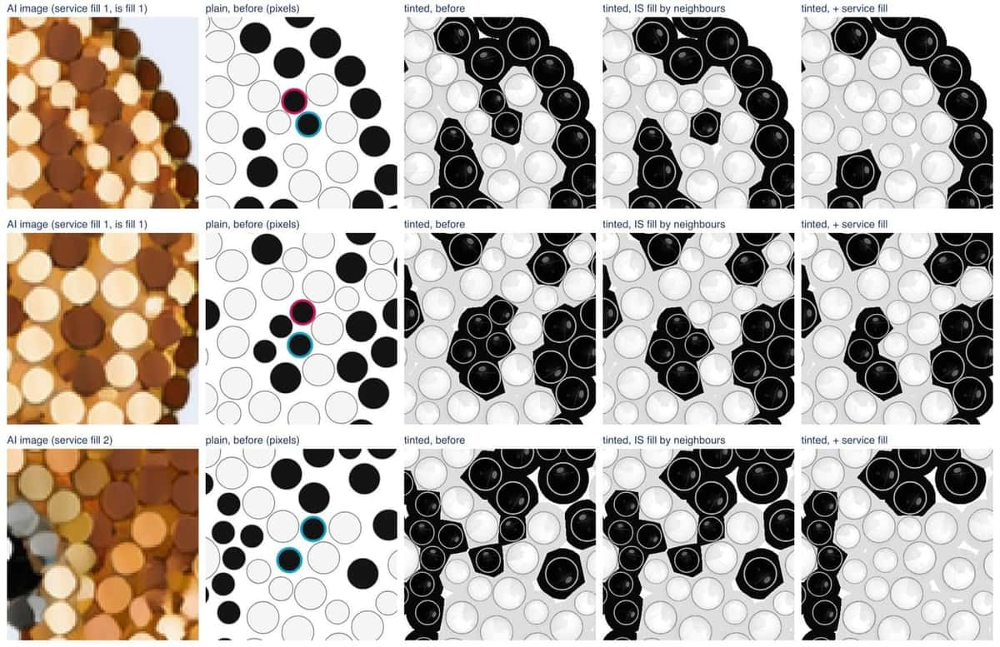
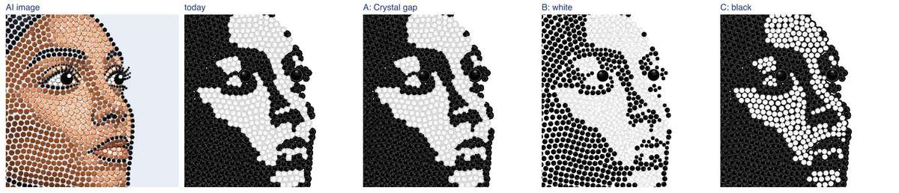

# exp-holes — holes in the designs, and black & white read from the AI image

Status: 24 Oct 2026, branch `exp-holes`. First round (23 Oct): experiment, everything behind flags.
Alex's decisions on it (24 Oct), now built:

1. The IS hole fill is on in production (`IS_FILL_HOLES=0` turns it off), with a neighbour step for
   filled stones (section 5). Spec 7.5. The strass rules `fill_exact` and `fill_cover_mask` stay off
   everywhere.
2. Black & white reads every delivered stone from the AI image (section 6). Spec 7.6.
3. Two crashes on AI images whose subject touches the image's edge are fixed in IS's strass copy
   (section 7, `services/strass/ORIGIN.md`).

Dark spots (24 Oct, section 9): Alex saw small Jet stones with a dark halo among Crystal stones in
the B&W designs. The cause was fill stones reading the AI's gap paint; now every stone the IS fill
adds takes its neighbours' colour (replacing the 6 ΔE step of the first decision), and the service's
own fill stones can do the same behind `IS_SERVICE_FILL_NEIGHBOURS=1` (off).

B&W render (24 Oct, section 10): most of the dark spots left are Jet stones the AI drew (its
mid-tones are Jet and Crystal side by side), drawn larger by the tinted view's dark gap. The gap rule
of B&W designs is now a setting (`BW_GAP`, today's rule by default, spec 8), and a stone can take its
colour from the AI stone disc it overlaps most (`IS_BW_FROM_DISCS=1`, off, spec 7.6; the service
reports the discs as `report.discsAtMm`). Alex chooses.

Designs measured here: the 9 CC0 AI images of IS-03b (`tools/fixtures/is03b-ai/`) and the 12 RS
test images (`services/strass/prototype/img/`), each laid out again with `DEFAULT` (no provider
call). The private portraits were measured the same way (colour and B&W); their pictures, numbers
and reports stay in `data/private-portraits/` (`holes.html`, `bw.html`) and are not part of this file.

Reproduce: `services/strass/scripts/holes_trace.py OUT default NAME=PNG ...` (layouts and stage
traces), then `node tools/exp-holes.mjs data/exp-holes/manifest.json docs/exp-holes` and `node
tools/exp-bw.mjs data/exp-holes/manifest.json docs/exp-holes` and `node tools/exp-spots.mjs
data/exp-holes/manifest.json docs/exp-holes both` and `node tools/exp-bw-diagnosis.mjs
data/exp-holes/manifest.json OUT OUT/diagnosis.html` and `node tools/exp-bw-render.mjs
data/exp-holes/manifest.json OUT/diagnosis.json OUT2`. The pictures in
[`docs/exp-holes/`](exp-holes/) were then reduced to 1200 px wide (JPEG quality 60);
`results.json`, `bw-results.json`, `spots-results.json`, `bw-diagnosis.json` and
`bw-render-results.json` there hold every number below.

## 1. What a hole is

A spot inside the subject where an SS6 stone, or failing that an SS4 stone, fits with at least
0.1 mm to every neighbour.

- **Subject**: the AI image's alpha (alpha ≥ 128), closed with a disc of 1 mm across (the gaps
  between the AI's stones), then every enclosed transparent area of at most two SS6 stones' area
  (6.3 mm²) filled. Larger transparent areas inside the outline (between an arm and the body, say)
  stay outside the subject.
- **Fits**: the whole stone inside the subject (measured on a 20 px/mm grid in the layout's mm) and
  a rim gap of at least 0.1 mm to every stone of the design (exact, not rasterised).
- **Counted** greedily on the design after the SS16 cap and the overlap cleanup (7.5): the free
  spot farthest from everything first, SS6 while one fits, then SS4.
- **Hole area**: the holes' disc area over the subject area. **Largest empty circle**: the largest
  circle inside the subject that touches no stone (no gap kept).

## 2. Holes before and after the fill

| design | stones | SS6 holes | SS4 holes | hole area | largest empty mm | holes, fill | after, mm | causes | fill_exact | fill-both | coverage before / after |
| --- | ---: | ---: | ---: | ---: | ---: | --- | ---: | --- | ---: | ---: | --- |
| car-rule | 3531 | 0 | 17 | 0.17 % | 2.18 | 17 → 0 | 1.70 | check 1, fill-margin 16 | 3 | 3 | 0.626 / 0.628 |
| cat-norule | 3140 | 0 | 8 | 0.10 % | 2.02 | 8 → 0 | 1.69 | eyes 2, rows 5, fill-margin 1 | 2 | 2 | 0.645 / 0.646 |
| cat-rule | 3573 | 0 | 6 | 0.06 % | 2.17 | 6 → 0 | 1.70 | check 1, eyes 2, rows 3 | 3 | 3 | 0.67 / 0.671 |
| dachshund-rule | 1628 | 0 | 5 | 0.12 % | 1.78 | 5 → 0 | 1.67 | eyes 4, fill-margin 1 | 3 | 3 | 0.678 / 0.679 |
| dog-norule | 2071 | 2 | 11 | 0.25 % | 2.45 | 13 → 0 | 1.69 | eyes 10, rows 1, fill-margin 2 | 11 | 11 | 0.64 / 0.643 |
| dog-rule | 2039 | 3 | 8 | 0.24 % | 2.22 | 11 → 0 | 1.70 | eyes 9, rows 2 | 10 | 10 | 0.643 / 0.645 |
| giraffe-rule | 2286 | 1 | 40 | 0.65 % | 2.60 | 41 → 0 | 1.70 | eyes 3, rows 15, fill-margin 23 | 14 | 14 | 0.589 / 0.595 |
| mug-norule | 2224 | 0 | 0 | 0.00 % | 1.68 | 0 → 0 | 1.68 | – | 0 | 0 | 0.698 / 0.698 |
| mug-rule | 1751 | 0 | 0 | 0.00 % | 1.42 | 0 → 0 | 1.42 | – | 0 | 0 | 0.7 / 0.7 |
| rs-cat | 2150 | 0 | 12 | 0.21 % | 1.77 | 12 → 0 | 1.70 | eyes 3, rows 2, fill-declined 1, fill-margin 6 | 5 | 3 | 0.647 / 0.649 |
| rs-dog | 1670 | 2 | 11 | 0.31 % | 2.39 | 13 → 0 | 1.66 | eyes 9, rows 1, fill-declined 1, fill-margin 2 | 9 | 7 | 0.628 / 0.632 |
| rs-einstein | 3590 | 0 | 4 | 0.04 % | 1.79 | 4 → 0 | 1.69 | eyes 1, fill-declined 1, fill-margin 2 | 2 | 0 | 0.671 / 0.671 |
| rs-jesus | 3297 | 0 | 10 | 0.11 % | 1.78 | 10 → 0 | 1.70 | rows 3, fill-margin 7 | 4 | 4 | 0.629 / 0.63 |
| rs-lake | 4089 | 0 | 11 | 0.10 % | 2.19 | 11 → 0 | 1.69 | check 1, fill-declined 3, fill-margin 7 | 7 | 4 | 0.66 / 0.661 |
| rs-leopard | 2433 | 0 | 3 | 0.05 % | 1.75 | 3 → 0 | 1.69 | fill-margin 3 | 4 | 4 | 0.645 / 0.645 |
| rs-logo | 833 | 0 | 0 | 0.00 % | 1.42 | 0 → 0 | 1.42 | – | 0 | 0 | 0.796 / 0.796 |
| rs-parrot | 2542 | 0 | 10 | 0.15 % | 2.17 | 10 → 0 | 1.68 | check 1, eyes 2, rows 6, fill-margin 1 | 4 | 4 | 0.644 / 0.645 |
| rs-portrait | 3990 | 7 | 48 | 0.57 % | 3.14 | 55 → 0 | 1.70 | rows 16, fill-declined 6, fill-margin 32, edge 1 | 31 | 28 | 0.652 / 0.658 |
| rs-rose | 1846 | 0 | 0 | 0.00 % | 1.69 | 0 → 0 | 1.69 | – | 0 | 0 | 0.683 / 0.683 |
| rs-tulips | 2673 | 0 | 2 | 0.03 % | 1.97 | 2 → 0 | 1.70 | fill-declined 1, fill-margin 1 | 2 | 2 | 0.665 / 0.665 |
| rs-woman | 2613 | 3 | 11 | 0.24 % | 2.59 | 14 → 0 | 1.70 | eyes 8, rows 4, fill-margin 2 | 12 | 12 | 0.671 / 0.674 |

"fill_exact" and "fill-both": the holes left by the strass rules of section 4 alone (before any IS
fill). Coverage is the acceptance coverage of 7.5 without and with the fill.

Totals: 235 holes on 21 designs (18 SS6, 217 SS4), at most 0.65 % of a subject's area; the largest
empty circle is 1.4–3.1 mm before and at most 1.70 mm after (an SS4 stone with its two gaps does not
fit in that). With the fill every design has **0 holes**, stays accepted (7.4), the IS gap check
finds 0 violations (smallest gap 0.100 mm), the natural size is unchanged on all 21 (the filled
holes are inside the old footprint), and the coverage rises by up to 0.006. The private portraits,
colour and B&W, give the same picture: no hole left, every design accepted.

Pictures per design in [`docs/exp-holes/`](exp-holes/): `NAME-views.jpg` (plain before, holes
ringed | plain after | tinted before | tinted after) and `NAME-closeups.jpg` (the three worst hole
groups: AI image | plain before | tinted before | tinted after). For example:

- RS portrait, the most holes (hair): [views](exp-holes/rs-portrait-views.jpg),
  [close-ups](exp-holes/rs-portrait-closeups.jpg)
- giraffe (spots): [views](exp-holes/giraffe-rule-views.jpg),
  [close-ups](exp-holes/giraffe-rule-closeups.jpg)
- RS woman and dog-norule (eyes): [woman](exp-holes/rs-woman-closeups.jpg),
  [dog](exp-holes/dog-norule-closeups.jpg)

## 3. Why the holes are there

Each hole is given the first cause that applies, in this order, from the IS cleanup's removed
stones and a trace of the service's stages (`holes_trace.py`, which reproduces the service's
layout stone for stone and records each stage's decisions):

| cause | meaning | holes | share |
| --- | --- | ---: | ---: |
| is-cleanup | the IS overlap cleanup (7.5) removed a stone there | 0 | 0 % |
| check | the service's last gap check in `post_process` removed a stone there | 4 | 2 % |
| eyes | the eye stage removed the AI's stones there (around a pupil) | 53 | 23 % |
| rows | the ordered layout dropped the AI's stone (as a painted gap dot 20, interstitial 14, tiny 12, shadow 8) or deleted it pushing the rows apart (4) | 58 | 25 % |
| fill-declined | the service's fill found the spot and declined it: cover below 0.7 on the closed alpha (11), no "room" near a detection (2) | 13 | 6 % |
| fill-margin | the service's fill keeps 0.15 mm (0.1 mm gap + 0.05 mm raster margin) from every stone; the spot has 0.1–0.175 mm | 106 | 45 % |
| edge | outside the service's strict subject mask | 1 | 0 % |
| not-detected | the AI drew a stone there that no detector found | 0 | 0 % |
| ai-empty | the AI drew no stone there | 0 | 0 % |

One stage, the service's fill after the eye stage, accounts for 51 % (fill-margin and
fill-declined); the eye stage and the ordered layout's filters make up the rest. Detection and the
IS cleanup cause none. The private portraits show the same order, with fill-declined much larger on
some B&W designs.

## 4. The fixes tried

**A. IS hole fill** (`src/pipeline/holes.js`; adopted, spec 7.5). After the overlap cleanup the
holes of section 1 are filled: SS6 first, then SS4, each with at least 0.1 mm to every stone (exact
check), only where the whole stone is inside the subject. Each new stone's colour is read from the
AI image as the service reads its own fill stones (`sample_delivered`): the mean CIE Lab of the
opaque pixels within the inner 60 % of its radius, snapped to the catalogue by the service's
`snap_colours` rules (palette `PLUS_REAL_SKIN`); the JavaScript port gives the same colour id as the
service's Python on 450 of 450 random spots (Lab within 0.0001). Then the neighbour step (section 5),
the IS gap check and acceptance. About 0.5 s per design.

**B. Service fill rules** (strass copy, `fill_exact` and `fill_cover_mask`; not adopted, off in
every rule set). The fills after the eye stage keep 0.1 mm from every stone, checked exactly,
instead of 0.15 mm on the raster (`fill_exact`), and measure their 0.7 cover on the strict subject
mask they fill instead of the closed alpha (`fill_cover_mask`); "fill-both" is both.

| service rules | stones | holes left | SS6 holes left | largest empty, max mm | accepted |
| --- | ---: | ---: | ---: | ---: | --- |
| `DEFAULT` | 53 969 | 235 | 18 | 3.14 | 21 / 21 |
| `fill_exact` | 54 095 | 126 | 19 | 3.14 | 21 / 21 |
| fill-both | 54 109 | 114 | 18 | 2.84 | 21 / 21 |

B removes about half of the holes and nothing else changes (faces, pupils and violations identical
on every layout); the eye and rows holes are not its stage. A reaches 0 on its own, keeps the strass
copy's layout at the RS rules, and was chosen.

## 5. Colours of the filled stones

First decision (24 Oct): a filled stone read its colour from the AI image's pixels, then a filled
stone whose colour no neighbour within 0.5 mm used took the neighbours' most common colour when that
was within 6 ΔE of the sampled colour. On these 21 designs that step changed none of the 235 filled
stones: 83 had a colour no neighbour used, but the neighbours' colour was 6.0 to 79 ΔE (median 23)
from the sampled one. The pixels under a hole are the AI's gap paint or a mix at a colour boundary,
not a stone. Section 9 shows what that did in black & white.

Now (spec 7.5): every filled stone takes its neighbours' colour and does not read its pixels. Among
the stones within 1 mm of its edge each weighs 1 − gap / 1 mm, so nearer stones count more; the
colour with the largest total weight wins, on a tie the nearest stone's. Filled stones next to
filled stones are decided in rounds; one with no decided stone within 1 mm takes the nearest
decided stone's colour. In black & white the same vote is taken between the neighbours' Jet and
Crystal (7.6).

## 6. Black & white read from the AI image

Rule (spec 7.6): after the fill, every delivered stone takes its lightness
from the AI image itself: the mean CIE L\* of the pixels composited on white within the inner 60 %
of its radius (at least 2 px). Below `BW_THRESHOLD` (default 55) Jet, otherwise Crystal. The filled
stones are not read: they take Jet or Crystal from their neighbours (section 5). Before,
the service's catalogue colour was mapped by its fill's L\*, so the service's colour snapping (skin
and chroma rules, the eye stage's colours, the dark-dot clean-up) stood between the AI's drawing and
the result.

In production the B&W design is laid out from an AI image drawn with the B&W prompt (Jet and
Crystal only). The CC0 and RS AI images are colour images, so on them the rule splits each colour
area by its lightness, which is the harder case (mid-tone greens and browns); the private B&W images,
drawn with the B&W prompt, are almost two-tone. Old against new on the 21 designs at 55:

| design | Otsu L\* | Jet share old → new | stones changed | lone, old | lone at 45 / 55 / 65 (%) |
| --- | ---: | --- | ---: | ---: | --- |
| car-rule | 50.5 | 51.3 % → 49.9 % | 64 | 0.5 % | 0.7 / 0.7 / 0.6 |
| cat-norule | 64.5 | 26.7 % → 24.1 % | 142 | 2.5 % | 1.8 / 2.2 / 2.5 |
| cat-rule | 65.5 | 36.2 % → 26.8 % | 347 | 2.0 % | 1.5 / 2.2 / 2.2 |
| dachshund-rule | 41.5 | 90.1 % → 82.3 % | 129 | 1.2 % | 1.0 / 1.5 / 1.8 |
| dog-norule | 48.5 | 48.7 % → 34.4 % | 311 | 2.1 % | 1.0 / 2.2 / 1.5 |
| dog-rule | 47.5 | 44.0 % → 35.7 % | 188 | 1.5 % | 1.3 / 1.0 / 1.7 |
| giraffe-rule | 56.5 | 48.7 % → 47.7 % | 32 | 5.7 % | 3.5 / 3.8 / 5.4 |
| mug-norule | 69.5 | 21.6 % → 21.3 % | 9 | 0.8 % | 3.4 / 0.8 / 0.8 |
| mug-rule | 81.5 | 12.7 % → 2.5 % | 180 | 0.1 % | 0.0 / 1.4 / 0.2 |
| rs-cat | 55.5 | 53.3 % → 47.9 % | 128 | 2.1 % | 1.8 / 2.2 / 2.2 |
| rs-dog | 58.5 | 33.9 % → 30.8 % | 77 | 1.1 % | 2.1 / 1.9 / 2.1 |
| rs-einstein | 53.5 | 62.8 % → 58.8 % | 144 | 0.6 % | 1.1 / 0.7 / 1.1 |
| rs-jesus | 46.5 | 68.8 % → 66.6 % | 77 | 1.7 % | 2.1 / 1.7 / 2.9 |
| rs-lake | 59.5 | 63.2 % → 54.6 % | 347 | 2.3 % | 1.5 / 2.3 / 2.5 |
| rs-leopard | 50.5 | 53.0 % → 51.8 % | 26 | 7.9 % | 8.4 / 7.9 / 7.9 |
| rs-logo | 31.5 | 85.1 % → 85.1 % | 0 | 0.0 % | 0.0 / 0.0 / 0.0 |
| rs-parrot | 52.5 | 49.0 % → 41.3 % | 208 | 2.1 % | 1.6 / 1.8 / 2.5 |
| rs-portrait | 52.5 | 43.2 % → 44.1 % | 146 | 1.1 % | 1.0 / 0.9 / 1.0 |
| rs-rose | 42.5 | 94.5 % → 94.2 % | 6 | 0.1 % | 0.5 / 0.4 / 0.1 |
| rs-tulips | 60.5 | 54.4 % → 40.8 % | 378 | 0.8 % | 0.9 / 1.7 / 0.8 |
| rs-woman | 37.5 | 76.8 % → 74.9 % | 54 | 0.3 % | 0.9 / 0.3 / 0.4 |

- **Stones changed**: stones of the old design (no fill) whose Jet/Crystal differs in the new one.
- **Lone**: the speckle, a Jet stone with no Jet neighbour within 0.5 mm (or Crystal without a
  Crystal one), among stones with at least 3 neighbours; in the face box (from the two pupils: 1.6
  pupil distances to each side, 1.2 above and 2.2 below their midpoint) for the 12 designs with a
  face, else over the whole design.
- **Otsu L\***: the natural break between the image's dark and light stones.

The new rule is darker where the service's skin and fur colours were dark catalogue colours over
mid-tone AI pixels (dogs, cats, tulips) and keeps what the AI drew otherwise. Speckle stays about
where it was (faces 2.3 % old, 2.2 % new at 55).

Threshold: over the 12 faces, the speckle is 1.9 % at 40, 2.1 % at 45 and 50, 2.2 % at 55, 2.4 % at
60, 2.5 % at 65 and 2.4 % at 70: a little cleaner below 55, but the differences are a few stones
per face. On the private B&W portraits (drawn with the B&W prompt) the same holds: 45–50 is slightly
cleaner than 55 in the faces, from 60 up single Jet stones start to appear on cheeks, and each
image's natural break lies around 50; the difference between 50 and 55 is small. The default stays
55; 50 is the value to try if faces look speckled (`BW_THRESHOLD=50`).

Pictures: `NAME-bw.jpg` (AI image | plain old | tinted old | plain new | tinted new) for every
design, `NAME-bw-faces.jpg` (the face: AI image | old | new at 45, 50, 55, 60, 65) for the 12 with a
face. For example [RS woman](exp-holes/rs-woman-bw.jpg) and its
[face](exp-holes/rs-woman-bw-faces.jpg), [RS tulips](exp-holes/rs-tulips-bw.jpg), the
[dog-norule face](exp-holes/dog-norule-bw-faces.jpg).

## 7. Two crashes at the image's edge (strass copy)

An AI image whose subject touches the image's edge crashed the layout service twice in a row, both
fixed in IS's strass copy and recorded in `services/strass/ORIGIN.md`, each with a test on a small
synthetic image (`tests/test_exp_holes.py`):

1. Colour stage (`colour.py`, `IndexError` on an empty quantile): the service's fill reaches half a
   pixel past the last pixel centre and `legalise` can push stones further, so delivered stones
   can lie beyond the image; `sample_delivered` (IS-05b) then read a disc with no pixel. Such a
   stone now reads the nearest pixel.
2. Pupil finder (`eyes.py`, `_find_inscribed`, an RS bug): the window around a dark disc cut by the
   border was clamped at 0 but not at the image's size. It now ends at the edge.

A stone or disc inside the image is read as before, so no layout that did not crash changes; the
equivalence test against the prototype holds.

## 8. Settings

- `IS_FILL_HOLES` (default on; `0` turns the hole fill off).
- `BW_THRESHOLD` (default 55).
- `IS_SERVICE_FILL_NEIGHBOURS` (default off; `1` gives the service's fill stones their neighbours'
  colour, section 9).
- `BW_GAP` (default `nearest`, today's tinted gaps; `crystal`, `white`, `black` for B&W designs,
  section 10).
- `IS_BW_FROM_DISCS` (default off; `1` reads a B&W stone from the AI stone disc it overlaps most,
  section 10).
- Fake mode (`IS_FAKE=1`) uses `src/pipeline/fake/ai.png`, the fake layout's own stones drawn as
  flat discs (`tools/make-fake-ai.mjs`), so the fill and black & white read the image the layout
  came from.

## 9. Dark spots in black & white

Alex saw small Jet stones with a dark halo among Crystal stones in the tinted B&W designs. The
suspected cause: the hole fill puts SS4 stones in the spaces between stones, they read their colour
from the AI image there, which is the AI's dark gap paint, and become Jet among Crystal; in the
tinted view each Jet stone's gap colour (section 8 of the spec) draws the halo.

**Checked first** (`tools/exp-spots.mjs`), on every design and both modes, with the stones split into
the IS fill's, the service's own fill stones (`sample_delivered` makes them read their own pixels
too; the service now reports them as `report.fillAtMm`) and the rest (the stones the AI drew).
"Spots": in colour a stone no neighbour within 0.5 mm shares its colour with; in B&W a Jet stone
with at least 3 neighbours, more than half of them Crystal. Before the fix (fill stones reading
their pixels), on the 21 designs:

| class | stones | colour: lone | B&W: Jet among Crystal | B&W: Crystal among Jet |
| --- | ---: | ---: | ---: | ---: |
| IS fill | 235 | 83 (35 %) | 20 (8.5 %) | 29 (12 %) |
| service fill | 1135 | 270 (24 %) | 118 (10 %) | 43 (3.8 %) |
| stones the AI drew | 52 834 | 6217 (12 %) | 3353 (6.3 %) | 3113 (5.9 %) |

Both kinds of fill stone are spots two to three times as often as the stones the AI drew, and the
service's fill stones, five times as many, read darker than their neighbours (mean L\* 26 against
39 around them). The private B&W portraits, drawn with the B&W prompt (white stones with black
outlines on dark gap paint), show it more strongly, and for both kinds of fill stone. So the
cause is confirmed, for the IS fill and the service's fill alike.

**Fix** (spec 7.5, 7.6): the IS fill's stones take their neighbours' colour (section 5). The
service's fill stones get the same vote in IS behind `IS_SERVICE_FILL_NEIGHBOURS=1` (off), in one
vote with the IS fill's stones; the strass copy only reports which stones they are.

| design | mode | IS fill | service fill | IS fill spots, before → after | service fill spots → with flag | spots in stones the AI drew | IS fill recoloured | service fill recoloured (flag) |
| --- | --- | ---: | ---: | --- | --- | ---: | ---: | ---: |
| car-rule | colour | 17 | 250 | 4 → 0 | 52 → 9 | 200 | 7 | 188 |
| car-rule-bw | B&W | 17 | 250 | 0 → 0 | 28 → 4 | 181 | 1 | 85 |
| cat-norule | colour | 8 | 27 | 5 → 0 | 10 → 0 | 655 | 6 | 20 |
| cat-norule-bw | B&W | 8 | 27 | 0 → 0 | 5 → 0 | 272 | 1 | 11 |
| cat-rule | colour | 6 | 34 | 1 → 0 | 14 → 0 | 512 | 3 | 24 |
| cat-rule-bw | B&W | 6 | 34 | 0 → 0 | 6 → 2 | 316 | 0 | 10 |
| dachshund-rule | colour | 5 | 17 | 1 → 0 | 4 → 0 | 68 | 2 | 14 |
| dachshund-rule-bw | B&W | 5 | 17 | 0 → 0 | 3 → 0 | 36 | 1 | 9 |
| dog-norule | colour | 13 | 27 | 5 → 0 | 5 → 0 | 281 | 7 | 14 |
| dog-norule-bw | B&W | 13 | 27 | 0 → 0 | 6 → 1 | 149 | 1 | 12 |
| dog-rule | colour | 11 | 24 | 6 → 0 | 11 → 0 | 323 | 10 | 18 |
| dog-rule-bw | B&W | 11 | 24 | 3 → 0 | 5 → 0 | 152 | 3 | 9 |
| giraffe-rule | colour | 41 | 259 | 21 → 0 | 78 → 18 | 618 | 33 | 168 |
| giraffe-rule-bw | B&W | 41 | 259 | 8 → 1 | 28 → 6 | 201 | 15 | 95 |
| mug-norule | colour | 0 | 0 | 0 → 0 | 0 → 0 | 123 | 0 | 0 |
| mug-norule-bw | B&W | 0 | 0 | 0 → 0 | 0 → 0 | 153 | 0 | 0 |
| mug-rule | colour | 0 | 0 | 0 → 0 | 0 → 0 | 31 | 0 | 0 |
| mug-rule-bw | B&W | 0 | 0 | 0 → 0 | 0 → 0 | 37 | 0 | 0 |
| rs-cat | colour | 12 | 11 | 4 → 0 | 4 → 0 | 340 | 7 | 8 |
| rs-cat-bw | B&W | 12 | 11 | 1 → 0 | 0 → 0 | 104 | 4 | 6 |
| rs-dog | colour | 13 | 12 | 7 → 0 | 8 → 0 | 251 | 9 | 11 |
| rs-dog-bw | B&W | 13 | 12 | 0 → 0 | 3 → 0 | 104 | 3 | 3 |
| rs-einstein | colour | 4 | 8 | 1 → 0 | 2 → 1 | 300 | 3 | 4 |
| rs-einstein-bw | B&W | 4 | 8 | 0 → 0 | 0 → 0 | 294 | 1 | 4 |
| rs-jesus | colour | 10 | 23 | 2 → 0 | 10 → 0 | 389 | 4 | 14 |
| rs-jesus-bw | B&W | 10 | 23 | 0 → 0 | 2 → 0 | 181 | 7 | 10 |
| rs-lake | colour | 11 | 5 | 6 → 0 | 1 → 0 | 520 | 7 | 2 |
| rs-lake-bw | B&W | 11 | 5 | 0 → 0 | 0 → 0 | 294 | 3 | 2 |
| rs-leopard | colour | 3 | 22 | 1 → 0 | 12 → 0 | 596 | 1 | 18 |
| rs-leopard-bw | B&W | 3 | 22 | 0 → 0 | 3 → 0 | 375 | 0 | 11 |
| rs-logo | colour | 0 | 0 | 0 → 0 | 0 → 0 | 1 | 0 | 0 |
| rs-logo-bw | B&W | 0 | 0 | 0 → 0 | 0 → 0 | 0 | 0 | 0 |
| rs-parrot | colour | 10 | 51 | 4 → 0 | 19 → 1 | 272 | 8 | 34 |
| rs-parrot-bw | B&W | 10 | 51 | 3 → 0 | 11 → 0 | 127 | 5 | 15 |
| rs-portrait | colour | 55 | 352 | 6 → 0 | 31 → 15 | 449 | 16 | 207 |
| rs-portrait-bw | B&W | 55 | 352 | 1 → 0 | 17 → 4 | 108 | 12 | 38 |
| rs-rose | colour | 0 | 0 | 0 → 0 | 0 → 0 | 45 | 0 | 0 |
| rs-rose-bw | B&W | 0 | 0 | 0 → 0 | 0 → 0 | 1 | 0 | 0 |
| rs-tulips | colour | 2 | 2 | 2 → 0 | 0 → 0 | 95 | 2 | 2 |
| rs-tulips-bw | B&W | 2 | 2 | 0 → 0 | 0 → 0 | 193 | 0 | 0 |
| rs-woman | colour | 14 | 11 | 7 → 0 | 9 → 0 | 103 | 9 | 10 |
| rs-woman-bw | B&W | 14 | 11 | 4 → 0 | 1 → 0 | 70 | 8 | 3 |

(Spots: lone stones in colour, Jet among Crystal in B&W. The B&W rows here are the colour AI images
laid out in B&W mode; the private portraits, drawn with the B&W prompt, are the real case.)

Totals: the IS fill's spots go from 83 to 0 in colour and from 20 to 1 in B&W; 134 (colour) and 65
(B&W) of its 235 stones change colour. With the flag the service's fill spots go from 270 to 44 in
colour and from 118 to 17 in B&W, but it recolours 756 of the 1135 service fill stones in colour
and 323 in B&W.

**What remains**:

- The one IS fill spot left (giraffe, B&W) is an SS4 stone with two Jet stones 0.13 and 0.15 mm
  away (weights 0.87 and 0.85) and two Crystal stones 0.15 and 0.27 mm away (0.85 and 0.73): Jet
  wins by weight. Its third Crystal neighbour is another filled stone, decided in a later round, so
  by the spot count (within 0.5 mm) it is Jet among mostly Crystal.
- With the flag off (the default), the service's fill stones keep their spots (118 in B&W). With
  the flag on 17 remain.
- Most "spots" left are stones the AI drew: one-stone-wide dark lines (outlines, strands of hair,
  the B&W prompt's mixing patterns). They are the drawing, not gap paint; the
  `NAME-remaining.jpg` close-ups show the densest of them for each B&W design.

**The flag's cost**: some of the service's fill stones sit on real dark detail the AI drew as a
line or a ring rather than as stones (an eye's outline, a thin black line), and the vote turns them
into the surrounding colour.
In colour it recolours two thirds of the service's fill stones, far beyond the spots. So the flag
stays off; it is there to try on the B&W designs where the service's fill makes spots.

Pictures: `NAME-spots.jpg` (colour) and `NAME-bw-spots.jpg` (B&W): the three worst groups of fill-
stone spots before the fix, AI image | plain before (ringed: magenta IS fill, cyan service fill) |
tinted before | tinted with the IS fill by neighbours (the pipeline) | tinted with the service's
fill stones too (flag). `NAME-bw-remaining.jpg`: the densest Jet-among-Crystal stones left in the
pipeline's B&W design (orange: drawn by the AI). For example the giraffe
([colour](exp-holes/giraffe-rule-spots.jpg), [B&W](exp-holes/giraffe-rule-bw-spots.jpg),
[left in B&W](exp-holes/giraffe-rule-bw-remaining.jpg)), the RS portrait
([B&W](exp-holes/rs-portrait-bw-spots.jpg)) and the car ([B&W](exp-holes/car-rule-bw-spots.jpg)).

## 10. Black & white: what the dark spots are, and the render

**Diagnosis** (`tools/exp-bw-diagnosis.mjs`; nothing changed). On each design as the pipeline makes
it in B&W, every Jet stone with at least 2 neighbours within 0.5 mm, more than half of them Crystal,
was classified by the AI pixels the pipeline read for it (the inner 60 % of its disc), split by the
service's detections into pixels on an AI stone disc and gap paint: (a) at least half on dark AI
stone discs, the AI drew a dark stone there; (b) at least half on gap paint and that paint darker
than the threshold, a stone the layout moved onto the AI's dark gap paint; (c) other. Then the
tinted view's gap pixels that are black from a Jet stone while the next stone within reach is
Crystal, by that Jet stone's class ("edge": a Jet stone that is not marked, the border of a dark
area).

| designs | marked Jet stones | (a) dark AI stone | (b) dark gap paint | (c) other | black gap next to Crystal | from (a) | from (b) | from edge |
| --- | ---: | ---: | ---: | ---: | ---: | ---: | ---: | ---: |
| 21 CC0 and RS, laid out in B&W | 3839 | 3670 (96 %) | 113 (3 %) | 56 (1 %) | 8133 mm² | 38 % | 1 % | 60 % |
| 12 private B&W portraits | 10 261 | 9649 (94 %) | 526 (5 %) | 86 (1 %) | 14 575 mm² | 59 % | 4 % | 37 % |

So the spots are real Jet stones: the AI draws mid-tones (skin, hair, background) as Jet and Crystal
stones side by side, often a checkerboard, and the plain view shows them too. What makes them dark
spots is the tinted view: each Jet stone fills its side of the gap with Jet's near-black gap colour,
out to 0.6 mm, so a Jet stone among Crystal sits in a black octagon and neighbouring ones merge into
black patches. Stones the layout moved onto the gap paint, (b), are a few per cent.

**The render** (spec 8, step 4; `BW_GAP`, B&W designs only; the colour designs are unchanged):

- `nearest` (default): today's rule.
- `crystal` (A): where the two nearest stones within reach differ, the gap of the lighter (Crystal's
  light grey); dark only between Jet stones. A Jet stone among Crystal shows at its true size; the
  dark areas stay solid.
- `white` (B) and `black` (C): every gap shows the fabric. B shows each Jet stone as a dot on white,
  closest to the stones themselves; C the reverse, the light areas get black gaps.

**The disc fix** (spec 7.6; `IS_BW_FROM_DISCS=1`, off): a stone read from the AI takes the colour of
the AI stone disc it overlaps most, not the pixels at its position; a stone on no disc is read as
before. The service now reports its stone detections as `report.discsAtMm`
(`services/strass/ORIGIN.md`); on car-rule they are exactly the trace's detections with a stone
verdict, which the tools use for the layouts made before. On the 21 designs it changes 300 of 54 204
stones (143 to Crystal, 157 to Jet) and Jet among Crystal goes from 3839 to 3787. On the private
portraits it changes 868 of 65 371 stones and Jet among Crystal goes from 10 261 to 9978, nearly all
in one design; in the design whose AI image is grey stones on dark gap paint it makes more (609 →
656): its stones turning Crystal sit in dark areas. Requiring at least half of the stone on the disc
is no better. The fix touches the 5 % it was meant for and leaves the rest of the spots as they are.

Pictures (`tools/exp-bw-render.mjs`, the disc fix on): AI image | today | A | B | C, for the whole
design, the face and the diagnosis's 4 close-ups; the private ones and every CC0 and RS design are in
`data/private-portraits/bw-render.html`. For example the RS woman ([face](exp-holes/rs-woman-bw-gaps-face.jpg),
[whole](exp-holes/rs-woman-bw-gaps-whole.jpg)) and close-ups of the RS portrait, the car, the cat and
the giraffe ([1](exp-holes/rs-portrait-bw-gaps-1.jpg), [2](exp-holes/car-rule-bw-gaps-1.jpg),
[3](exp-holes/cat-rule-bw-gaps-1.jpg), [4](exp-holes/giraffe-rule-bw-gaps-1.jpg)).

