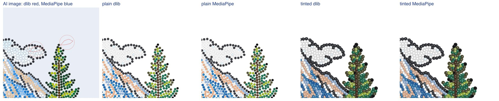
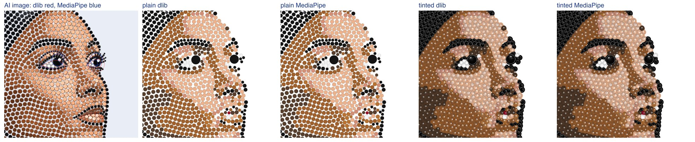

# IS-07a: MediaPipe face landmarks instead of dlib

26 Oct 2026, branch `is-07a-landmarks`. No provider calls.

## Why

The strass service (RS 38cd831) found faces with dlib's frontal face detector and 68-point shape
predictor. That model was trained on iBUG 300-W, whose licence excludes commercial use, so IS must
not use it in production. IS-07a replaces it with MediaPipe Face Landmarker (library and model
Apache 2.0). The dlib model stays only as a test-only dependency of the equivalence test against
the RS prototype, which uses dlib itself; it must never be shipped or used in production.

## What the service used dlib for

One call: `post._eye_boxes` took the 12 eye-contour points (dlib 36–47) of the largest face found,
and made from them the two eye boxes the pupils are looked for in. A face found means `face:
"human"`; none means `"animal"` (or `null` when the pupils are not one plausible pair, IS-05b).
`pupilsMm` and `pupilsAtMm` follow from the eye boxes. Nothing else reads the landmarks.

## The change

- `strass_layout/models.py`: MediaPipe's `FaceLandmarker` instead of dlib; `eye_contours()`
  returns the same six points per eye in dlib's order (Face Mesh points 33, 160, 158, 133, 153, 144
  and 362, 385, 387, 263, 373, 380). RS's search is kept: median 5 px blur, then Gaussian 3 and 6
  px; in each, the face with the largest box (the mesh's bounding box, as dlib took its detection
  box), wider than 0.12 of the image.
- Two rules bring MediaPipe's answers to dlib's on the test designs:
  - **confidence 0.6** (detection and presence; MediaPipe's default is 0.5). At 0.5 MediaPipe
    fitted a face to the RS dog at the 6 px blur, which made it "human". At 0.6 every person found
    at 0.5 in the 47 private images and the RS people is still found (0.7 too; 0.8 loses 2 of 45,
    0.9 loses 24).
  - **iris distance at least 0.25 of the face's width**: two meshes in the private images had
    their irises 0.10–0.12 of the width apart (a false or side-on find, which dlib's frontal
    detector does not report); such a mesh is not a face.
  - An eye-distance limit cannot tell dogs from people: the dogs' irises are 0.51–0.54 of the face
    width apart, the people's 0.33–0.52.
- `post._eye_boxes` reads `eye_contours()`; everything after it is unchanged.
- dlib: `tests/dlib_faces.py` (test only) gives the equivalence test RS's dlib landmarks; it is
  skipped without dlib or its model. `setup_mac.sh` installs dlib and downloads the model only with
  `--with-dlib-tests`. `requirements.txt` no longer has `dlib-bin`; the Dockerfile no longer
  fetches the model. `tests/test_is07a.py` checks that no service file imports dlib, that loading
  the service does not import it, and the eye contours' order.

## Installing MediaPipe with the existing pins

- `mediapipe==0.10.15`, installed with `pip install --no-deps` (`requirements-nodeps.txt`). Its
  declared dependencies jax and jaxlib need ml-dtypes ≥ 0.4, which tensorflow 2.16.2 (ml-dtypes
  ~= 0.3.1) refuses, and opencv-contrib-python would sit on top of opencv-python-headless. The Face
  Landmarker uses neither; everything it imports (absl-py, attrs, flatbuffers, matplotlib, numpy,
  opencv, protobuf) is already installed by `requirements.txt`. No pin changed.
- **Intel iMac, macOS 13:** PyPI labels every 0.10.x Intel wheel `macosx_11_0_x86_64`, but the
  binaries of 0.10.18, 0.10.20 and 0.10.21 are built for macOS 14.5 (`vtool -show-build`: minos
  14.5) and would not load on macOS 13. 0.10.15 is the last release whose binaries say minos 13.0
  (some 12.6) for both x86_64 and arm64, hence the pin.
- Checked here (Apple Silicon): a new venv from `requirements.txt` plus `requirements-nodeps.txt`
  installs and lays out, with numpy 1.26.4, protobuf 4.25.9, ml-dtypes 0.3.2 and tensorflow
  2.16.2, and dlib is never imported. **Not run on the iMac itself**; there the evidence is the
  wheel's binaries above. Run `scripts/setup_mac.sh` there once to confirm.
- The model, `models/mediapipe/face_landmarker.task` (3.8 MB, float16 version 1), is committed and
  its SHA-256 checked by `setup_mac.sh`.

## Comparison

`services/strass/scripts/is07a_landmarks.py` lays out each AI image twice with `DEFAULT` rules,
once with MediaPipe and once with dlib; `tools/is07a-landmarks.mjs` turns both into the delivered
design as the pipeline does (natural size, cleanup, hole fill, B&W mapping) and runs the
acceptance check. Pupil distance: each dlib pupil to the nearest MediaPipe pupil, in mm.

### 12 RS images and 9 CC0 AI images

| Design | Mode | Face found (dlib / MP) | Face (dlib → MP) | Pupils (dlib → MP) | Pupil distance mm | Service stones changed | Delivered stones changed | Violations dlib / MP | Accepted dlib / MP |
| --- | --- | --- | --- | --- | --- | --- | --- | --- | --- |
| rs-cat | colour | no / no | animal → animal | 2 → 2 | 0.00, 0.00 | 0 | 0 | 0 / 0 | yes / yes |
| rs-dog | colour | no / no | animal → animal | 2 → 2 | 0.00, 0.00 | 0 | 0 | 0 / 0 | yes / yes |
| rs-einstein | colour | yes / yes | human → human | 2 → 2 | 0.00, 0.00 | 0 | 0 | 0 / 0 | yes / yes |
| rs-jesus | colour | no / no | animal → animal | 1 → 1 | 0.00 | 0 | 0 | 0 / 0 | yes / yes |
| rs-lake | colour | yes / no | human → animal | 0 → 0 | – | 0 | 0 | 0 / 0 | yes / yes |
| rs-leopard | colour | no / no | animal → animal | 2 → 2 | 0.00, 0.00 | 0 | 0 | 0 / 0 | yes / yes |
| rs-logo | colour | no / no | animal → animal | 0 → 0 | – | 0 | 0 | 0 / 0 | yes / yes |
| rs-parrot | colour | no / no | animal → animal | 1 → 1 | 0.00 | 0 | 0 | 0 / 0 | yes / yes |
| rs-portrait | colour | yes / yes | human → human | 2 → 2 | 0.00, 0.00 | 0 | 0 | 0 / 0 | yes / yes |
| rs-rose | colour | no / no | animal → animal | 0 → 0 | – | 0 | 0 | 0 / 0 | yes / yes |
| rs-tulips | colour | no / no | animal → animal | 0 → 0 | – | 0 | 0 | 0 / 0 | yes / yes |
| rs-woman | colour | yes / yes | human → human | 2 → 2 | 0.00, 0.00 | 1 | 3 | 0 / 0 | yes / yes |
| cc0-car-rule | colour | no / no | none → none | 0 → 0 | – | 0 | 0 | 0 / 0 | yes / yes |
| cc0-cat-norule | colour | no / no | animal → animal | 2 → 2 | 0.00, 0.00 | 0 | 0 | 0 / 0 | yes / yes |
| cc0-cat-rule | colour | no / no | animal → animal | 2 → 2 | 0.00, 0.00 | 0 | 0 | 0 / 0 | yes / yes |
| cc0-dachshund-rule | colour | no / no | animal → animal | 2 → 2 | 0.00, 0.00 | 0 | 0 | 0 / 0 | yes / yes |
| cc0-dog-norule | colour | yes / yes | human → human | 2 → 2 | 0.00, 0.00 | 0 | 0 | 0 / 0 | yes / yes |
| cc0-dog-rule | colour | yes / yes | human → human | 2 → 2 | 0.00, 0.00 | 0 | 0 | 0 / 0 | yes / yes |
| cc0-giraffe-rule | colour | no / no | animal → animal | 2 → 2 | 0.00, 0.00 | 0 | 0 | 0 / 0 | yes / yes |
| cc0-mug-norule | colour | no / no | animal → animal | 0 → 0 | – | 0 | 0 | 0 / 0 | yes / yes |
| cc0-mug-rule | colour | no / no | animal → animal | 0 → 0 | – | 0 | 0 | 0 / 0 | yes / yes |

- **rs-lake**: dlib found a "face" on a cloud and a treetop; MediaPipe finds none. Neither places
  pupils, so the layout is the same.

  

- **rs-woman**: same face, same pupils; one service stone near the eye differs (three delivered
  stones after the cleanup and hole fill).

  

- The CC0 dogs stay "human", as with dlib (both models see a face there); the RS dog stays
  "animal".

### 47 private AI images (colour, -hs, B&W)

Details and pictures: `data/private-portraits/landmarks.html` (not committed).

- 45 of 47 identical stone for stone, delivered layouts included. All 47 accepted, 0 violations
  under both models. Where both place pupils, at the same positions (0.00 mm).
- One B&W design changes: dlib found no face, and the animal path put two pupils on a bench at the
  bottom of the picture; MediaPipe finds the face (closed eyes) and places none. MediaPipe is right.
- One B&W stencil design: one service stone near an eye differs.
- Two designs where dlib missed the face are "human" with MediaPipe, and two designs of one photo
  where dlib found a face without pupils have no face with MediaPipe; no stone changes in any of the
  four.

### Tests

- Strass unit tests: 120, OK (equivalence: 12 of 12 identical to the prototype with the test-only
  dlib landmarks; golden, IS-05b–d and exp-holes tests with MediaPipe). Without the dlib model the
  12 equivalence tests are skipped.
- `npm test`: 182 pass.

## Open

- Confirm on the Intel iMac with `scripts/setup_mac.sh` (no `--with-dlib-tests`).
- Confidence 0.6 rests on one animal (the RS dog) that MediaPipe mistook for a face; more animal
  designs would tell whether it holds.
- The Dockerfile is updated but was not built (no Docker here).
