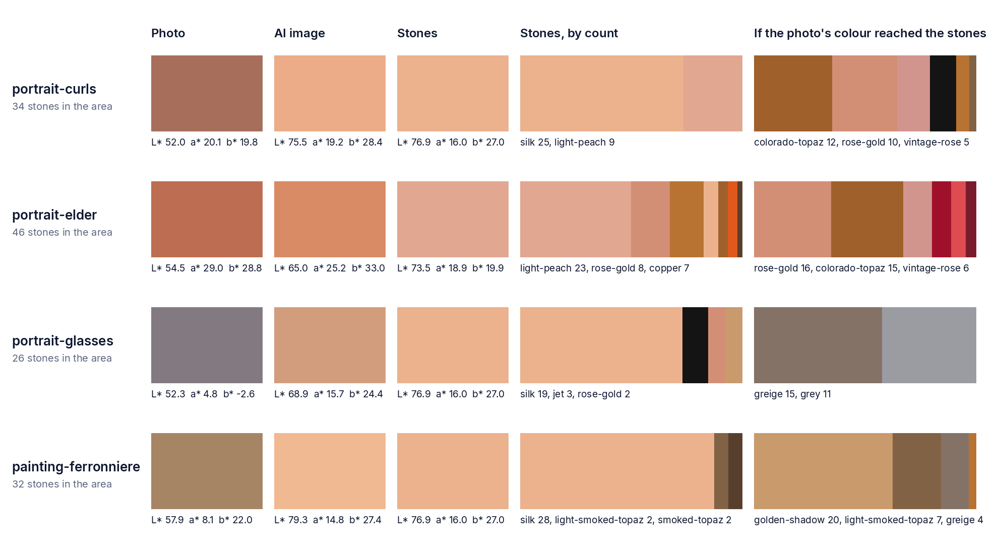

# PN-09 Skin colour check

Investigation only: no pipeline rule, prompt, colour catalogue or web app change, no provider call.

**Question.** In the `portrait-curls` Colour listing design (PN-04d) the woman's deep brown skin
comes out light peach. Where does that happen?

**Answer.** In the AI image. The AI painted her face skin at L\* 75 where the photo has L\* 52
(ΔE2000 20). From there the colour step does what it should: it reads the AI's colour and picks the
nearest skin stones (Silk and Light Peach), which are as light as the AI's paint. Had the photo's
colour reached the colour step, it would have picked Colorado Topaz, Rose Gold and Vintage Rose
(around L\* 51). The catalogue is not the cause, though it is thin for mid-depth reddish browns. The
three lighter-skinned references are lightened by the AI too (+10 to +21 L\*), much more than
their hair and clothes (+3 to +12).

## Method

Script: `services/strass/scripts/skin_check.py` (diagnosis only; the service never runs it), run on
the attempt folders of the four listing designs in `data/listing/runs/` (each found by its
`tinted.png`, the same file as the design's in `data/listing/designs/`):

| Design | Attempt | Skin seen in the photo as |
| --- | --- | --- |
| portrait-curls | `2026-10-30T18-25-01-927Z-portrait-curls/…/attempt-1` | deep brown, warm light |
| portrait-elder | `2026-10-30T18-26-46-538Z-portrait-elder/…/attempt-1` | tanned brown, warm light |
| portrait-glasses | `2026-10-30T18-28-24-624Z-portrait-glasses/…/attempt-1` | light, cool overcast light (reads grey) |
| painting-ferronniere | `2026-10-30T19-37-15-234Z-painting-ferronniere/…/attempt-1` | light, under yellowed varnish |

- **Skin area: the face landmarks**, found in `prepared.png` with the service's own MediaPipe Face
  Landmarker (`models/mediapipe/face_landmarker.task`). The area is discs of 0.06 × the face's width
  around Face Mesh points 50, 280 (cheeks), 205, 425 (lower cheeks) and 199 (chin), inside the face
  mesh's hull and the cut-out. For portrait-glasses the lower cheeks and chin are beard, so his area
  is points 50, 280, 101 and 330 instead. Every area was checked by eye on an overlay (bare skin in
  the photo; in the AI image glasses' area touches the lower rim of the drawn glasses, which gives
  it 3 Jet stones).
- **The same area in the AI image:** the AI's own face landmarks, mapped onto the photo's by a
  similarity transform fitted on the 468 mesh points, because the AI redraws the face a little moved
  (0.4 to 1.4 patch radii from where the spec 7.1 crop puts it).
- **The stones:** the final stones (`stones.json`) whose centre lies in the AI area (mm to AI pixels
  by the layout report: `(mm + offsetMm) / mmPerPx`). Their colour is their catalogue fill.
- Every colour is the **median** CIE Lab (D65) of the area's pixels, or of the stones' fills.

## Step 1: the prepared photo

| Design | Pixels | L\* | a\* | b\* |
| --- | ---: | ---: | ---: | ---: |
| portrait-curls | 10 179 | 52.0 | 20.1 | 19.8 |
| portrait-elder | 19 926 | 54.5 | 29.0 | 28.8 |
| portrait-glasses | 8 426 | 52.3 | 4.8 | −2.6 |
| painting-ferronniere | 5 891 | 57.9 | 8.1 | 22.0 |

The medians are of lit cheeks: curls' skin is darker in the shadows; the median is her mid-tone.

## Step 2: the AI image

| Design | Pixels | L\* | a\* | b\* | ΔL\* from the photo | ΔE2000 from the photo |
| --- | ---: | ---: | ---: | ---: | ---: | ---: |
| portrait-curls | 7 976 | 75.5 | 19.2 | 28.4 | **+23.5** | 20.4 |
| portrait-elder | 11 696 | 65.0 | 25.2 | 33.0 | +10.5 | 10.1 |
| portrait-glasses | 4 935 | 68.9 | 15.7 | 24.4 | +16.6 | 23.8 |
| painting-ferronniere | 6 873 | 79.3 | 14.8 | 27.4 | +21.4 | 17.5 |

Everything outside the face (hair, clothes, objects; outside the face mesh's hull):

| Design | Photo L\* | AI L\* | ΔL\* | Face ΔL\* |
| --- | ---: | ---: | ---: | ---: |
| portrait-curls | 12.7 | 19.0 | +6.3 | +23.5 |
| portrait-elder | 34.3 | 37.3 | +3.0 | +10.5 |
| portrait-glasses | 29.6 | 41.5 | +11.9 | +16.6 |
| painting-ferronniere | 21.1 | 29.2 | +8.1 | +21.4 |

The AI lightens a little everywhere but the skin most, and the darkest skin most of all.

## Step 3: the final stones

| Design | Stones | L\* | a\* | b\* | Colours (count) |
| --- | ---: | ---: | ---: | ---: | --- |
| portrait-curls | 34 | 76.9 | 16.0 | 27.0 | Silk 25, Light Peach 9 |
| portrait-elder | 46 | 73.5 | 18.9 | 19.9 | Light Peach 23, Rose Gold 8, Copper 7, Silk 3, Colorado Topaz 2, Hyacinth 2, Smoked Topaz 1 |
| portrait-glasses | 26 | 76.9 | 16.0 | 27.0 | Silk 19, Jet 3 (glasses rim), Rose Gold 2, Golden Shadow 2 |
| painting-ferronniere | 32 | 76.9 | 16.0 | 27.0 | Silk 28, Light Smoked Topaz 2, Smoked Topaz 2 |

### The colour step on its own

Per stone in the area: the AI colour the service reads (mean Lab of the inner 60 % of the stone, as
`sample_delivered` and `skin_nearest_inner`), what `snap_colours` alone makes of it, and, for the
comparison, what the photo's own colour under the same stone would have become.

| Design | AI under the stones (L\* a\* b\*) | `snap_colours` of the AI colour | Final stones | The photo's colour, snapped | Its median fill L\* |
| --- | --- | --- | --- | --- | ---: |
| portrait-curls | 80.0 20.6 26.6 | Silk 26, Light Peach 8 | Silk 25, Light Peach 9 | Colorado Topaz 12, Rose Gold 10, Vintage Rose 5, Jet 4, Copper 2, Light Smoked Topaz 1 | 50.9 |
| portrait-elder | 72.8 28.1 31.9 | Light Peach 19, Rose Gold 9, Copper 7, Silk 6, … | Light Peach 23, Rose Gold 8, Copper 7, Silk 3, … | Rose Gold 16, Colorado Topaz 15, Vintage Rose 6, Light Siam 4, Padparadscha 3, Siam 2 | 53.3 |
| portrait-glasses | 83.8 12.9 21.0 | Silk 18, Rose Gold 3, Jet 3, Golden Shadow 2 | Silk 19, Jet 3, Rose Gold 2, Golden Shadow 2 | Greige 15, Grey 11 | 49.4 |
| painting-ferronniere | 84.2 13.4 25.0 | Silk 28, Light Smoked Topaz 2, Smoked Topaz 2 | the same | Golden Shadow 20, Light Smoked Topaz 7, Greige 4, Copper 1 | 67.0 |

The final stones are the plain snap of the AI's colour, give or take the face finishing's few
changes, and they are no lighter than the AI's paint (Silk, L\* 76.9, is the lightest skin stone;
the AI's cheeks are L\* 80 to 84). The colour step does not lighten skin.

## What the colour step does with skin (the strass service, `DEFAULT` rules)

1. **Reading** (`colour.stone_colours`, rules `sample_delivered`, `mean_colour`): each stone's Lab is
   the mean of the AI image's pixels within the inner 60 % of its radius at its delivered position.
2. **Snapping** (`colour.snap_colours`, palette `PLUS_REAL_SKIN`, the real fills of all 47 catalogue
   colours): nearest catalogue colour by ΔE2000, with these rules for a **warm** colour (hue 25° to
   78°, chroma 8 to 65: every AI skin colour here, and every photo's but glasses' cool grey one):
   - no colour of chroma below 8 (Jet, Hematite, Jet Hematite, Black Diamond, Grey, Silver, Crystal,
     Crystal Clear) may be chosen (+1000), so dark brown skin never turns grey or black;
   - no chroma penalty (outside the warm range a stone less saturated than 0.9 × the colour's chroma
     pays 0.5 per unit it lacks);
   - Topaz is blocked below chroma 50, Indian Siam from hue 30° (IMG-026I), Gold, Citrine and Peridot
     below hue 80°, Hyacinth below chroma 60.
   Nothing here depends on lightness: a deep brown is matched to the nearest deep stone.
3. **Tone separation** (`distinct._distinct`): k-means on the stone colours; a skin colour is only
   ever swapped for another skin colour.
4. **Face finishing** (`faces.finish_faces`), on every SS4 and SS6 stone already in the skin set:
   - `skin_nearest`: re-snapped to the nearest of the **11 skin colours** (`distinct.SKIN` without
     Topaz): Smoked Topaz, Light Smoked Topaz, Colorado Topaz, Copper, Light Colorado, Rose Gold,
     Golden Shadow, Vintage Rose, Rose Peach, Light Peach, Silk;
   - `warm_shadow` (IS-05d): a stone whose nearest skin colour is Smoked Topaz takes Colorado Topaz
     when that is at most 3 ΔE2000 further. This is the only rule that lightens (L\* 29 → 47), and
     only on near ties; on deep skin it could lighten some of the darkest stones;
   - `calm_skin`: a lone skin stone takes the skin colour most of its neighbours share, if that is
     within 15 ΔE2000 of its own.
5. **The eye stage** (`eyes`, `plausible_eyes`, `lively_eyes`) builds pupil and catch-light stones in
   the eye boxes only; the cheeks are not touched.

**Is any catalogue colour close to curls' photo skin (L\* 52.0, a\* 20.1, b\* 19.8)?** The nearest are
Colorado Topaz (ΔE2000 11.2), Greige (12.1, not a skin colour), Light Smoked Topaz (12.2), Rose
Gold (12.4) and Copper (12.7). None is close; all are about equally far, in different directions:
Colorado Topaz and Copper too orange, Light Smoked Topaz too grey, Rose Gold too light.

## The darkest skin-tone colours in the catalogue

The skin set (`distinct.SKIN`; Topaz, also in it, is never chosen for skin), from the dark end, real
fills (`catalogue.json` `fill`):

| Colour | Hex | L\* | a\* | b\* | Chroma |
| --- | --- | ---: | ---: | ---: | ---: |
| Smoked Topaz | `#583f2d` | 29.0 | 8.3 | 15.3 | 17.4 |
| Light Smoked Topaz | `#826244` | 44.1 | 8.9 | 22.1 | 23.8 |
| Colorado Topaz | `#a0602c` | 47.0 | 21.5 | 39.6 | 45.1 |
| Copper (AI only) | `#b87333` | 54.8 | 21.7 | 45.4 | 50.3 |
| Light Colorado | `#c38e43` | 62.8 | 12.4 | 46.8 | 48.4 |
| Rose Gold (AI only) | `#d38f75` | 65.6 | 22.7 | 24.3 | 33.3 |
| Golden Shadow (AI only) | `#c99a6c` | 67.0 | 11.8 | 30.9 | 33.0 |
| Vintage Rose (AI only) | `#d1958e` | 67.3 | 21.6 | 12.7 | 25.1 |
| Rose Peach (AI only) | `#ee8987` | 67.9 | 38.2 | 18.0 | 42.2 |
| Light Peach | `#e2a791` | 73.5 | 18.9 | 19.9 | 27.4 |
| Silk (AI only) | `#ebb28d` | 76.9 | 16.0 | 27.0 | 31.4 |

Other warm dark colours outside the skin set: Siam `#7a1b2c` (L\* 27.0, a red), Indian Siam
`#610b16` (19.4, blocked for skin), Khaki `#5b593c` (37.3, olive), Greige `#847267` (49.4,
grey-brown).

**Enough deep browns?** In lightness, just about: the set reaches L\* 29, and deep skin can be drawn
with Smoked Topaz, Light Smoked Topaz and Colorado Topaz. In colour, no: between L\* 29 and 55 there
are only three skin stones, and none has the warm, reddish, moderately saturated brown of most dark
skin (around a\* 15 to 22, b\* 18 to 25). Light Smoked Topaz and Smoked Topaz are too grey (a\* 8 to
9), Colorado Topaz and Copper too orange (chroma 45 to 50). So a faithful dark skin would come out
in the right lightness but a little grey or a little orange, ΔE2000 about 11 to 12 off. Light skin
has eight stones between L\* 63 and 77. This gap does not explain the lightening (the stones were
never asked for a dark colour), but it would show once the lightening is fixed.

## Conclusion

The lightening happens **in the AI image**: +23.5 L\* on curls' cheeks, much more than the +6 on her
hair and top. The colour step copies the AI's light paint faithfully, and the catalogue had dark
enough stones for the photo's colour (Colorado Topaz, Rose Gold, Vintage Rose would have been
picked). The same shift, smaller, lightens the three lighter references; it is least visible there
because Silk and Light Peach are near their true colours.

A likely cause, from the prompt, not tested (no provider calls in this build): the skin ramp the AI
is given lists the skin stones from light to dark, starting with Silk and Light Peach, and asks it to
stay inside the ramp with at most three neighbouring shades per area. Nothing asks it to keep the
photo's skin depth, and the light end of the ramp is the default.

The numbers rest on one design per subject and one dark-skinned subject; the AI's run-to-run spread
is not measured.

## Possible fixes (none implemented)

1. **Prompt: keep the photo's skin depth.** Add a rule that skin keeps its lightness from the photo
   and give the ramp's dark end for dark skin (for example "deep skin: Copper, Colorado Topaz, Light
   Smoked Topaz, Smoked Topaz; keep the photo's skin tone, never lighten it"), or split the ramp into
   light and deep skin. Fixes the cause where it happens. Risks: a prompt version change, so the
   regression designs must be made again (provider cost); the AI may then darken light skin, or draw
   dark faces with too little contrast for the features (eyes, lips and shadows next to Smoked Topaz
   and Jet); the AI's response to such rules varies and needs several portraits per skin tone to
   judge, measured with this script.
2. **Colour step: correct skin lightness from the photo.** After the layout, for a person's face,
   measure the skin's median L\* in the photo and in the AI image (as here) and re-snap the skin
   stones' AI colours shifted by the difference, keeping the AI's shading pattern but restoring the
   depth. Works even when the AI lightens. Risks: needs the photo and the AI image aligned (the AI
   moves the face by up to 1.4 patch radii here; landmarks must be found in both, and fail on some
   drawings); only covers detected faces, not necks, arms or hands; the photo's lighting (curls' warm
   sun, glasses' grey overcast) becomes the stone colour, so a cool photo gives grey skin
   (glasses' photo snaps to Greige and Grey); a new pipeline stage with its own spec and tests.
3. **Catalogue: add a mid-depth reddish brown to the skin set.** A stone near L\* 40 to 45, a\* 15 to
   20, b\* 20 to 25 (and the prompt's ramp) would bring deep skin within a few ΔE instead of 11 to 12.
   Risks: it does not fix the lightening on its own; it needs a stone a buyer can actually buy; the
   palette line and therefore the prompt change, with the same regression cost as fix 1.

Recommended order: 1, measured with `skin_check.py` on several dark-skinned portraits; 3 alongside
if the stones then come out grey or orange; 2 only if the AI cannot be made to keep the skin depth.
