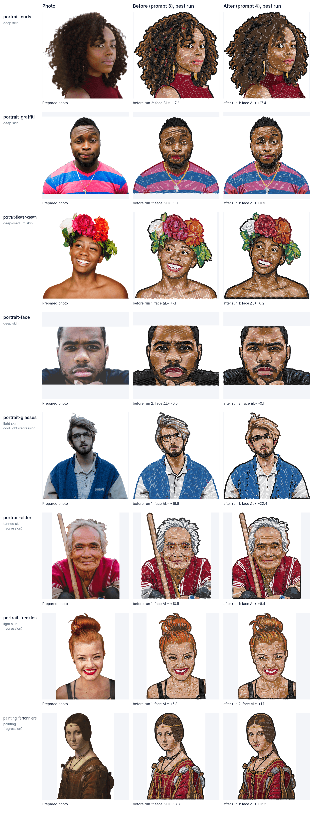

# PN-10 Keep skin depth in the AI image

**Result: the goal is not met.** With the new prompt (version 4) 8 of the 16 after-runs have a face
ΔL\* between −8 and +8; portrait-curls (+17.4, +19.4), portrait-glasses (+22.4, +25.8) and
painting-ferronniere (+16.5, +19.9) stay far too light, one portrait-face run is 9.6 darker than the
photo and one portrait-elder run is +9.0. As the brief says, there was one prompt revision and no
further tuning. No light-skin subject came out darker than its photo.

The change helps medium-dark and tanned skin (portrait-flower-crown, portrait-elder,
portrait-graffiti and portrait-freckles all moved towards the photo) and makes portrait-curls'
face visibly browner, but not enough by the measure; it does nothing for the painting, makes the
cool-light photo lighter still, and over-darkens the tight close-up of portrait-face.

## The prompt change (version 3 → 4)

In the colour part of the prompt (section 4 of v6, `src/pipeline/prompt.js`), two lines; nothing
else changed, and the Black & white prompts keep their text:

- the skin ramp now says it covers every skin tone, from the lightest to the deepest, and that deep
  skin uses its dark end (`SKIN_RAMP_LINE`);
- after the rule "Never use Topaz or Hyacinth on skin", a new rule (`SKIN_TONE_RULE`) tells the AI to
  keep each person's skin tone, lightness and undertone as the photo shows them, never to lighten or
  whiten skin, and to keep each face as light or as dark as it is in the photo.

No skin colour of any group of people is named.

## Test set and runs

| Subject | Photo | Skin in the photo | Licence |
| --- | --- | --- | --- |
| portrait-curls | candidate 2, [Confident Eye Contact](https://commons.wikimedia.org/wiki/File:Confident_Eye_Contact_(Unsplash).jpg), Tanja Heffner | deep | CC0 |
| portrait-graffiti | candidate 11, [Man before graffitied wall](https://commons.wikimedia.org/wiki/File:Man_before_graffitied_wall_(Unsplash).jpg), Ayo Ogunseinde | deep | CC0 |
| portrait-flower-crown | candidate 12, [Mother Nature, Summer](https://commons.wikimedia.org/wiki/File:Mother_Nature,_Summer_(Unsplash).jpg), Autumn Goodman | deep-medium | CC0 |
| portrait-face | candidate 14, [Face portrait](https://commons.wikimedia.org/wiki/File:Face_portrait_(Unsplash).jpg), William Stitt | deep | CC0 |
| portrait-glasses | candidate 6 (regression) | light, cool overcast light | CC0 |
| portrait-elder | candidate 3 (regression) | tanned | CC0 |
| portrait-freckles | candidate 1 (regression) | light | CC0 |
| painting-ferronniere | candidate 9 (regression) | painting, yellowed varnish | Public domain |

All photos were first posted on Unsplash before June 2017 (CC0 then) and are recorded with their file
page, author and date in [listing/portraits/candidates.json](listing/portraits/candidates.json).
Candidate 13 ([Crown of Leaves](https://commons.wikimedia.org/wiki/File:Crown_of_Leaves_(Unsplash).jpg))
was picked first as medium-dark, but her face measured L\* 77 in this brightly lit photo, so she was
replaced by candidate 14; her two before-runs are in the table as extra data.

Runs, made with `tools/make-listing-designs.mjs` (the real pipeline, background removal on, no
adjustments; `--full` keeps them out of the listing designs, in `data/listing/skin-prompt/`):

- before (prompt 3): 2 runs per dark-skin subject; portrait-curls' first is its PN-04d listing run;
  the regression subjects' befores are their PN-04d listing runs (painting-ferronniere has two),
  with no new provider call;
- after (prompt 4): 2 runs per subject.

**Provider calls: 25 of the 30 allowed** (9 before: 7, then 2 for the replacement subject; 16
after). Every design was made on its first try, with no automatic re-run.

## Measurement

`services/strass/scripts/skin_check.py` (PN-09, [skin-check.md](skin-check.md)), on each run's
attempt folder:

- **Face ΔL\*** (the goal's measure): the median L\* of the skin area in the AI image minus the
  photo's. The skin area is discs around face landmarks on the cheeks and chin (Face Mesh 50, 280,
  205, 425, 199); for the three bearded men (portrait-glasses, portrait-graffiti, portrait-face)
  the beard-free cheeks only (50, 280, 101, 330). Each subject keeps the same area before and after.
- **Whole face ΔL\*** (new in PN-10, not the goal's measure): the same over the face mesh's whole hull,
  eyes, brows and lips included. The skin area above holds the face's lightest skin (lit cheeks);
  the whole face shows its overall depth.
- **Hair/clothes ΔL\***: everything outside the face hull.

## Results

| Subject | Skin | Run | Prompt | Face ΔL\* (skin area) | In goal | Whole face ΔL\* | Hair/clothes ΔL\* | Face stones (most) |
| --- | --- | --- | ---: | ---: | :---: | ---: | ---: | --- |
| portrait-curls | deep | before 1 | 3 | +23.5 |  | +12.5 | +6.3 | silk 25, light-peach 9 |
| portrait-curls | deep | before 2 | 3 | +17.2 |  | +14.4 | -1.6 | silk 21, rose-gold 8, jet 5 |
| portrait-curls | deep | after 1 | 4 | +17.4 | **no** | +10.6 | -1.5 | silk 17, rose-gold 3, golden-shadow 2 |
| portrait-curls | deep | after 2 | 4 | +19.4 | **no** | +9.3 | +2.0 | silk 28, rose-gold 6 |
| portrait-graffiti | deep | before 1 | 3 | +6.0 |  | +7.3 | -4.8 | silk 22, golden-shadow 5, copper 2 |
| portrait-graffiti | deep | before 2 | 3 | +1.0 |  | -2.0 | -13.3 | silk 21, colorado-topaz 6, copper 6 |
| portrait-graffiti | deep | after 1 | 4 | +0.9 | yes | +1.5 | -11.1 | silk 22, copper 6, rose-gold 3 |
| portrait-graffiti | deep | after 2 | 4 | -5.3 | yes | -1.9 | -12.2 | silk 19, copper 11, colorado-topaz 3 |
| portrait-flower-crown | deep-medium | before 1 | 3 | +7.1 |  | -1.4 | -7.6 | silk 27, rose-gold 12, copper 1 |
| portrait-flower-crown | deep-medium | before 2 | 3 | +8.7 |  | +2.0 | -3.0 | silk 20, golden-shadow 9, copper 2 |
| portrait-flower-crown | deep-medium | after 1 | 4 | -0.2 | yes | -5.8 | -7.4 | copper 13, golden-shadow 10, silk 10 |
| portrait-flower-crown | deep-medium | after 2 | 4 | -4.0 | yes | -1.2 | -4.1 | copper 17, silk 10, rose-gold 5 |
| portrait-face | deep | before 1 | 3 | +3.4 |  | -9.7 | -12.2 | silk 35, rose-gold 21, copper 8 |
| portrait-face | deep | before 2 | 3 | -0.5 |  | -10.9 | -11.1 | silk 26, rose-gold 24, copper 13 |
| portrait-face | deep | after 1 | 4 | -9.6 | **no** | -21.8 | -19.8 | copper 38, colorado-topaz 28, rose-gold 10 |
| portrait-face | deep | after 2 | 4 | -0.1 | yes | -19.4 | -15.6 | rose-gold 39, silk 23, copper 2 |
| portrait-glasses | light, cool light | before 1 | 3 | +16.6 |  | +11.5 | +11.9 | silk 19, jet 3, rose-gold 2 |
| portrait-glasses | light, cool light | after 1 | 4 | +22.4 | **no** | +2.4 | +7.8 | silk 22 |
| portrait-glasses | light, cool light | after 2 | 4 | +25.8 | **no** | +11.0 | +11.8 | silk 18, light-peach 2 |
| portrait-elder | tanned | before 1 | 3 | +10.5 |  | +4.5 | +3.0 | light-peach 23, rose-gold 8, copper 7 |
| portrait-elder | tanned | after 1 | 4 | +6.4 | yes | -0.8 | -1.2 | silk 14, rose-gold 11, light-peach 7 |
| portrait-elder | tanned | after 2 | 4 | +9.0 | **no** | +0.8 | +1.2 | silk 17, light-peach 12, rose-gold 11 |
| portrait-freckles | light | before 1 | 3 | +5.3 |  | +6.1 | +12.5 | silk 32, light-peach 10, rose-gold 8 |
| portrait-freckles | light | after 1 | 4 | +1.9 | yes | +3.7 | +8.2 | silk 23, light-peach 16, rose-gold 8 |
| portrait-freckles | light | after 2 | 4 | +1.1 | yes | +1.6 | +5.0 | silk 22, rose-gold 18, light-peach 9 |
| painting-ferronniere | painting | before 1 | 3 | +21.4 |  | +10.8 | +8.1 | silk 28, light-smoked-topaz 2, smoked-topaz 2 |
| painting-ferronniere | painting | before 2 | 3 | +13.3 |  | +10.0 | +5.6 | silk 25, rose-gold 7, jet 3 |
| painting-ferronniere | painting | after 1 | 4 | +16.5 | **no** | +12.0 | +3.8 | silk 21, rose-gold 5, light-peach 1 |
| painting-ferronniere | painting | after 2 | 4 | +19.9 | **no** | +15.3 | +8.4 | silk 31, jet 1, copper 1 |
| portrait-leaves (dropped) | light-medium | before 1 | 3 | +6.5 |  | +1.3 | -7.8 | silk 21 |
| portrait-leaves (dropped) | light-medium | before 2 | 3 | +7.7 |  | +2.0 | -4.7 | silk 18 |

## Per subject: likeness and contrast

- **portrait-curls** (deep): the after designs are clearly browner than the befores: mid-brown
  cheeks and forehead instead of light peach, darker hair, and the eyes, nose and lips stay as clear
  as before. But the AI still puts Silk on her lit cheekbones, so the skin area stays +17 to +19
  (the whole face +9 to +11, from +12 to +14). Better, not right.
- **portrait-graffiti** (deep): close to the photo before and after (within ±6 in every run); the
  squint, brows, beard and smile read well. No real change.
- **portrait-flower-crown** (deep-medium): the clearest improvement. Before, the face was a light
  tan with pink; after, a warm brown close to the photo (−0.2 and −4.0). The eyes, the open smile
  and the teeth keep their contrast.
- **portrait-face** (deep, a tight close-up): the cheeks are fine in run 2 (−0.1) but 9.6 too dark
  in run 1, and the whole face is 19 to 22 darker than the photo (10 to 11 before): the AI drew heavier
  Jet shadows around the eyes, nose and jaw. The features are all there, but the face reads harsher
  and darker than the photo. The new rule can over-darken.
- **portrait-glasses** (light skin, grey overcast light): the photo's cheeks are a cool grey L\* 52;
  the AI paints a warm peach face in both versions, lighter after (+22, +26). The skin looks like a
  plausible light skin, not like the photo's grey cast; his hair came out light brown and closer to
  the photo after. The measure here is mostly the photo's colour cast; the prompt does not help.
- **portrait-elder** (tanned): better after: the face is browner (+6.4 and +9.0 from +10.5; whole
  face −0.8 and +0.8), the wrinkles, eyes and smile are kept.
- **portrait-freckles** (light): after +1.1 and +1.9 (from +5.3); the light skin still looks right,
  and more freckles show on the face. Not darker than the photo.
- **painting-ferronniere** (painting): unchanged in effect (+16.5, +19.9 against +13.3, +21.4). The
  AI reads the varnish-yellowed face as light skin and cleans it; the new rule does not change that.

## Conclusion

The prompt change moves faces towards the photo where the AI's lightening was moderate (tanned and
medium-dark skin, and light skin), but not where it was largest (portrait-curls), not for a painting
and not for a cool-light photo, and it can over-darken a close-up. The goal (every after-run within
±8) is not met after the one revision; tuning stopped here. Whether to keep prompt 4 is Alex's
decision: on this set it is better for 4 subjects, about the same for 2, and worse for 2
(portrait-glasses lighter, portrait-face darker).

If skin depth must be guaranteed, the next step is not more prompt wording but PN-09's fix 2
(correct the skin stones' lightness from the photo in the colour step), with its risks as listed in
[skin-check.md](skin-check.md).

## Reproducing

- Designs: `data/listing/skin-prompt/` (`before.json`, `before-face.json`, `after.json`, the logs and
  the full-size designs; git-ignored); their runs in `data/listing/runs/*-skin-*`.
- Measurement: `services/strass/.venv/bin/python scripts/skin_check.py JOBS.json OUT.json` with one
  job per run (`{"id", "attempt", "patches"?}`).
- Picture: `node tools/make-skin-prompt-sheet.mjs rows.json docs/skin-prompt.png`, one row per
  subject with the run of the smallest |face ΔL\*| before and after.
